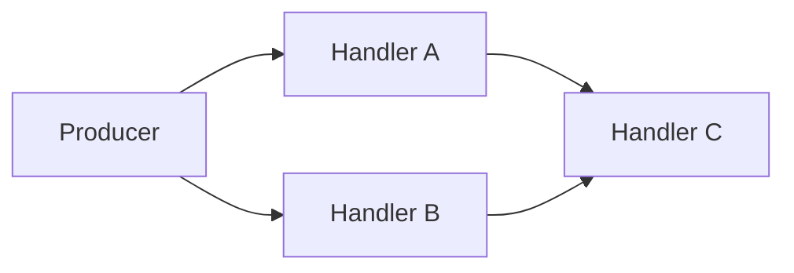
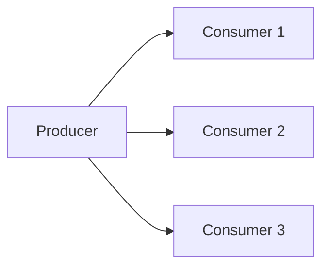
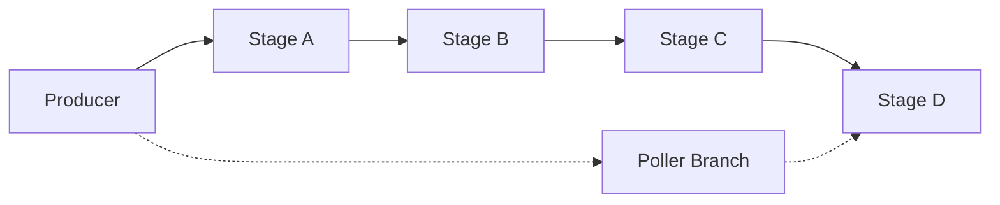

[](https://github.com/nicholassm/disruptor-rs/actions)
[](https://codecov.io/gh/nicholassm/disruptor-rs)
[](LICENSE-MIT)
[](https://doc.rust-lang.org/cargo/reference/manifest.html#the-rust-version-field)

# Disruptor-RS

**Disruptor-RS** is a high-performance, low-latency inter-thread communication library for Rust. It is a faithful port of the renowned [LMAX Disruptor](https://github.com/LMAX-Exchange/disruptor) pattern originally built in Java.

By fully embracing the concept of **Mechanical Sympathy**—understanding how the underlying hardware actually operates—Disruptor-RS eschews traditional queues, channels, and locks. Instead, it utilizes a pre-allocated ring buffer and sequence-based dependency coordination to eliminate allocations on the hot path and avoid false sharing between threads.

It purposely trades CPU resources (via busy-spin waiting) for extreme performance. On a 32-core AMD Ryzen AI MAX+, a single-producer/single-consumer pipeline reaches a staggering **514 million events/s** with batch publishing, outperforming Crossbeam channels by **8x to 20x** (see [Performance](#performance)).

---

## 🚀 Key Features

### Core Capabilities
- **Multiple Producer/Consumer Configurations:** SPSC, SPMC, MPSC, MPMC are all natively supported.
- **Complex Topologies:** Compose powerful execution pipelines, diamond patterns, multicast fan-outs, and independent out-of-band branches.
- **Zero-Allocation Hot Path:** Events are pre-allocated and mutated in-place within the ring buffer.
- **Automatic Batching:** Consumers dynamically process bursts of events, amortizing the cost of sequence coordination.
- **Non-blocking Operations:** Support for `try_publish` and `try_batch_publish` with robust backpressure handling.

### Advanced Ergonomics
- **Type-State Builder:** The builder API uses compile-time type-states to prevent invalid, incomplete, or cyclic topologies.
- **Event Poller API:** Prefer to manage your own threads or async executors? The pull-based `EventPoller` lets you control the consumption loop.
- **Wait Strategies:** Tune your latency/CPU trade-offs with `BusySpin` or the slightly more power-aware `BusySpinWithSpinLoopHint`.
- **Thread Control:** Built-in core pinning via `pin_at_core` and custom thread naming.
- **Panic Resilience:** Transparent capture and propagation of consumer panics via the `ConsumerPanic` mechanism.

---

## ⚡ Quick Start

Add Disruptor-RS to your project:

```bash
cargo add --git https://github.com/nicholassm/disruptor-rs disruptor
```

A complete Disruptor lifecycle consists of **Setup**, **Publishing**, and **Shutdown**:

```rust
use disruptor::*;

// 1. Define your pre-allocated event type.
struct Event {
    price: f64,
}

fn main() {
    let factory = || Event { price: 0.0 };

    // 2. Define your event processor (Consumer).
    let processor = |e: &Event, sequence: Sequence, _end_of_batch: bool| {
        println!("seq={sequence}, price={:.1}", e.price);
    };

    // 3. Setup: Build the Disruptor and spawn consumer threads.
    // Ring buffer size must be a power of two (e.g., 8).
    let mut producer = build_single_producer(8, factory, BusySpin)
        .handle_events_with(processor)
        .build();

    // 4. Publish: Write events via the `Producer` handle.
    for i in 0..10 {
        producer.publish(|e| { 
            e.price = i as f64; // Mutate the pre-allocated event in-place
        });
    }
    
    // 5. Shutdown: Dropping the `Producer` safely stops all consumer threads 
    // and drains the remaining events.
}
```

---

## 🏗️ Topologies

The builder API makes it trivial to express complex dependency graphs. 

### Pipeline
Stages execute sequentially. A stage only processes an event after the previous stage is finished.


```rust
let mut producer = build_single_producer(64, factory, BusySpin)
    .handle_events_with(stage_a)
    .and_then()
    .handle_events_with(stage_b)
    .and_then()
    .handle_events_with(stage_c)
    .build();
```

### Diamond (Fan-Out / Fan-In)
Consumers `A` and `B` process events concurrently. Consumer `C` waits until **both** `A` and `B` have finished.



```rust
let mut producer = build_single_producer(64, factory, BusySpin)
    .handle_events_with(handler_a)
    .handle_events_with(handler_b)
    .and_then()
    .handle_events_with(handler_c)
    .build();
```

### Multicast
Every consumer independently receives every event.



```rust
let mut producer = build_single_producer(64, factory, BusySpin)
    .handle_events_with(consumer_1)
    .handle_events_with(consumer_2)
    .handle_events_with(consumer_3)
    .build();
```

### Out-of-Band Branch
Need to run background tasks (like logging or metrics) without blocking your critical pipeline? Create an out-of-band branch.



```rust
// Create a branch from the initial builder
let mut builder = build_single_producer(64, factory, BusySpin);
let branch = builder.new_branch();

// Build the main pipeline
let builder = builder
    .handle_events_with(a)
    .and_then().handle_events_with(b)
    .and_then().handle_events_with(c);

// Re-join the branch. This returns a pull-based EventPoller for the branch.
let (mut journal_poller, builder) = builder.join(branch);

// The final stage waits for both the main pipeline and the branch
let mut producer = builder.handle_events_with(d).build();
```

---

## 🎛️ Advanced Control

### Event Polling (Pull API)
If you don't want Disruptor to spawn and manage threads, you can extract an `EventPoller` to manually pull events inside your own executor or game loop.

```rust
let builder = build_single_producer(8, factory, BusySpin);
let (mut poller, builder) = builder.new_event_poller();
let mut producer = builder.build();

producer.publish(|e| { e.price = 42.0; });

loop {
    match poller.poll() {
        Ok(mut events) => {
            for event in &mut events { /* Process event */ }
        },
        Err(Polling::NoEvents) => { /* Try again later */ },
        Err(Polling::Shutdown) => { break; },
        Err(_) => unreachable!(),
    }
}
```

### Multiple Producers
For MPSC/MPMC scenarios, simply clone the multi-producer handle and distribute it across your threads.

```rust
let mut producer1 = build_multi_producer(64, factory, BusySpin)
    .handle_events_with(processor)
    .build();

let mut producer2 = producer1.clone();

std::thread::scope(|s| {
    s.spawn(move || producer1.publish(|e| e.price = 10.0));
    s.spawn(move || producer2.publish(|e| e.price = 20.0));
});
```

### Wait Strategies

| Strategy | Latency | CPU Usage | Best For |
|----------|---------|-----------|----------|
| `BusySpin` | **Lowest** | 100% | Dedicated cores, hard real-time systems, HFT. |
| `BusySpinWithSpinLoopHint` | Very Low | ~95% | Dedicated cores, slightly power-aware CPUs. |

*(Note: Both strategies currently trade CPU utilization for latency. Use them when you can dedicate physical cores to your consumers).*

---

## 📊 Performance

Benchmarked on an **AMD Ryzen AI MAX+ 395** (32-core, 123 GB RAM, x86_64)
using [Criterion](https://github.com/bheisler/criterion.rs). The SPSC
benchmark publishes events in bursts of varying sizes, measuring per-event
latency and throughput. Run `cargo bench -p disruptor-bench --bench spsc` to
reproduce.

### Per-Event Latency (no pause between bursts)

| Burst Size | Crossbeam | Disruptor | Speedup |
|-----------:|----------:|----------:|--------:|
|          1 |   40.5 ns |    4.6 ns |    8.8x |
|         10 |   46.2 ns |    2.3 ns |   19.9x |
|        100 |   19.8 ns |    1.9 ns |   10.2x |

### Throughput (no pause between bursts)

| Burst Size | Crossbeam  | Disruptor  | Speedup |
|-----------:|-----------:|-----------:|--------:|
|          1 |  24.7 M/s  | 215.8 M/s  |    8.7x |
|         10 |  21.4 M/s  | 426.9 M/s  |   19.9x |
|        100 |  50.4 M/s  | 514.9 M/s  |   10.2x |

<details>
<summary>Results with 1 ms pause between bursts</summary>

| Burst Size | Crossbeam | Disruptor | Speedup |
|-----------:|----------:|----------:|--------:|
|          1 |   41.3 ns |    3.8 ns |   10.9x |
|         10 |   41.4 ns |    2.0 ns |   20.6x |
|        100 |   27.4 ns |    2.0 ns |   14.1x |

Throughput:

| Burst Size | Crossbeam  | Disruptor  | Speedup |
|-----------:|-----------:|-----------:|--------:|
|          1 |  24.2 M/s  | 260.7 M/s  |   10.8x |
|         10 |  24.2 M/s  | 497.3 M/s  |   20.6x |
|        100 |  36.4 M/s  | 512.5 M/s  |   14.1x |

</details>

<details>
<summary>Results with 10 ms pause between bursts</summary>

| Burst Size | Crossbeam | Disruptor | Speedup |
|-----------:|----------:|----------:|--------:|
|          1 |   38.5 ns |    5.5 ns |    7.0x |
|         10 |   67.6 ns |    3.5 ns |   19.1x |
|        100 |   21.9 ns |    2.4 ns |    9.1x |

Throughput:

| Burst Size | Crossbeam  | Disruptor  | Speedup |
|-----------:|-----------:|-----------:|--------:|
|          1 |  26.0 M/s  | 182.9 M/s  |    7.0x |
|         10 |  14.8 M/s  | 282.8 M/s  |   19.1x |
|        100 |  45.7 M/s  | 416.9 M/s  |    9.1x |

</details>

Disruptor's advantage grows with batch size. Performance is also resilient to
pauses between bursts -- Crossbeam degrades significantly at 10 ms pauses
while Disruptor stays consistent.

### MPSC (2 producers, no pause)

| Burst Size | Crossbeam   | Disruptor   | Speedup |
|-----------:|------------:|------------:|--------:|
|          1 |    281 ns   |    179 ns   |    1.6x |
|         10 |  1,353 ns   |    405 ns   |    3.3x |
|        100 |  7,502 ns   |  3,586 ns   |    2.1x |

Multi-producer contention (CAS) narrows the gap compared to SPSC, but
Disruptor still provides consistent improvement across burst sizes.

### Running Benchmarks

```bash
cargo bench -p disruptor-bench                     # All benchmarks
cargo bench -p disruptor-bench --bench spsc        # SPSC latency/throughput
cargo bench -p disruptor-bench --bench mpsc        # MPSC
cargo bench -p disruptor-bench --bench comparison  # Disruptor vs Crossbeam
```

---

## 🤔 When to Use Disruptor-RS

**✅ Excellent Fit:**
- Sub-microsecond inter-thread communication is a hard requirement.
- You can afford to dedicate physical CPU cores specifically to consumer threads.
- Events arrive in bursts, making batch processing highly advantageous.
- You need complex, multi-stage consumer topologies (pipelines, diamonds, fan-out).

**❌ Consider Alternatives (like `crossbeam` or `tokio::sync::mpsc`) When:**
- CPU resources are scarce or shared (Disruptor relies on busy-spinning).
- You are writing standard async/await code.
- Simple fire-and-forget messaging is sufficient and extreme latency is not a priority.

---

## 🛡️ Correctness and Safety

Lock-free programming is notoriously difficult. Disruptor-RS employs several rigorous validation strategies to ensure correctness:

1. **Miri**: All tests run under Miri in CI to aggressively detect undefined behavior, memory leaks, and pointer aliasing violations.
2. **Loom**: Concurrency model checking. Loom explores exhaustive thread schedules and interleavings to catch subtle data races (`tests/loom_tests.rs`).
3. **TLA+**: Formal mathematical verification of the core sequence protocol for SPMC and MPMC configurations (`verification/`).

**On `unsafe` usage**: 
The library contains a minimal amount of well-documented `unsafe` blocks. They are strictly utilized for two high-performance patterns:
- O(1) ring buffer indexing via `sequence & (size - 1)`.
- Direct pointer manipulation (`&mut *event_ptr`) to mutate pre-allocated slots, which is completely memory-safe because the Disruptor sequencing protocol independently enforces exclusive ownership.
- All atomic operations strictly utilize `Release`/`Acquire` ordering (never `SeqCst`) to minimize memory barrier overhead without sacrificing correctness.

---

## 🏛️ Architecture & Design Choices

Disruptor-RS operates as a **7-crate workspace** (e.g., `disruptor-core`, `disruptor-dsl`, `disruptor-seq`), keeping concerns rigidly separated. 

Key architectural choices:
- **Zero Allocation**: Events are initialized once in a `Box<[UnsafeCell<E>]>`. Data is never moved; it is mutated in-place.
- **Cache-Line Padding**: Sequence cursors are wrapped in `CachePadded<AtomicI64>` to eliminate false sharing between cores.
- **Monomorphization**: There is no dynamic dispatch (`dyn Trait`) in the hot path. All generics are monomorphized for peak compiler optimization.

For an in-depth dive into the architecture, check out the `docs/architecture` and `docs/design` directories.

---

## 📚 Examples

Check out the `examples/` directory for fully runnable reference implementations:

| Example | Description | Command |
|---------|-------------|---------|
| `basic_spsc` | Single producer, single consumer | `cargo run -p disruptor-examples --example basic_spsc` |
| `basic_mpsc` | Multi producer, single consumer | `cargo run -p disruptor-examples --example basic_mpsc` |
| `diamond` | Diamond topology (fan-out, merge) | `cargo run -p disruptor-examples --example diamond` |
| `pipeline` | Sequential pipeline stages | `cargo run -p disruptor-examples --example pipeline` |
| `event_poller` | Pull-based EventPoller API | `cargo run -p disruptor-examples --example event_poller` |
| `batch_publish` | Batch publication | `cargo run -p disruptor-examples --example batch_publish` |
| `multicast` | Fan-out to multiple consumers | `cargo run -p disruptor-examples --example multicast` |
| `affinity` | CPU core pinning | `cargo run -p disruptor-examples --example affinity` |
| `wait_strategies` | Comparing wait strategies | `cargo run -p disruptor-examples --example wait_strategies` |
| `chained_disruptors` | Chaining multiple Disruptors | `cargo run -p disruptor-examples --example chained_disruptors` |

---

## 🛠️ Running Tests

```bash
cargo test --workspace                # All tests
cargo test --workspace --lib          # Unit tests only
cargo test --workspace --test '*'     # Integration tests only
```

To run advanced verification tools:

```bash
# Loom concurrency model checking
RUSTFLAGS="--cfg loom" cargo test --test loom_tests --release

# Miri undefined behavior detection (requires Rust nightly)
cargo +nightly miri test
```

---

## 🤝 Contributing

Contributions are heavily encouraged! Please review [CONTRIBUTING.md](CONTRIBUTING.md) for development setup and PR guidelines.

## 📄 License

Licensed under the [MIT License](LICENSE-MIT).
