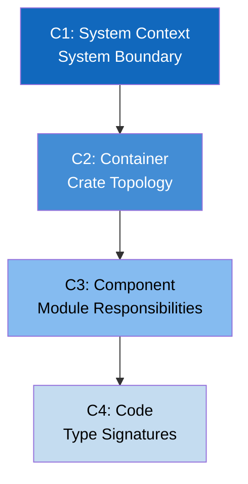

# Disruptor-RS Documentation Center

> **Key takeaway**: Disruptor-RS is a Rust implementation of a high-performance lock-free event bus.

This documentation repository provides the complete technical documentation for Disruptor-RS v4.0.0.
You can choose a reading path based on your role, or browse by directory.

---

## Project Overview

Disruptor-RS ports the LMAX Disruptor pattern to the Rust ecosystem.
It achieves low-latency inter-thread communication through a pre-allocated RingBuffer, sequence number coordination, and lock-free publishing.

**Current State (v4.0.0)**:
- Single crate architecture (`disruptor`)
- Supports Single/Multi Producer
- Supports both Push (managed thread) and Pull (EventPoller) consumption modes
- 2 WaitStrategy implementations: `BusySpin`, `BusySpinWithSpinLoopHint`
- Type-state Builder pattern: `SPBuilder` / `MPBuilder`

**Target State (v5.0.0)**:
- 7 crate workspace architecture
- 8 WaitStrategy implementations
- Complete DSL builder
- CLI tooling

---

## Documentation Navigation

| Directory | Purpose | Audience | Entry File |
|-----------|---------|----------|------------|
| `architecture/` | System structure decisions (C4 model) | Architects | [c1-context.md](architecture/c1-context.md) |
| `design/` | Technical design rationale | Developers | To be created |
| `guide/` | Usage and operation guides | Users | To be created |
| `reference/` | API reference manual | Everyone | To be created |
| `appendix/` | Supplementary materials | Deep research | To be created |
| `verification/` | Correctness verification | Quality assurance | To be created |

---

## Recommended Reading Paths

### Path A: Architects / Technical Leads

You need to understand the overall system structure and key design decisions.

```
c1-context.md  -->  c2-container.md  -->  c3-component.md  -->  c4-code.md
  (System boundary)    (Crate topology)      (Module responsibilities)  (Type signatures)
```

1. Start with [C1 System Context](architecture/c1-context.md) to understand where Disruptor-RS sits in the system
2. Move to [C2 Container](architecture/c2-container.md) to see the dependency graph of the 7 crates
3. Dive into [C3 Component](architecture/c3-component.md) to learn the module breakdown within each crate
4. Consult [C4 Code](architecture/c4-code.md) to review core type signatures and trait hierarchies

### Path B: Developers / Contributors

You need to get started quickly and begin contributing code.

```
c2-container.md  -->  c3-component.md  -->  c4-code.md  -->  guide/
  (Find your crate)      (Find your module)     (Understand interfaces) (Operation guides)
```

1. Start from [C2 Container](architecture/c2-container.md) to locate the crate you need to modify
2. Find the specific module in [C3 Component](architecture/c3-component.md)
3. Refer to [C4 Code](architecture/c4-code.md) to understand type constraints

### Path C: Users / Integrators

You need to integrate Disruptor-RS into your application.

```
guide/ (Quick start)  -->  reference/ (API reference)  -->  appendix/ (Performance tuning)
```

1. Follow the quick start guide in `guide/` to set up your project (to be created)
2. Consult `reference/` for API details (to be created)

---

## Architecture Documentation Overview

The C4 model is divided into four layers from high to low. Each layer answers a core question:

| Level | File | Core Question |
|-------|------|---------------|
| C1 System Context | [c1-context.md](architecture/c1-context.md) | How does Disruptor-RS interact with external systems? |
| C2 Container | [c2-container.md](architecture/c2-container.md) | How are the 7 crates organized and what are their dependencies? |
| C3 Component | [c3-component.md](architecture/c3-component.md) | What modules exist inside each crate? |
| C4 Code | [c4-code.md](architecture/c4-code.md) | What are the signatures of core types and traits? |



---

## Glossary

| Term | Definition |
|------|------------|
| RingBuffer | Pre-allocated ring buffer whose size must be a power of 2 |
| Sequence | Sequence number of type `i64`, incrementing from 0 |
| Cursor | `CachePadded<AtomicI64>`, avoids false sharing |
| Barrier | Sequence dependency coordination interface; `get_after()` returns the readable sequence |
| Producer | Event publisher, available in Single and Multi variants |
| Consumer | Event consumer, runs on a dedicated thread |
| EventPoller | Pull-mode consumption API where the user controls the thread |
| WaitStrategy | Strategy used by consumers when waiting for new events |
| False Sharing | Cache line contention issue on multi-core CPUs |
| LMAX Disruptor | The original high-performance messaging framework implemented in Java |

---

## Quick Code Example

You can create a Disruptor and publish events in just 3 lines of code:

```rust
use disruptor::*;

struct Event { price: f64 }

let factory = || Event { price: 0.0 };
let processor = |e: &Event, seq: Sequence, end_of_batch: bool| {
    // Handle event
};

let mut producer = build_single_producer(8, factory, BusySpin)
    .handle_events_with(processor)
    .build();

producer.publish(|e| { e.price = 42.0; });
```

The multi-producer mode is equally concise:

```rust
use disruptor::*;

struct Event { price: f64 }

let factory = || Event { price: 0.0 };
let processor = |e: &Event, seq: Sequence, end_of_batch: bool| {
    // Handle event
};

let mut producer1 = build_multi_producer(64, factory, BusySpin)
    .handle_events_with(processor)
    .build();

let mut producer2 = producer1.clone();
// producer1 and producer2 can be used from different threads.
```

---

## Directory Structure

```text
docs/
├── README.md                    <-- You are here
├── architecture/
│   ├── c1-context.md            System context diagram
│   ├── c2-container.md          Crate topology diagram
│   ├── c3-component.md          Module responsibilities diagram
│   └── c4-code.md               Type signatures diagram
├── design/                      (To be created)
├── guide/                       (To be created)
├── reference/                   (To be created)
├── appendix/                    (To be created)
└── verification/                (To be created)
```

---

## Conventions

- **Language**: Body text is in English; code and technical terms remain in English
- **Diagrams**: All diagrams use Mermaid format
- **Formulas**: Mathematical formulas use LaTeX format
- **Architecture diagrams**: Follow the C4 model (Context, Container, Component, Code)
- **Documentation style**: Follow the Google Developer Documentation Style Guide
- **File naming**: Lowercase letters, hyphen-separated

---

## Version Information

| Item | Value |
|------|-------|
| Disruptor-RS Version | 4.0.0 |
| Rust Edition | 2024 |
| Minimum Rust Version | 1.85 |
| Documentation Version | 1.0.0 |
| Last Updated | 2026-04-03 |
