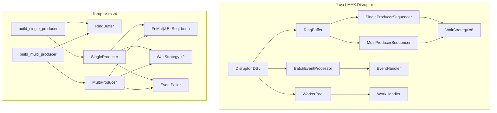

# Java LMAX Disruptor to Rust Component Mapping

> **Key takeaway**: disruptor-rs v4 implements the core subset (~60%) of the Java LMAX Disruptor, covering all critical data path components. The v5 goal is to achieve 100% feature parity while leveraging Rust's type system to eliminate safety constraints that rely on runtime checks in the Java implementation.

**Abstract**: This document provides a complete component mapping table between the Java LMAX Disruptor (`com.lmax.disruptor` 4.0) and disruptor-rs, annotating the current implementation status (v4) and target architecture (v5), to help Java Disruptor users quickly understand the correspondences in the Rust implementation.

---

## 1. Core Component Mapping

### 1.1 Data Structure Layer

| Java Component | Java Package | Rust Type (v4) | Rust Type (Target v5) | Mapping Notes |
|---|---|---|---|---|
| `RingBuffer<E>` | `com.lmax.disruptor` | `RingBuffer<E>` | `RingBuffer<E>` | Structurally identical: `UnsafeCell<E>[]` + `index_mask`. Java version inherits from `RingBufferFields`; Rust uses a flat struct |
| `Sequence` | `com.lmax.disruptor` | `Cursor` (internal `CachePadded<AtomicI64>`) | `Sequence` | v4 named `Cursor`, v5 renamed to `Sequence` to match LMAX terminology |
| `SequenceGroup` | `com.lmax.disruptor` | No direct equivalent; `Vec<Arc<Cursor>>` in builder | `SequenceGroup` | Java dynamically adds/removes consumers. Rust builder fixes the topology at build time |

### 1.2 Sequencer Layer

| Java Component | Java Package | Rust Type (v4) | Rust Type (Target v5) | Mapping Notes |
|---|---|---|---|---|
| `Sequencer` (interface) | `com.lmax.disruptor` | `Producer<E>` trait | `Sequencer` trait | Java `Sequencer` manages claim + publish. Rust `Producer` trait merges sequencer and translator |
| `SingleProducerSequencer` | `com.lmax.disruptor` | `SingleProducer<E, C>` | `SingleProducerSequencer` | Local `sequence` field, no CAS |
| `MultiProducerSequencer` | `com.lmax.disruptor` | `MultiProducer<E, C>` | `MultiProducerSequencer` | CAS loop + availability bit array |
| `AbstractSequencer` | `com.lmax.disruptor` | None (Rust does not use inheritance) | None | Java uses an abstract class to share fields. Rust holds them directly in each struct |

### 1.3 Barrier Layer

| Java Component | Java Package | Rust Type (v4) | Rust Type (Target v5) | Mapping Notes |
|---|---|---|---|---|
| `SequenceBarrier` (interface) | `com.lmax.disruptor` | `Barrier` trait | `SequenceBarrier` trait | `get_after(prev)` returns the available sequence. Java version includes `waitFor()` semantics |
| `ProcessingSequenceBarrier` | `com.lmax.disruptor` | `SingleConsumerBarrier` | `DependentSequenceBarrier` | Tracks a single upstream consumer |
| (multi-consumer variant) | Implicit in `SequenceGroup` | `MultiConsumerBarrier` | `DependentSequenceGroup` | Takes the `min()` of multiple cursors |
| `SingleProducerBarrier` (internal) | No standalone class | `SingleProducerBarrier` | `SingleProducerBarrier` | v4 already correctly named |
| `MultiProducerBarrier` (internal) | No standalone class | `MultiProducerBarrier` | `MultiProducerBarrier` | Availability bit array + CAS cursor |

### 1.4 Consumer Layer

| Java Component | Java Package | Rust Type (v4) | Rust Type (Target v5) | Mapping Notes |
|---|---|---|---|---|
| `EventHandler<E>` | `com.lmax.disruptor` | `FnMut(&E, Sequence, bool)` closure | `EventHandler<E>` trait (optional) | Rust uses closures instead of interfaces. `bool` = `endOfBatch` |
| `EventProcessor` (interface) | `com.lmax.disruptor` | `Consumer` struct (internal) | `EventProcessor` trait | Java `EventProcessor` is a `Runnable`. Rust version holds a `JoinHandle` |
| `BatchEventProcessor<E>` | `com.lmax.disruptor` | `start_processor()` function | `BatchEventProcessor<E>` | The function `start_processor()` is equivalent to Java's `BatchEventProcessor.run()`. Contains the batch loop logic |
| `WorkHandler<E>` | `com.lmax.disruptor` | Not implemented | `WorkHandler<E>` trait | Java's work stealing pattern. Multiple handlers compete to process the same event |
| `WorkerPool` | `com.lmax.disruptor` | Not implemented | `WorkerPool<E>` | Manages a group of `WorkHandler`s |
| `EventPoller<E>` | `com.lmax.disruptor` | `EventPoller<E, B>` | `EventPoller<E, B>` | Poll-based API for user-controlled threads. Fully implemented in v4 |

### 1.5 Wait Strategy Layer

| Java Component | Java Package | Rust Type (v4) | Rust Type (Target v5) | Mapping Notes |
|---|---|---|---|---|
| `WaitStrategy` (interface) | `com.lmax.disruptor` | `WaitStrategy: Copy + Send` trait | `WaitStrategy: Copy + Send` | Java uses an interface; Rust uses a trait. `Copy` constraint avoids heap allocation |
| `BusySpinWaitStrategy` | `com.lmax.disruptor.strategy` | `BusySpin` | `BusySpin` | Empty loop, lowest latency |
| `SpinLoopHintWaitStrategy` | No direct equivalent | `BusySpinWithSpinLoopHint` | `SpinLoopHint` | `hint::spin_loop()`, v5 simplifies the name |
| `YieldingWaitStrategy` | `com.lmax.disruptor.strategy` | Not implemented | `Yielding` | `thread::yield_now()` with spin count |
| `SleepingWaitStrategy` | `com.lmax.disruptor.strategy` | Not implemented | `Sleeping` | Progressive: spin -> yield -> `thread::sleep()` |
| `BlockingWaitStrategy` | `com.lmax.disruptor.strategy` | Not implemented | `Blocking` | `Condvar` + `Mutex` |
| `TimeoutBlockingWaitStrategy` | `com.lmax.disruptor.strategy` | Not implemented | `TimeoutBlocking` | `Condvar::wait_timeout()` |
| `LiteBlockingWaitStrategy` | `com.lmax.disruptor.strategy` | Not implemented | `LiteBlocking` | Lightweight `Condvar`, reduces unpark overhead |
| `LiteTimeoutBlockingWaitStrategy` | `com.lmax.disruptor.strategy` | Not implemented | `LiteTimeoutBlocking` | `LiteBlocking` + timeout |

### 1.6 DSL / Builder Layer

| Java Component | Java Package | Rust Type (v4) | Rust Type (Target v5) | Mapping Notes |
|---|---|---|---|---|
| `Disruptor<E>` | `com.lmax.disruptor.dsl` | `build_single_producer()` / `build_multi_producer()` functions | `Disruptor<E>` facade | Java's `Disruptor` is builder + runtime. Rust v4 separates builder and runtime |
| `EventHandlerGroup<E>` | `com.lmax.disruptor.dsl` | `SPBuilder<SC/MC, ...>` typestate | `EventHandlerGroup<E>` | Java uses runtime checks for handler count. Rust uses `PhantomData<State>` typestate encoding |
| `EventFactory<E>` | `com.lmax.disruptor` | `FnMut() -> E` closure | `FnMut() -> E` | Rust closures naturally replace the Java `EventFactory` interface |
| `EventTranslator<E>` | `com.lmax.disruptor` | `FnOnce(&mut E)` closure (in `publish()`) | `FnOnce(&mut E)` | Java requires an explicit translator object. Rust passes a closure directly |

### 1.7 Lifecycle & Error Handling

| Java Component | Java Package | Rust Type (v4) | Rust Type (Target v5) | Mapping Notes |
|---|---|---|---|---|
| `LifecycleAware` | `com.lmax.disruptor` | None | `LifecycleAware` trait (optional) | `on_start()` / `on_shutdown()` callbacks |
| `ExceptionHandler<E>` | `com.lmax.disruptor` | None (panic = abort strategy) | `ExceptionHandler<E>` trait | Java version can ignore/log/halt. Rust uses `PublishGuard` to prevent sequence holes |
| `AlertException` | `com.lmax.disruptor` | None | Not needed | Java uses checked exceptions to implement the shutdown signal. Rust uses `shutdown_at_sequence` + `Polling::Shutdown` |
| `InsufficientCapacityException` | `com.lmax.disruptor` | `RingBufferFull` / `MissingFreeSlots` | `PublishError` enum | v5 unifies as `PublishError::Full` / `PublishError::InsufficientCapacity(u64)` |
| `TimeoutException` | `com.lmax.disruptor` | None | `Polling::Timeout` | Paired with `TimeoutBlocking` wait strategy |

---

## 2. Architecture Differences Overview



---

## 3. Type Safety Differences

### Java: Runtime Checks

```java
// Java - runtime IllegalStateException
disruptor.handleEventsWith(handler1, handler2);
disruptor.after(handler1).handleEventsWith(handler3);
disruptor.start(); // If topology has a cycle -> runtime exception
```

### Rust: Compile-Time Guarantees

```rust
// Rust - typestate guarantees correctness
let mut producer = build_single_producer(8, factory, BusySpin)
    .handle_events_with(handler1)   // NC -> SC
    .handle_events_with(handler2)   // SC -> MC
    .and_then()                     // MC -> NC (new dependency layer)
    .handle_events_with(handler3)   // NC -> SC
    .build();                       // SC -> SingleProducer
// The compiler rejects invalid topologies -- you cannot call .build() in NC state
```

The v4 builder uses phantom type states (`NC`, `SC`, `MC`) to enforce at compile time:
- At least one consumer must exist before build
- `and_then()` can only be called after at least one consumer is added
- Build produces the correct barrier type (`SingleConsumerBarrier` vs `MultiConsumerBarrier`)

---

## 4. Unimplemented Component Analysis

| Missing Component | Priority | Implementation Difficulty | Notes |
|---|---|---|---|
| WorkHandler / WorkerPool | Medium | Medium | Requires work stealing CAS logic |
| YieldingWaitStrategy | High | Low | `thread::yield_now()` + spin count |
| SleepingWaitStrategy | High | Low | Progressive: spin -> yield -> sleep |
| BlockingWaitStrategy | High | Medium | `Condvar` + `Mutex`, requires `SignalBarrier` |
| TimeoutBlockingWaitStrategy | Medium | Medium | `Condvar::wait_timeout()` |
| LiteBlockingWaitStrategy | Low | Medium | Optimized blocking |
| LiteTimeoutBlockingWaitStrategy | Low | Medium | Optimized timeout blocking |
| ExceptionHandler | Medium | Low | Trait + default impl |
| LifecycleAware | Low | Low | `on_start()` / `on_shutdown()` |
| SequenceGroup dynamic modification | Low | High | Runtime add/remove of consumers, requires complex synchronization |

---

## 5. Availability Buffer Implementation Differences

Java and Rust have significant implementation differences in multi-producer availability tracking:

### Java: int[] availableBuffer

```java
// Java: one int per slot, stores the round number
private final int[] availableBuffer;

private void setAvailable(long sequence) {
    int index = calculateIndex(sequence);
    int flag  = calculateAvailabilityFlag(sequence);
    availableBuffer[index] = flag; // Plain write (non-atomic)
}
```

### Rust: AtomicU64 bit array + XOR

```rust
// Rust: 64 slots share one AtomicU64
// Each bit encodes whether the slot was published in an odd or even round
available: Box<[AtomicU64]>

fn publish_with_ordering(&self, sequence: Sequence, ordering: Ordering) {
    let (availability_index, bit_index) = self.calculate_availability_indices(sequence);
    let mask = 1 << bit_index;
    // XOR flips the bit -> encodes even/odd round
    self.availability_at(availability_index).fetch_xor(mask, ordering);
}
```

The Rust approach is more compact (64x compression ratio), but queries require bit manipulation.

---

## 6. Reference Resources

- Java LMAX Disruptor: https://github.com/LMAX-Exchange/disruptor
- disruptor-rs: https://github.com/trunkszi/disruptor-rs
- Java Disruptor API Docs: https://lmax-exchange.github.io/disruptor/
