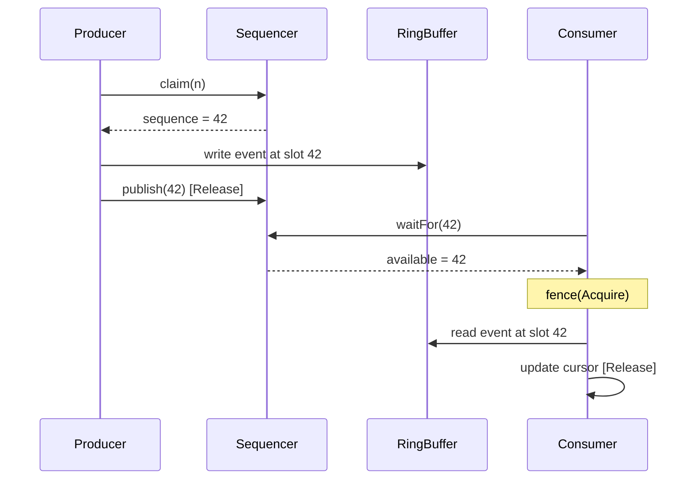
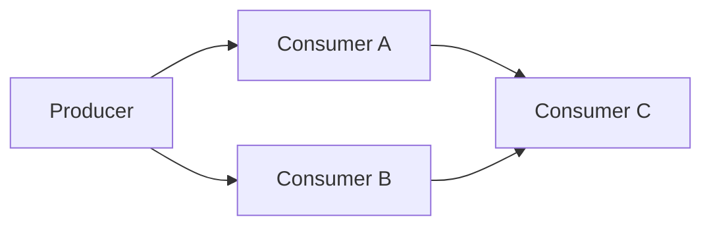

# LMAX Disruptor Paper In-Depth Analysis

> **Key takeaway**: The LMAX Disruptor paper demonstrates that mechanical sympathy + lock-free design can achieve an extreme throughput of 6 million transactions per second within a single thread. disruptor-rs maps these principles to Rust's ownership model, eliminating the inherent deficiencies in the Java implementation at the GC and memory model layers.

**Abstract**: This document analyzes the LMAX Disruptor technical paper (Trisha Gee & Martin Thompson, 2011) chapter by chapter, distills core design insights, and establishes a precise mapping from paper claims to the disruptor-rs implementation.

---

## 1. Core Thesis of the Paper

The LMAX Disruptor paper puts forward a fundamental thesis:

> The true bottleneck of modern CPU hardware is not computational power, but **data access patterns**. If you respect how the hardware works (mechanical sympathy), lock-free designs can be **an order of magnitude** faster than traditional concurrent queues.

This thesis contains four key insights:

1. **Pre-allocation eliminates GC pressure** -- Events in the ring buffer are allocated once at startup, with zero allocations during runtime
2. **Sequence numbers replace locks** -- Monotonically increasing sequences naturally encode happens-before relationships
3. **Cache padding eliminates false sharing** -- Ensures independent atomic variables do not share a cache line
4. **Batching amortizes overhead** -- Consumers process all available events at once, spreading synchronization costs across the entire batch

---

## 2. Chapter-by-Chapter Summary

### Chapter 1: Abstract & Background

The paper opens by describing the business requirements of LMAX Exchange: a system that processes financial transactions with microsecond-level latency. The traditional queue-based architecture (`java.util.concurrent.ArrayBlockingQueue`) could not meet the latency requirements because:

- Lock contention causes thread context switches (approximately 10-20 us cost)
- Dynamic memory allocation in queue implementations triggers GC pauses
- CPU cache utilization is extremely low

### Chapter 2: Mechanical Sympathy

The paper cites Martin Thompson's core philosophy:

> "If you understand how the hardware works, you can write software that 'resonates' with it."

Key hardware facts:
- L1 cache access is approximately 1ns, main memory access is approximately 65-100ns (two orders of magnitude difference)
- Cache lines are 64 bytes; the CPU reads and writes in cache-line units
- The store buffer and invalidation queue of modern CPUs introduce fixed overhead for data synchronization across cores

### Chapter 3: Ring Buffer Design

The ring buffer is the core data structure of the Disruptor:

```
    ┌───┬───┬───┬───┬───┬───┬───┬───┐
    │ 0 │ 1 │ 2 │ 3 │ 4 │ 5 │ 6 │ 7 │  ← Pre-allocated slots
    └───┴───┴───┴───┴───┴───┴───┴───┘
          ↑                   ↑
       Consumer            Producer
      (sequence=1)        (sequence=5)
```

Key design elements:
- **Size must be a power of 2**: Allows bitwise AND (`sequence & mask`) instead of modulo operation
- **Pre-allocation**: All events are created via a factory at construction time; at runtime they are only **mutated**, never allocated
- **Unidirectional advancement**: Sequence numbers only increase, never decrease, allowing $2^{63} - 1$ events to be processed before overflow

### Chapter 4: Sequencing & Coordination

The paper defines the Sequencer as the core coordination mechanism:

- **Single Producer**: No contention, directly increments a local sequence
- **Multi Producer**: Uses CAS (`compare_exchange`) to atomically increment a shared sequence



### Chapter 5: Wait Strategies

The paper describes the latency/CPU tradeoffs of different wait strategies:

| Strategy | Latency | CPU Consumption | Use Case |
|------|------|----------|----------|
| BusySpin | Lowest | 100% | Financial trading |
| SpinLoopHint | Very low | ~80% | Low latency + power saving |
| Yielding | Low | Moderate | General low latency |
| Sleeping | Moderate | Very low | Throughput-oriented |
| Blocking | High | Lowest | Low-frequency events |

### Chapter 6: Dependency Graphs

Consumers can form DAG (Directed Acyclic Graph) dependency relationships:



Consumer C must wait for both A and B to finish processing the same event before it can start. This is implemented via `MultiConsumerBarrier`, which takes the minimum of all dependent cursors.

### Chapter 7: Batching

When a consumer falls behind the producer, it discovers that multiple events are already available and can process them all at once:

$$
\text{batch\_size} = \text{available\_sequence} - \text{current\_sequence} + 1
$$

The advantages of this adaptive batching are:
- Under high load, the batch automatically grows, increasing throughput
- Under low load, the batch is 1, maintaining low latency
- Synchronization overhead is amortized across the entire batch

### Chapter 8: Performance Results

Key data points reported in the paper:
- Unicast (1P-1C): Disruptor ~25M ops/sec, ABQ ~5M ops/sec
- Three Step Pipeline: Disruptor ~16M ops/sec, ABQ ~0.3M ops/sec
- Multicast (1P-3C): Disruptor ~9M ops/sec, ABQ does not directly support this

---

## 3. Paper Claims to Rust Implementation Mapping

| Paper Claim | Java Mechanism | disruptor-rs Implementation | Notes |
|---|---|---|---|
| Pre-allocation eliminates GC | `EventFactory` populates at startup | `RingBuffer::new()` accepts `FnMut() -> E` factory | Rust has no GC, double advantage |
| Sequences replace locks | `AtomicLong` + `Unsafe` | `Cursor` wraps `CachePadded<AtomicI64>` | `CachePadded` provides automatic padding |
| 2^n size + bitmask | `indexMask = bufferSize - 1` | `index_mask: i64` in `RingBuffer` | Same strategy |
| Single producer no CAS | `SingleProducerSequencer` | `SingleProducer` uses a local `sequence` field | Completely CAS-free claim path |
| Multi producer CAS claim | `MultiProducerSequencer.next()` | `MultiProducerBarrier::compare_exchange()` | `AcqRel/Relaxed` ordering |
| Availability buffer | `int[] availableBuffer` | `Box<[AtomicU64]>` + XOR bit toggle | More compact: 64 slots/AtomicU64 |
| Consumer batching | `BatchEventProcessor.run()` | `while available >= sequence` loop | `consumer.rs:93` |
| Barrier dependency graph | `SequenceBarrier` + `ProcessingSequenceBarrier` | `SingleConsumerBarrier` / `MultiConsumerBarrier` | Type-safe builder ensures correctness |
| WaitStrategy trait | `WaitStrategy` interface | `WaitStrategy: Copy + Send` trait | Copy avoids allocation |
| Graceful shutdown | `halt()` | `shutdown_at_sequence` AtomicI64 + Drop impl | RAII auto-triggers |
| Event publication guard | None (Java has no panic unwinding issue) | `SinglePublishGuard` / `PublishGuard` RAII | Prevents sequence holes caused by panics |

---

## 4. Advantages of Rust over Java

### 4.1 Zero GC

The Java Disruptor's pre-allocation strategy reduces GC but cannot eliminate it entirely: the JVM still needs to scan the object graph. Rust's ownership model completes memory management at compile time, with zero GC overhead at runtime.

$$
\text{Java: } T_{\text{worst}} = T_{\text{op}} + T_{\text{GC\_pause}} \quad \text{(unpredictable)}
$$
$$
\text{Rust: } T_{\text{worst}} = T_{\text{op}} \quad \text{(deterministic)}
$$

### 4.2 Ownership Guarantees Safety

The safety of the Java Disruptor relies on documentation conventions: "do not write to the event after publishing." Violating this convention is undefined behavior.

disruptor-rs enforces this through the type system:

```rust
// Producer obtains &mut E (exclusive reference)
producer.publish(|e: &mut Event| {
    e.price = 42.0;
    // When the closure ends, &mut E is dropped
    // Publishing completes automatically -- you cannot access the event after this
});
```

### 4.3 Precise Memory Ordering

Java's `volatile` is equivalent to `Ordering::SeqCst`, which is the strongest memory ordering. Some locations in the LMAX Java implementation do not actually need such strong guarantees.

disruptor-rs selects the weakest sufficient ordering for each atomic operation:

| Scenario | Java | Rust (disruptor-rs) |
|------|------|---------------------|
| Publish sequence | `volatile` write (SeqCst) | `store(Release)` |
| Read barrier | `volatile` read (SeqCst) | `load(Relaxed)` + separate `fence(Acquire)` |
| CAS claim | `compareAndSet` (SeqCst) | `compare_exchange(AcqRel, Relaxed)` |
| Shutdown signal | `volatile` write | `store(Relaxed)` |

On x86 these differences are minor (x86 stores are naturally Release), but on ARM/RISC-V this can reduce the number of memory barrier instructions.

### 4.4 Zero-Cost Abstractions

Rust's generic monomorphization means the `WaitStrategy` trait is inlined at compile time:

```rust
// WaitStrategy is a Copy + Send trait
// The compiler eliminates the empty function body of BusySpin::wait_for()
fn wait_for_events<B, W>(sequence: Sequence, ..., wait_strategy: &W)
where W: WaitStrategy
{
    wait_strategy.wait_for(sequence); // Compiles to no-op for BusySpin
}
```

Java's interface dispatch, even when JIT-inlined, carries the risk of profile-guided deoptimization.

### 4.5 Panic Safety via RAII Guards

The Java Disruptor does not handle the problem of sequence holes when an event handler throws an exception. If an `EventTranslator` throws an exception, the sequence already claimed by the producer is never published, causing all consumers to **deadlock permanently**.

disruptor-rs solves this problem using RAII guards:

```rust
struct PublishGuard<'a> {
    barrier:   &'a MultiProducerBarrier,
    lower:     Sequence,
    count:     i64,
    committed: bool,
}

impl Drop for PublishGuard<'_> {
    fn drop(&mut self) {
        if !self.committed {
            // Panic path: publish the sequence to prevent holes
            self.barrier.publish(self.lower);
        }
    }
}
```

---

## 5. Features Implemented in disruptor-rs but Not Covered by the Paper

| Feature | Description |
|------|------|
| EventPoller API | User can control the consumer thread, rather than having it managed by the Disruptor |
| Branch/Join DAG | `new_branch()` / `join()` support complex DAG topologies |
| Stateful event handler | `handle_events_and_state_with()` supports handler-local state |
| CPU affinity pinning | `pin_at_core()` pins consumer threads to specific CPU cores |
| Batch publication | `batch_publish()` / `try_batch_publish()` publishes n events at once |

---

## 6. Paper Limitations and disruptor-rs Responses

### 6.1 The Paper Assumes a Single NUMA Node

The paper's benchmarks run on a single NUMA node. Cache coherency costs across NUMA nodes are significantly higher. disruptor-rs allows users to pin related threads to the same NUMA node via `pin_at_core()`.

### 6.2 The Paper Does Not Discuss Backpressure Strategies

When the ring buffer is full, the paper assumes the producer can busy spin. disruptor-rs provides `try_publish()` returning `Result<Sequence, RingBufferFull>`, letting users decide their own backpressure strategy.

### 6.3 The Paper Does Not Discuss Sequence Overflow

The paper implicitly assumes that the $2^{63}$ capacity of `long` is sufficient. disruptor-rs similarly uses `i64`, but explicitly states in the documentation that this is the user's responsibility.

---

## References

1. Thompson, M., Farley, D., Barker, M., Gee, P., & Stewart, A. (2011). *Disruptor: High performance alternative to bounded queues for exchanging data between concurrent threads*. LMAX Exchange.
2. Thompson, M. (2011). *Mechanical Sympathy* (blog). https://mechanical-sympathy.blogspot.com/
3. Drepper, U. (2007). *What Every Programmer Should Know About Memory*. Red Hat, Inc.
