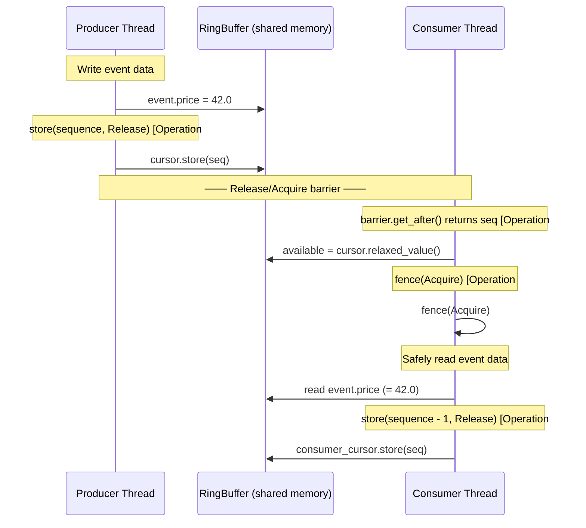
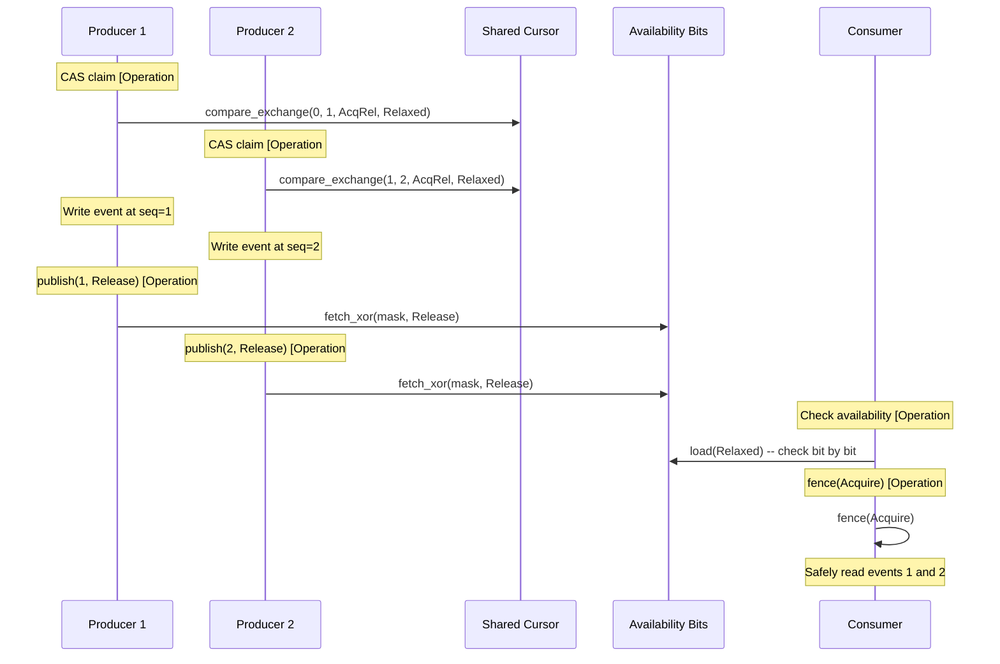
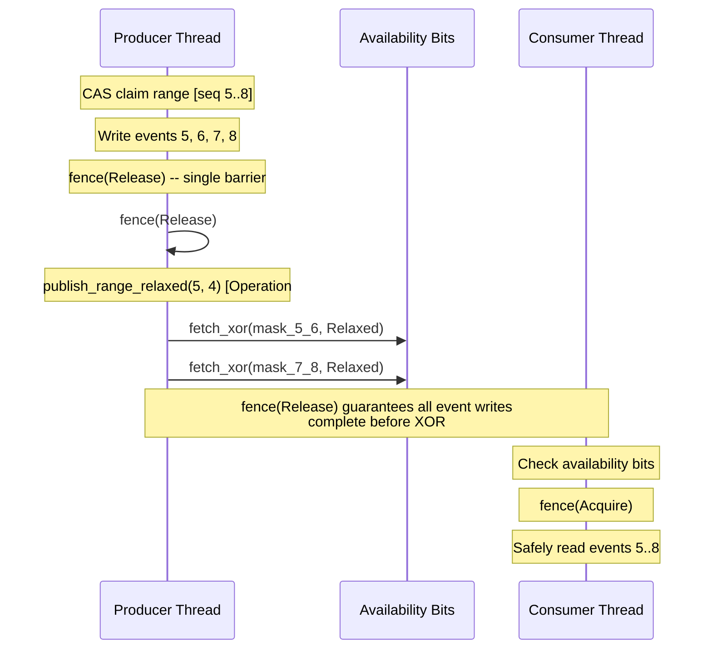

# Memory Ordering Detailed Rationale

> **Key takeaway**: Every atomic operation in disruptor-rs uses the **weakest sufficient** memory ordering, avoiding the over-synchronization of Java's `volatile` (equivalent to `SeqCst`). On weak memory model platforms like ARM/RISC-V, this directly reduces the number of memory barrier instructions, lowering latency.

**Abstract**: This document provides a one-by-one justification of the memory ordering choice for all 16 atomic operations in disruptor-rs, establishes a complete happens-before relationship chain, and uses Mermaid diagrams to illustrate the synchronization protocol between producer and consumer.

---

## 1. Ordering Basics Review

| Ordering | Semantics | x86 Cost | ARM Cost |
|---|---|---|---|
| `Relaxed` | Guarantees atomicity only | No extra instructions | No extra instructions |
| `Acquire` | Subsequent reads/writes in this thread cannot be reordered before this operation | No extra instructions (x86 loads are naturally Acquire) | `ldar` or `dmb ishld` |
| `Release` | Previous reads/writes in this thread cannot be reordered after this operation | No extra instructions (x86 stores are naturally Release) | `stlr` or `dmb ish` |
| `AcqRel` | Both Acquire and Release | No extra instructions | `dmb ish` (full barrier) |
| `SeqCst` | Global total order | `mfence` or `lock` prefix | `dmb ish` + sequential guarantee |

---

## 2. Complete Atomic Operation List with Justifications

### 2.1 cursor.rs -- Sequence Management

| # | Location | Operation | Ordering | Justification |
|---|---|---|---|---|
| 1 | `cursor.rs:19` | `compare_exchange(current, next, AcqRel, Relaxed)` | Success: `AcqRel`, Failure: `Relaxed` | **Success path**: producer claims a sequence. `Acquire` ensures the latest consumer cursor value is read (prevents using a stale barrier). `Release` ensures the preceding barrier check is visible to subsequent operations. **Failure path**: only obtains the new `current` value for retry, no synchronization needed, `Relaxed` is sufficient. |
| 2 | `cursor.rs:25` | `store(sequence, Release)` | `Release` | This is the **publish operation**. `Release` ensures that all preceding writes to the event (`*event_ptr = ...`) are completed before the sequence becomes visible to consumers. This is the **critical first half** of the producer-consumer synchronization. |
| 3 | `cursor.rs:31` | `load(Relaxed)` | `Relaxed` | Used for fast barrier checks ("are there new events?"). No ordering guarantees are needed because: (a) reading a stale value only results in one extra spin; (b) actual synchronization is provided by the subsequent `fence(Acquire)`. |

### 2.2 consumer.rs -- Consumer Logic

| # | Location | Operation | Ordering | Justification |
|---|---|---|---|---|
| 4 | `consumer.rs:179` | `fence(Acquire)` | `Acquire` fence | This is the **other half** of the producer-consumer synchronization. Paired with the producer's `store(Release)`, it establishes happens-before: producer's writes to the event --happens-before--> consumer's reads of the event. A standalone fence is used instead of `load(Acquire)` because: `barrier.get_after()` uses a `Relaxed` load (operation #3), and the fence is executed only **after** confirming that events are available, avoiding repeated acquire barriers in the spin loop. |
| 5 | `consumer.rs:103` | `cursor.store(sequence - 1, Release)` | `Release` (via `Cursor::store`) | The consumer updates its own cursor, indicating processing is complete up to `sequence - 1`. `Release` ensures all consumer reads of the event are completed before the cursor update. When the producer reads the consumer cursor (via `barrier.get_after()`), it sees all operations the consumer has completed. |
| 6 | `consumer.rs:173` | `shutdown_at_sequence.load(Relaxed)` | `Relaxed` | Shutdown signal check. `Relaxed` is sufficient because: (a) shutdown is a monotonic operation (transitions from `NONE` to a specific value, never reverts); (b) even if seeing the shutdown signal is delayed, the consumer only spins a few extra times; (c) no data depends on the precise moment the shutdown value is observed. |

### 2.3 producer/multi.rs -- Multi-Producer

| # | Location | Operation | Ordering | Justification |
|---|---|---|---|---|
| 7 | `multi.rs:78` | `counter.fetch_add(1, AcqRel)` | `AcqRel` | Clone reference count increment. `AcqRel` ensures: (a) `Acquire` -- sees the latest effects of other clone/drop operations; (b) `Release` -- all field copies for this clone are completed before the count increment. This follows the standard `Arc` reference counting protocol. |
| 8 | `multi.rs:108` | `counter.fetch_sub(1, AcqRel)` | `AcqRel` | Drop reference count decrement. `AcqRel` ensures: (a) `Acquire` -- if the count reaches zero, all operations from other producers are visible; (b) `Release` -- all operations of this producer are completed before the count decrement. The last drop must perform shutdown. |
| 9 | `multi.rs:176` | `compare_exchange(current, n_next, AcqRel, Relaxed)` | Success: `AcqRel`, Failure: `Relaxed` | Multi-producer sequence claim. Semantics are the same as operation #1: (a) `Acquire` reads the latest cursor value; (b) `Release` ensures the preceding consumer barrier check is visible; (c) on failure, `Relaxed` only needs to obtain the new current value. |
| 10 | `multi.rs:373,384` | `fetch_xor(flip_mask, Relaxed)` | `Relaxed` | Availability bit flip during batch publishing. Using `Relaxed` is safe because these XOR operations occur within `PublishGuard::commit()`, which executes `fence(Release)` **before** calling `publish_range_relaxed()`. All event writes are made visible to consumers through the fence. |
| 11 | `multi.rs:395` | `fetch_xor(mask, ordering)` | Parameterized (caller decides) | `publish_with_ordering()` accepts an `Ordering` parameter. When called from `ProducerBarrier::publish()`, `Release` is passed (single event publish needs its own Release). When called from `publish_range_relaxed()`, `Relaxed` is passed (external fence already present). |
| 12 | `multi.rs:404,423` | `load(Relaxed)` | `Relaxed` | Consumer reads availability bits to determine if a sequence has been published. `Relaxed` is sufficient because the consumer in `wait_for_events()` will execute `fence(Acquire)` **after** confirming availability, establishing happens-before. |
| 13 | `multi.rs:439` | `publish(sequence)` calls `publish_with_ordering(sequence, Release)` | `Release` | ProducerBarrier publish for a single event. `Release` ensures all preceding writes to the event are completed before the availability bit flip. This is the critical synchronization point for the producer-consumer protocol in the multi-producer scenario. |

### 2.4 producer/single.rs -- Single Producer

| # | Location | Operation | Ordering | Justification |
|---|---|---|---|---|
| 14 | `single.rs:196` | `shutdown_at_sequence.store(sequence, Relaxed)` | `Relaxed` | Shutdown signal emission. Paired with operation #6. `Relaxed` is sufficient because shutdown is an idempotent terminal signal that the consumer will eventually see. All events processed before shutdown are already correctly guaranteed by the publish/consume Release/Acquire chain. |

### 2.5 event_poller.rs -- Polling API

| # | Location | Operation | Ordering | Justification |
|---|---|---|---|---|
| 15 | `event_poller.rs:249` | `shutdown_at_sequence.load(Relaxed)` | `Relaxed` | Same justification as operations #6 and #14. Shutdown checks do not require strict ordering. |
| 16 | `event_poller.rs:257` | `fence(Acquire)` | `Acquire` fence | Same role as operation #4. After confirming that events are available, establishes happens-before to safely read event data. |

---

## 3. Happens-Before Relationship Diagrams

### 3.1 Single Producer - Single Consumer



**Happens-before chain**:

$$
\text{write}(event) \xrightarrow{\text{program order}} \text{store}(seq, \text{Release}) \xrightarrow{\text{Release/Acquire}} \text{fence}(\text{Acquire}) \xrightarrow{\text{program order}} \text{read}(event)
$$

### 3.2 Multi Producer Additional Synchronization



### 3.3 Batch Publish Path (Multi Producer)



**Key design**: Batch publish uses `fence(Release)` + multiple `Relaxed` XORs, rather than using `Release` for each XOR. This reduces N Release barriers to a single fence.

---

## 4. Why Not SeqCst

`SeqCst` provides a global total order, but the Disruptor does not need a global total order for the following reasons:

1. **Producer to consumer is unidirectional data flow**: Only needs a Release -> Acquire pair
2. **Multiple producers coordinate via CAS**: The `AcqRel` of CAS already establishes happens-before between producers
3. **Consumer cursor updates are independent**: Each consumer has its own cursor; no total order between consumers is needed

On x86, `Release` stores and `Acquire` loads produce no extra instructions (the x86 TSO model naturally provides these guarantees). However, `SeqCst` stores require `mfence` or `lock`-prefixed instructions, costing approximately 20-30 cycles.

---

## 5. Fence vs Atomic Load Choice

disruptor-rs uses a standalone `fence(Acquire)` on the consumer side rather than `load(Acquire)`:

```rust
// Current implementation: Relaxed load + standalone fence
let mut available = barrier.get_after(sequence); // Relaxed
while available < sequence {
    wait_strategy.wait_for(sequence);
    available = barrier.get_after(sequence);      // Relaxed
}
fence(Ordering::Acquire); // Executed only once after confirming availability
```

**Advantage**: In the spin loop, each `barrier.get_after()` only performs a `Relaxed` load. The `Acquire` fence is executed only **once** after confirming events are available. If `load(Acquire)` were used instead, every spin loop iteration would execute acquire semantics, adding unnecessary barrier instructions on ARM.

$$
\text{fence approach: } N_{\text{barrier}} = 1 \quad \text{vs} \quad \text{load(Acquire) approach: } N_{\text{barrier}} = K_{\text{spins}}
$$

---

## 6. Audit Checklist

When verifying memory ordering correctness, check the following conditions:

- [ ] Every `Release` store has a paired `Acquire` load or fence
- [ ] Every shared data access has a complete happens-before chain
- [ ] `Relaxed` operations do not depend on ordering guarantees
- [ ] The CAS failure ordering is not stronger than the success ordering
- [ ] Standalone fences are positioned at critical section boundaries
- [ ] Miri reports no data races under `-Zmiri-disable-isolation`
