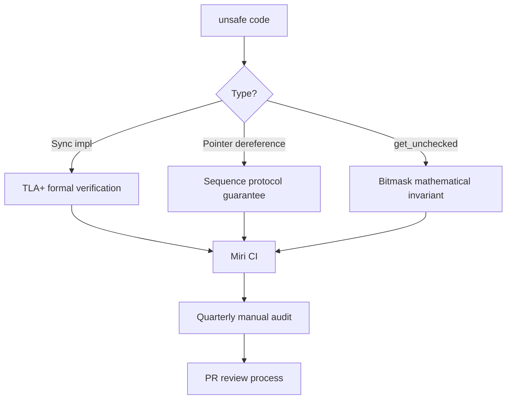

# Unsafe Code Audit Report

> **Key takeaway**: disruptor-rs contains 8 uses of `unsafe` (1 trait impl + 7 blocks), all concentrated on ring buffer access and pointer dereference paths. Each unsafe use has a clear safety invariant. The overall risk level is **moderate**, and dual assurance through Miri CI detection and periodic manual audits is recommended.

**Abstract**: This document provides a complete audit of all unsafe code in disruptor-rs, evaluating the safety justification, risk level, and mitigation measures for each unsafe use. The audit is based on the `main` branch code as of 2026-04-03.

---

## 1. Unsafe Usage Inventory

### 1.1 Overview

| # | File:Line | Category | Risk Level |
|---|---|---|---|
| 1 | `ringbuffer.rs:5` | `unsafe impl Sync` | **High** |
| 2 | `ringbuffer.rs:49` | `get_unchecked` | Low |
| 3 | `consumer.rs:97` | Pointer dereference `& *ptr` | Medium |
| 4 | `consumer.rs:143` | Pointer dereference `& *ptr` | Medium |
| 5 | `producer.rs:61` | Pointer dereference `&mut *ptr` | Medium |
| 6 | `producer/single.rs:159` | Pointer dereference `&mut *ptr` | Medium |
| 7 | `producer/multi.rs:203` | Pointer dereference `&mut *ptr` | Medium |
| 8 | `producer/multi.rs:355` | `get_unchecked` | Low |

---

## 2. Item-by-Item Audit

### 2.1 `ringbuffer.rs:5` -- unsafe impl Sync

```rust
unsafe impl<E> Sync for RingBuffer<E> {}
```

| Property | Value |
|---|---|
| **Operation** | Implements `Sync` trait for `RingBuffer<E>` |
| **Precondition** | `RingBuffer` internally uses `UnsafeCell<E>` to store event slots. `UnsafeCell` is not `Sync`, so the compiler will not auto-derive `Sync` |
| **Safety justification** | The Disruptor protocol guarantees that at any given moment, each slot has at most one `&mut E` (producer write) or multiple `&E` (consumer reads), never both simultaneously. This is coordinated through sequence numbers: a producer can only write to a claimed but unpublished slot, and consumers can only read published slots |
| **Risk level** | **High** -- This is the foundation of the entire safety model. A bug in the sequence coordination logic would result in a data race (UB) |
| **Mitigation** | Miri detection, TLA+ formal verification (`verification/` directory), unit tests for sequence coordination logic |
| **Note** | Missing `E: Send` bound. The current impl implements `Sync` for all `E`, including `!Send` types. Recommend changing to `unsafe impl<E: Send> Sync for RingBuffer<E> {}` |
| **Last audited** | 2026-04-03 |

### 2.2 `ringbuffer.rs:49` -- get_unchecked

```rust
let slot = unsafe { self.slots.get_unchecked(index) };
```

| Property | Value |
|---|---|
| **Operation** | Unchecked array access without bounds checking |
| **Precondition** | `index = (sequence & self.index_mask) as usize`, where `index_mask = size - 1` and `size` is a power of 2 |
| **Safety justification** | Bitwise AND guarantees `index` is within `[0, size)`. Mathematical proof: if `size = 2^k`, then `mask = 2^k - 1`, and `sequence & mask` produces a result in $[0, 2^k - 1]$ |
| **Risk level** | **Low** -- The invariant is guaranteed in `RingBuffer::new()` via `is_power_of_two()` check |
| **Mitigation** | Constructor panics if size is not a power of 2 |
| **Last audited** | 2026-04-03 |

### 2.3 `consumer.rs:97` -- Consumer reads event

```rust
let event_ptr = ring_buffer.get(sequence);
let event     = unsafe { & *event_ptr };
```

| Property | Value |
|---|---|
| **Operation** | Dereferences `*mut E` as `&E` (shared reference) |
| **Precondition** | The consumer only reads an event after `wait_for_events()` returns `Some(available)`. `wait_for_events()` ensures `sequence <= available` and executes `fence(Acquire)` before returning |
| **Safety justification** | (1) The producer has published this sequence via `store(Release)`, and `fence(Acquire)` establishes happens-before, guaranteeing event data is visible. (2) The producer will not overwrite this slot because the consumer cursor has not yet advanced to a position allowing the producer to wrap around. (3) Multiple consumers can simultaneously hold `&E` (shared references), which is safe |
| **Risk level** | **Medium** -- Safety depends on the consumer cursor correctly preventing producer wraparound |
| **Mitigation** | Unit tests for `RingBuffer::free_slots()` logic, Miri CI |
| **Last audited** | 2026-04-03 |

### 2.4 `consumer.rs:143` -- Stateful consumer reads event

```rust
let event_ptr = ring_buffer.get(sequence);
let event     = unsafe { & *event_ptr };
```

| Property | Value |
|---|---|
| **Operation** | Identical to #2.3, in the `start_processor_with_state` variant |
| **Safety justification** | The same justification as #2.3 applies |
| **Risk level** | **Medium** |
| **Last audited** | 2026-04-03 |

### 2.5 `producer.rs:61` -- MutBatchIter dereference

```rust
let event_ptr = self.ring_buffer.get(self.current);
let event     = unsafe { &mut *event_ptr };
```

| Property | Value |
|---|---|
| **Operation** | Dereferences `*mut E` as `&mut E` (exclusive reference) |
| **Precondition** | `MutBatchIter` is created by `apply_updates()`, with range `[lower, upper]`, where these sequences have already been claimed by the producer (single producer via `next_sequences()`, multi producer via CAS) |
| **Safety justification** | (1) The claimed sequence range is exclusive to this producer. (2) The iterator's `current` increments from `lower` to `upper`, producing only one `&mut E` per sequence. (3) Consumers will not read unpublished slots. (4) `PublishGuard` RAII ensures sequences are published even if the closure panics |
| **Risk level** | **Medium** -- Safety depends on the correctness of the claim logic |
| **Last audited** | 2026-04-03 |

### 2.6 `producer/single.rs:159` -- SingleProducer writes event

```rust
let event_ptr = self.ring_buffer.get(sequence);
let event     = unsafe { &mut *event_ptr };
```

| Property | Value |
|---|---|
| **Operation** | Dereferences `*mut E` as `&mut E` |
| **Precondition** | `apply_update()` is only called after `next_sequences()` succeeds. `next_sequences()` confirms the consumer is not on this slot |
| **Safety justification** | (1) `SingleProducer` does not implement `Clone`/`Sync`; there is only one producer thread. (2) `sequence` is local to the producer, not shared with other threads. (3) Consumers will not read unpublished slots. (4) `SinglePublishGuard` RAII ensures panic safety |
| **Risk level** | **Medium** |
| **Last audited** | 2026-04-03 |

### 2.7 `producer/multi.rs:203` -- MultiProducer writes event

```rust
let event_ptr = self.ring_buffer.get(sequence);
let event     = unsafe { &mut *event_ptr };
```

| Property | Value |
|---|---|
| **Operation** | Dereferences `*mut E` as `&mut E` |
| **Precondition** | `apply_update()` is only called after `next_sequences()` successfully claims a sequence via CAS |
| **Safety justification** | (1) CAS guarantees each sequence is claimed by only one producer. (2) `claimed_sequence` is a per-producer local field. (3) Consumers will not read slots that have not been published via the availability bit. (4) `PublishGuard` RAII ensures panic safety |
| **Risk level** | **Medium** -- Correctness of the CAS claim is critical |
| **Last audited** | 2026-04-03 |

### 2.8 `producer/multi.rs:355` -- Availability array access

```rust
unsafe { self.available.get_unchecked(index) }
```

| Property | Value |
|---|---|
| **Operation** | Unchecked access to the availability bit array |
| **Precondition** | `index = slot_index >> 6`, `slot_index = sequence & index_mask` |
| **Safety justification** | (1) `slot_index` is within `[0, size)` (guaranteed by bitmask). (2) `available` size is `size/64`. (3) `slot_index >> 6` equals `slot_index / 64`, producing a result within `[0, size/64)`. (4) `MultiProducerBarrier::new()` asserts `size >= 64` |
| **Risk level** | **Low** -- The invariant is guaranteed in the constructor via assert |
| **Last audited** | 2026-04-03 |

---

## 3. Risk Level Definitions

| Level | Definition | Criteria |
|---|---|---|
| **Low** | Safety is guaranteed by mathematical invariants | Bounds checks ensured by bitmask or assert |
| **Medium** | Safety depends on protocol correctness | Depends on sequence coordination logic, happens-before chain |
| **High** | Safety is a global invariant | Violation would be a soundness issue for the entire library |
| **Critical** | Known soundness issue exists | Currently none |

---

## 4. Known Issues

### 4.1 `unsafe impl Sync` Missing `Send` Bound

**Current code**:
```rust
unsafe impl<E> Sync for RingBuffer<E> {}
```

**Issue**: For types where `E: !Send` (such as `Rc<T>`), this allows sharing non-Send types across threads via `RingBuffer`, which may lead to UB.

**Recommended fix**:
```rust
unsafe impl<E: Send> Sync for RingBuffer<E> {}
```

**Impact**: The builder already requires `E: Send + Sync`, so this issue will not manifest in practice, but the `RingBuffer` impl itself should be sound.

---

## 5. Audit Process

### 5.1 Audit Checklist

For each unsafe use during every audit, check the following conditions:

- [ ] `// SAFETY:` comment exists and accurately describes the invariant
- [ ] Preconditions are verified in the call chain
- [ ] No new unsafe uses bypass existing checks
- [ ] Miri tests cover this path
- [ ] No new unsafe introduced in change PRs without audit

### 5.2 Automated Tools

| Tool | Purpose | CI Integration Status |
|---|---|---|
| Miri | Detects UB, data races, memory leaks | Configured (`rust-toolchain.toml` includes the miri component) |
| `cargo clippy` | Detects common unsafe misuse | Configured |
| `cargo audit` | Dependency security audit | Recommended to add |
| `unsafe_code` lint | Flags new unsafe additions | Recommended to add `#![deny(unsafe_op_in_unsafe_fn)]` |

### 5.3 Audit Cadence

| Event | Audit Requirement |
|---|---|
| Every PR containing `unsafe` changes | Must include a SAFETY justification in the PR description |
| Quarterly audit | Complete re-audit of all unsafe uses |
| Dependency upgrade | Check `crossbeam-utils`, `core_affinity` for SAFETY changes |

---

## 6. Mitigation Strategy Summary



---

## 7. Audit Sign-off

| Item | Value |
|---|---|
| Audit date | 2026-04-03 |
| Code branch | `main` |
| Total unsafe count | 8 (1 impl + 7 blocks) |
| High-risk items | 1 (`unsafe impl Sync`) |
| Blocking items | 0 |
| Next audit | 2026-07-03 |
