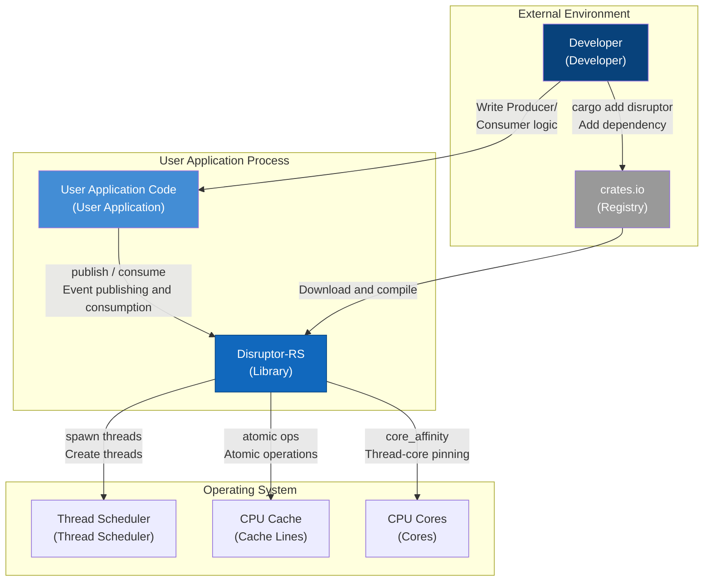
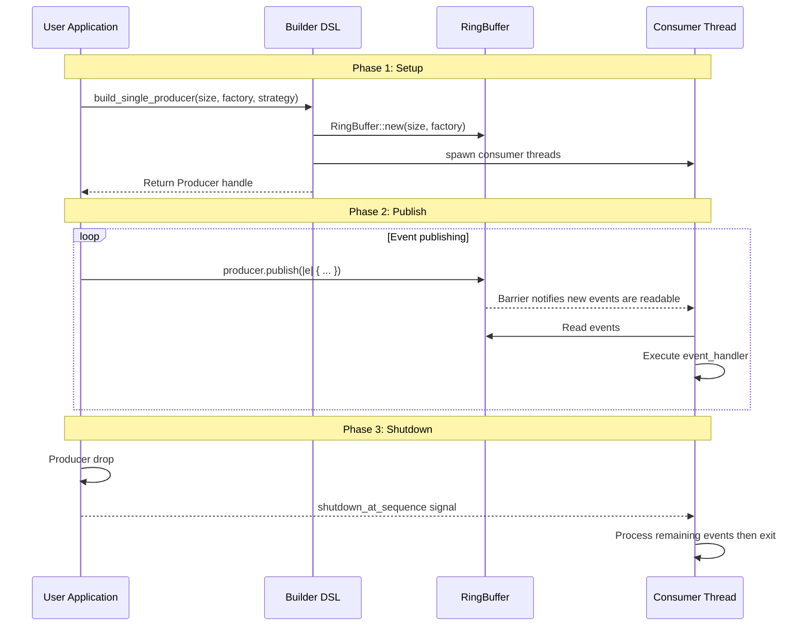
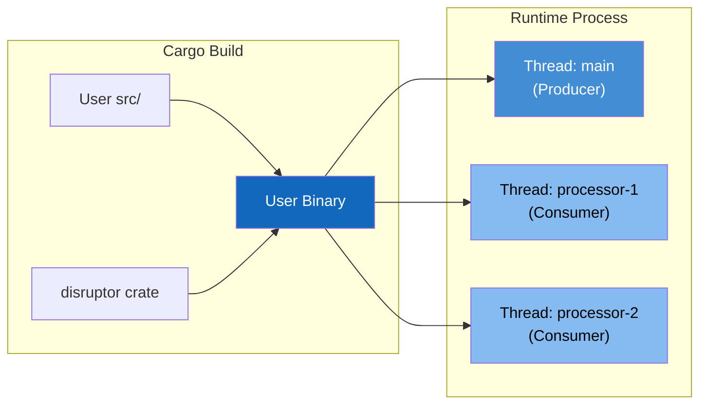

# C1: System Context -- The System Boundary of Disruptor-RS

> **Key takeaway**: Disruptor-RS is a library embedded in user applications and does not communicate directly with external systems.

This document defines the system context of Disruptor-RS.
It answers one question: Where does Disruptor-RS sit within the overall software system?

---

## 1. Context Overview

Disruptor-RS is an **embedded library**.
It is not a standalone service but rather is linked into the user application's process.
All interactions occur between threads within the same operating system process.

---

## 2. System Elements Table

| Element | Type | Responsibility | Tech Stack |
|---------|------|----------------|------------|
| Developer | Person | Write Producer/Consumer logic, configure Disruptor | Rust |
| User Application | Software system | Carrier of business logic, calls Disruptor API | Rust binary/lib |
| Disruptor-RS | Library | Provide low-latency inter-thread communication | Rust crate |
| crates.io | External system | Package registry and distribution | Cargo Registry |
| OS Thread Scheduler | Platform service | Thread creation, scheduling, and context switching | Linux/macOS/Windows |
| CPU Cache | Hardware | L1/L2/L3 cache lines, affects false sharing | x86_64/aarch64 |
| CPU Cores | Hardware | Execute computation, support thread-core pinning | Multi-core processor |

---

## 3. Relationship Table

| Source | Target | Relationship Description | Protocol/Mechanism |
|--------|--------|--------------------------|---------------------|
| Developer | crates.io | Add dependency | `cargo add disruptor` |
| Developer | User Application | Write business logic | Rust source code |
| crates.io | Disruptor-RS | Download and compile | Cargo |
| User Application | Disruptor-RS | Publish and consume events | Rust function call |
| Disruptor-RS | OS Thread Scheduler | Create Consumer threads | `std::thread::spawn` |
| Disruptor-RS | CPU Cache | Atomic read/write of sequence numbers | `AtomicI64` + memory ordering |
| Disruptor-RS | CPU Cores | Pin threads to specific cores | `core_affinity` crate |

---

## 4. Boundary Definition

### 4.1 What Disruptor-RS Is Responsible For

- Pre-allocating the RingBuffer and managing its lifetime
- Coordinating read/write ordering between Producers and Consumers via Sequence/Cursor
- Creating and managing Consumer threads (Push mode)
- Providing the EventPoller API (Pull mode) for user-managed threads
- Eliminating false sharing via `CachePadded`
- Supporting thread-core pinning with `core_affinity`

### 4.2 What Disruptor-RS Is NOT Responsible For

- **Not responsible for** serializing/deserializing event data
- **Not responsible for** network communication or cross-process transport
- **Not responsible for** persistence or event replay
- **Not responsible for** business logic (defined by user closures)
- **Not responsible for** monitoring/metrics collection (users can implement this in their handlers)

---

## 5. Data Flow

The data flow between the user application and Disruptor-RS is divided into three phases:

---

## 6. Deployment View

Disruptor-RS is not deployed independently. It is statically linked into the user's Rust binary.

**Deployment Constraints**:
- Requires Rust Edition 2024, minimum version 1.85
- `core_affinity` thread-core pinning is available on Linux/macOS
- RingBuffer size must be a power of 2

---

## 7. Quality Attributes

| Attribute | Description | Implementation Approach |
|-----------|-------------|------------------------|
| Low latency | Nanosecond-level inter-thread communication | Lock-free design + busy spin + cache padding |
| High throughput | Tens of millions of events per second | Pre-allocation + batch publishing + bitwise AND indexing |
| Zero allocation | No heap allocation during steady-state operation | Pre-allocated RingBuffer + in-place closure updates |
| Thread safety | Compile-time guarantees | Rust ownership system + `Send`/`Sync` bounds |
| Predictability | No GC pauses | Rust's GC-free runtime |

---

## 8. Correspondence with Java LMAX Disruptor

| Java LMAX Disruptor | Disruptor-RS (Current) | Description |
|---------------------|------------------------|-------------|
| `RingBuffer<E>` | `RingBuffer<E>` | Ring buffer |
| `Sequence` | `type Sequence = i64` | Sequence number |
| `SequenceBarrier` | `trait Barrier` | Sequence dependency coordination |
| `SingleProducerSequencer` | `SingleProducerBarrier` + `SingleProducer` | Single producer |
| `MultiProducerSequencer` | `MultiProducerBarrier` + `MultiProducer` | Multi producer |
| `EventHandler<E>` | `FnMut(&E, Sequence, bool)` | Event handler closure |
| `EventPoller<E>` | `EventPoller<E, B>` | Pull-mode consumption |
| `WaitStrategy` | `trait WaitStrategy` | Wait strategy |
| `Disruptor<E>` (DSL) | `SPBuilder` / `MPBuilder` | Builder DSL |

---

## 9. Constraints and Assumptions

**Constraints**:
1. RingBuffer size must be a power of 2 (for bitwise AND indexing)
2. Multi Producer has a minimum RingBuffer size of 64 slots
3. Event type `E` must satisfy `Send + Sync + 'static`
4. Sequence number upper bound is $2^{63} - 1$; behavior is undefined beyond this limit

**Assumptions**:
1. The user application runs on a multi-core CPU
2. Consumer processing speed can keep up with the Producer's publish rate
3. The operating system supports POSIX threads
