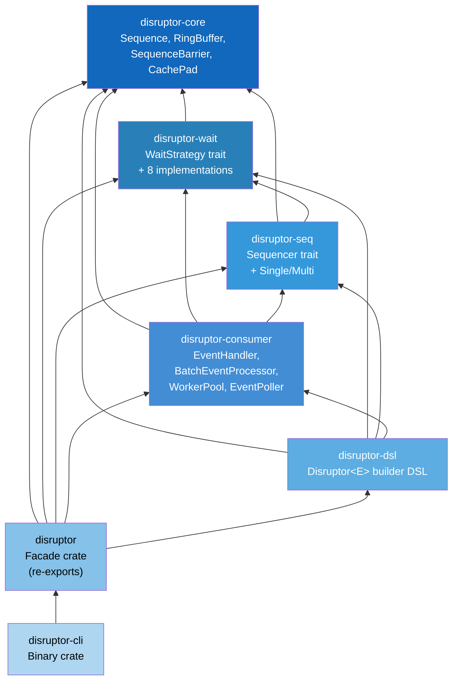
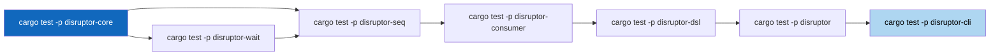

# C2: Container (Crate) -- 7 Crate Workspace Topology

> **Key takeaway**: The 7 crates are layered by dependency direction, with core at the bottom and facade at the top.

This document defines the responsibilities and dependency relationships of the 7 crates in the target workspace.
In the C4 model, a Container corresponds to a crate in the Rust ecosystem.

---

## 1. Crate Dependency Graph

Dependency direction: arrows indicate "depends on". Lower-level crates do not depend on upper-level crates.



---

## 2. Crate Responsibilities Table

| Crate | Layer | Responsibility | Public Types (Core) |
|-------|-------|----------------|---------------------|
| `disruptor-core` | L0 (Foundation) | Define sequence numbers, ring buffer, sequence barrier, and cache line padding | `Sequence`, `RingBuffer<E>`, `SequenceBarrier`, `CachePad<T>` |
| `disruptor-wait` | L1 (Strategy) | Define the wait strategy trait and 8 implementations | `WaitStrategy`, `BusySpin`, `Yielding`, `Sleeping`, `Blocking`, etc. |
| `disruptor-seq` | L1 (Coordination) | Define the Sequencer trait and single/multi producer implementations | `Sequencer`, `SingleSequencer`, `MultiSequencer` |
| `disruptor-consumer` | L2 (Consumption) | Define event handler, batch processor, worker pool, and poller | `EventHandler`, `BatchEventProcessor`, `WorkerPool`, `EventPoller` |
| `disruptor-dsl` | L3 (Building) | Provide a type-safe Builder DSL | `Disruptor<E>`, `EventHandlerGroup`, `Config` |
| `disruptor` | L4 (Facade) | Unified export of all public APIs | (re-exports) |
| `disruptor-cli` | L4 (Tooling) | Command-line benchmarking and diagnostics tool | (binary) |

---

## 3. Dependency Direction Rules

All inter-crate dependencies must follow the unidirectional layering rule:

$$
\text{dep}(A, B) \implies \text{layer}(A) > \text{layer}(B)
$$

Where $\text{layer}$ values are defined as follows:

| Layer Value | Crate |
|-------------|-------|
| 0 | `disruptor-core` |
| 1 | `disruptor-wait`, `disruptor-seq` |
| 2 | `disruptor-consumer` |
| 3 | `disruptor-dsl` |
| 4 | `disruptor`, `disruptor-cli` |

**Prohibited**: Circular dependencies between crates at the same layer are not allowed. Although `disruptor-wait` and `disruptor-seq` are at the same layer, `seq` depends on `wait`, and this direction is fixed.

$$
\text{disruptor-cli} \xrightarrow{\text{dep}} \text{disruptor} \xrightarrow{\text{dep}} \text{disruptor-dsl} \xrightarrow{\text{dep}} \text{disruptor-consumer} \xrightarrow{\text{dep}} \text{disruptor-seq} \xrightarrow{\text{dep}} \text{disruptor-wait} \xrightarrow{\text{dep}} \text{disruptor-core}
$$

---

## 4. Detailed Crate Descriptions

### 4.1 disruptor-core (L0)

**Responsibility**: Provide foundational primitives shared by all crates.

```toml
[package]
name = "disruptor-core"

[dependencies]
# Only depends on std and crossbeam-utils (CachePadded)
crossbeam-utils = "0.8"
```

**Provides**:
- `Sequence`: Sequence number type (currently `type Sequence = i64`, target is a newtype)
- `RingBuffer<E>`: Pre-allocated ring buffer, `Box<[UnsafeCell<E>]>` + power-of-2
- `SequenceBarrier`: Sequence dependency coordination trait
- `CachePad<T>`: Cache line padding wrapper (based on `CachePadded<T>`)

**Does not provide**: Any publish/consume logic.

### 4.2 disruptor-wait (L1)

**Responsibility**: Define the WaitStrategy trait and 8 concrete strategies.

```toml
[dependencies]
disruptor-core = { path = "../disruptor-core" }
```

**Currently implemented (v4.0.0)**:
1. `BusySpin` -- Empty loop, lowest latency
2. `BusySpinWithSpinLoopHint` -- With `hint::spin_loop()`

**Target (v5.0.0) additions**:
3. `Yielding` -- `thread::yield_now()`
4. `Sleeping` -- `thread::sleep(Duration)`
5. `Blocking` -- `Condvar` + `Mutex`
6. `PhasedBackoff` -- Phased backoff
7. `TimeoutBlocking` -- Blocking with timeout
8. `LiteBlocking` -- Lightweight blocking

### 4.3 disruptor-seq (L1)

**Responsibility**: Extract Sequencer logic from Producer into an independent abstraction.

```toml
[dependencies]
disruptor-core = { path = "../disruptor-core" }
disruptor-wait = { path = "../disruptor-wait" }
```

**Provides**:
- `Sequencer` trait: `claim()`, `publish()`, `remaining_capacity()`
- `SingleSequencer`: Single-threaded sequence allocation (no CAS)
- `MultiSequencer`: Multi-threaded sequence allocation (CAS + availability bitmap)

**Mapping from current code**:
| Current (v4.0.0) | Target (v5.0.0) |
|-------------------|------------------|
| `SingleProducerBarrier` | `SingleSequencer` |
| `MultiProducerBarrier` | `MultiSequencer` |
| `ProducerBarrier` trait | `Sequencer` trait |

### 4.4 disruptor-consumer (L2)

**Responsibility**: Define all components for event consumption.

```toml
[dependencies]
disruptor-core = { path = "../disruptor-core" }
disruptor-wait = { path = "../disruptor-wait" }
disruptor-seq  = { path = "../disruptor-seq" }
```

**Provides**:
- `EventHandler<E>` trait: Replaces the current `FnMut(&E, Sequence, bool)` closure
- `BatchEventProcessor<E>`: Batch event processor with managed thread
- `WorkerPool<E>`: Multi-consumer load balancing
- `EventPoller<E>`: Pull-mode consumption API
- `LifecycleAware` trait: `on_start()`, `on_shutdown()`
- `ExceptionHandler` trait: Error handling callback

### 4.5 disruptor-dsl (L3)

**Responsibility**: Provide a type-safe Builder DSL.

```toml
[dependencies]
disruptor-core     = { path = "../disruptor-core" }
disruptor-wait     = { path = "../disruptor-wait" }
disruptor-seq      = { path = "../disruptor-seq" }
disruptor-consumer = { path = "../disruptor-consumer" }
```

**Provides**:
- `Disruptor<E>`: Top-level Builder, replacing the current `SPBuilder` / `MPBuilder`
- `EventHandlerGroup<E>`: Manages the consumer dependency graph
- `Config`: Global configuration (buffer size, wait strategy, affinity, etc.)

### 4.6 disruptor (L4 - Facade)

**Responsibility**: Unified export of all public APIs; users only need to depend on this single crate.

```toml
[dependencies]
disruptor-core     = { path = "../disruptor-core" }
disruptor-wait     = { path = "../disruptor-wait" }
disruptor-seq      = { path = "../disruptor-seq" }
disruptor-consumer = { path = "../disruptor-consumer" }
disruptor-dsl      = { path = "../disruptor-dsl" }
```

**User usage**:

```rust
// Users only need to add a single dependency
use disruptor::*;

let mut producer = Disruptor::new(1024, || Event::default())
    .wait_strategy(BusySpin)
    .handle_events_with(my_handler)
    .build();
```

### 4.7 disruptor-cli (L4 - Binary)

**Responsibility**: Provide command-line tools for benchmarking and diagnostics.

```toml
[dependencies]
disruptor = { path = "../disruptor" }
```

**Features**:
- `disruptor bench` -- Run built-in benchmarks
- `disruptor info` -- Output system information (CPU core count, cache line size)

---

## 5. Mapping from Current to Target

The current v4.0.0 is a single crate. Below is the mapping of source files to target crates:

| Current File | Target Crate | Notes |
|--------------|-------------|-------|
| `src/cursor.rs` | `disruptor-core` | `Cursor` renamed to `Sequence` newtype |
| `src/ringbuffer.rs` | `disruptor-core` | Direct migration |
| `src/barrier.rs` | `disruptor-core` | `Barrier` renamed to `SequenceBarrier` |
| `src/wait_strategies.rs` | `disruptor-wait` | Expanded to 8 strategies |
| `src/producer/single.rs` (Barrier portion) | `disruptor-seq` | Extracted as `SingleSequencer` |
| `src/producer/multi.rs` (Barrier portion) | `disruptor-seq` | Extracted as `MultiSequencer` |
| `src/producer.rs` + implementations | `disruptor-dsl` | Producer handle built by DSL |
| `src/consumer.rs` | `disruptor-consumer` | Extracted as `BatchEventProcessor` |
| `src/consumer/event_poller.rs` | `disruptor-consumer` | Direct migration |
| `src/builder.rs` + submodules | `disruptor-dsl` | Refactored into `Disruptor<E>` builder |
| `src/affinity.rs` | `disruptor-core` | As an optional feature |
| `src/lib.rs` | `disruptor` (facade) | Only re-exports retained |

---

## 6. Workspace Cargo.toml Structure

```toml
[workspace]
resolver = "3"
members = [
    "crates/disruptor-core",
    "crates/disruptor-wait",
    "crates/disruptor-seq",
    "crates/disruptor-consumer",
    "crates/disruptor-dsl",
    "crates/disruptor",
    "crates/disruptor-cli",
]

[workspace.package]
edition      = "2024"
rust-version = "1.85"
license      = "MIT"
repository   = "https://github.com/trunkszi/disruptor-rs"
```

---

## 7. Build and Test Strategy

Each crate is compiled and tested independently. CI executes in dependency order:



Integration tests are placed in the `tests/` directory of the `disruptor` facade crate.
Unit tests are placed within each individual crate.
