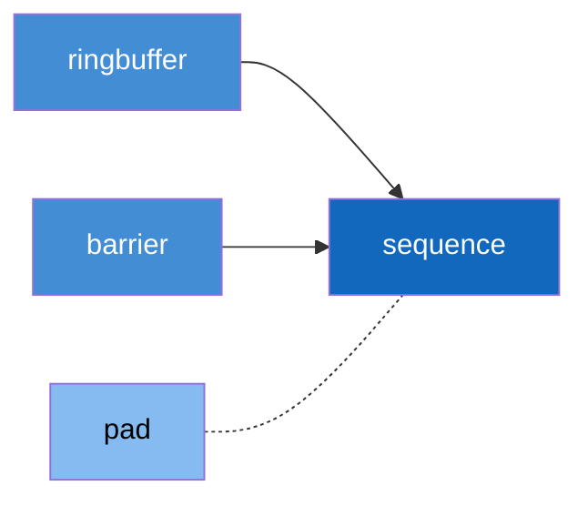
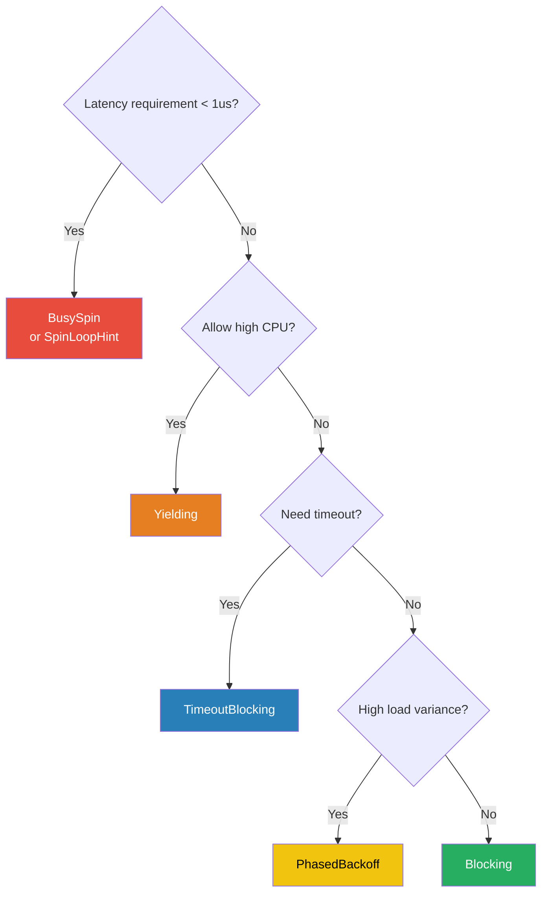
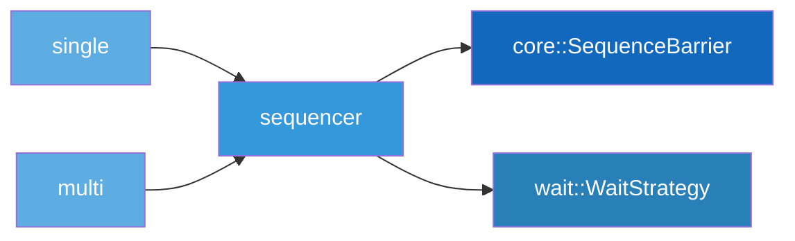
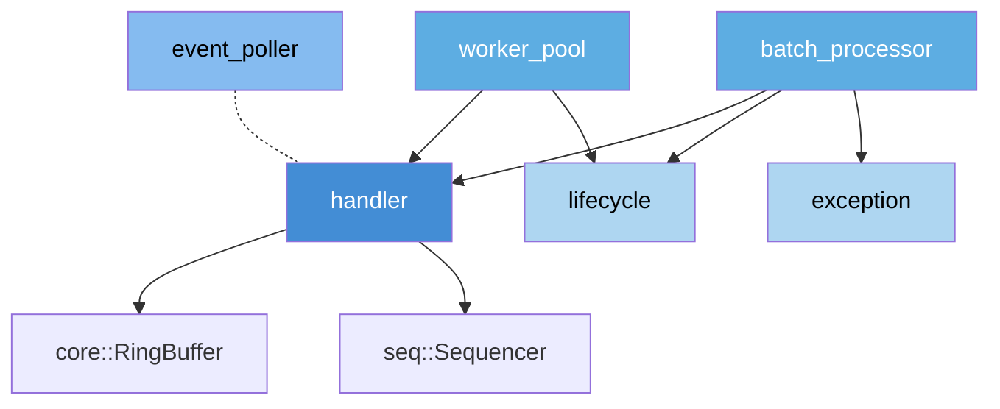
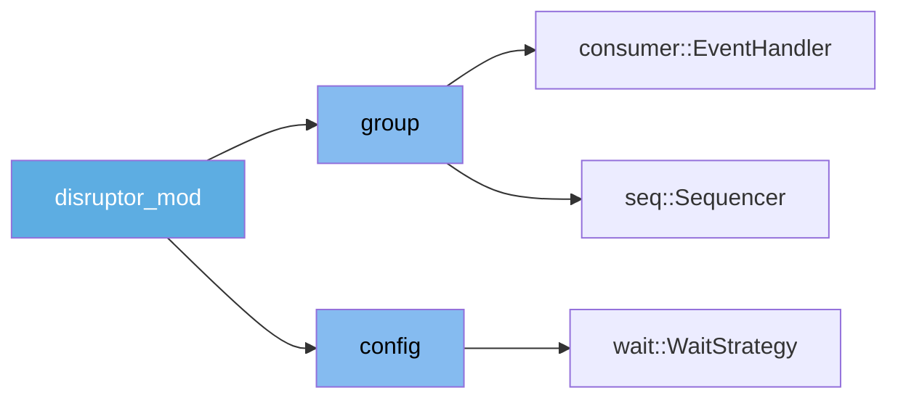

# C3: Component -- Internal Module Breakdown of Each Crate

> **Key takeaway**: Each crate is divided into independent modules by responsibility, exposing trait + struct externally.

This document defines the internal module structure of each crate in the target workspace.
In the C4 model, a Component corresponds to a module in Rust.

---

## 1. Global Module View

```mermaid
graph TB
    subgraph core["disruptor-core"]
        c_seq["sequence<br/>Sequence newtype"]
        c_rb["ringbuffer<br/>RingBuffer&lt;E&gt;"]
        c_bar["barrier<br/>SequenceBarrier trait"]
        c_pad["pad<br/>CachePad&lt;T&gt;"]
    end

    subgraph wait["disruptor-wait"]
        w_trait["strategy<br/>WaitStrategy trait"]
        w_busy["busy_spin<br/>BusySpin"]
        w_yield["yielding<br/>Yielding"]
        w_sleep["sleeping<br/>Sleeping"]
        w_block["blocking<br/>Blocking"]
        w_phased["phased_backoff<br/>PhasedBackoff"]
        w_timeout["timeout_blocking<br/>TimeoutBlocking"]
        w_lite["lite_blocking<br/>LiteBlocking"]
        w_hint["spin_loop_hint<br/>BusySpinWithSpinLoopHint"]
    end

    subgraph seq["disruptor-seq"]
        s_trait["sequencer<br/>Sequencer trait"]
        s_single["single<br/>SingleSequencer"]
        s_multi["multi<br/>MultiSequencer"]
    end

    subgraph consumer["disruptor-consumer"]
        con_handler["handler<br/>EventHandler trait"]
        con_batch["batch_processor<br/>BatchEventProcessor"]
        con_pool["worker_pool<br/>WorkerPool"]
        con_poll["event_poller<br/>EventPoller"]
        con_life["lifecycle<br/>LifecycleAware trait"]
        con_err["exception<br/>ExceptionHandler trait"]
    end

    subgraph dsl["disruptor-dsl"]
        d_disruptor["disruptor<br/>Disruptor&lt;E&gt;"]
        d_group["group<br/>EventHandlerGroup"]
        d_config["config<br/>Config"]
    end

    wait --> core
    seq --> core
    seq --> wait
    consumer --> core
    consumer --> seq
    dsl --> consumer

    style core fill:#1168bd,color:#fff
    style wait fill:#2980b9,color:#fff
    style seq fill:#3498db,color:#fff
    style consumer fill:#438dd5,color:#fff
    style dsl fill:#5dade2,color:#fff
```

---

## 2. disruptor-core Modules

**Responsibility**: Provide foundational primitives shared by all crates. Contains no business logic.

### Module Table

| Module | Public Types | Responsibility |
|--------|-------------|----------------|
| `sequence` | `Sequence` | Sequence number newtype wrapping `i64`, supports arithmetic operations |
| `ringbuffer` | `RingBuffer<E>` | Pre-allocated ring buffer with power-of-2 size |
| `barrier` | `SequenceBarrier` trait | Sequence dependency coordination interface |
| `pad` | `CachePad<T>` | Cache line padding wrapper, eliminates false sharing |

### Module Dependency Graph

### Key Design

`RingBuffer<E>` uses bitwise AND instead of modulo operation for indexing:

$$
\text{index} = \text{sequence} \mathbin{\&} (\text{size} - 1)
$$

This requires `size` to be a power of 2: $\text{size} = 2^n, \; n \in \mathbb{N}^+$

**Correspondence with current implementation**:
- `Cursor` in `src/cursor.rs` will evolve into the `Sequence` newtype
- `src/ringbuffer.rs` migrates directly
- The `Barrier` trait in `src/barrier.rs` is renamed to `SequenceBarrier`

---

## 3. disruptor-wait Modules

**Responsibility**: Define the wait strategy trait and 8 concrete implementations. Consumers call a wait strategy when there are no new events.

### Module Table

| Module | Public Type | Wait Method | Latency | CPU Usage |
|--------|------------|-------------|---------|-----------|
| `strategy` | `WaitStrategy` trait | (Interface definition) | -- | -- |
| `busy_spin` | `BusySpin` | Empty loop | Lowest | Highest |
| `spin_loop_hint` | `BusySpinWithSpinLoopHint` | `hint::spin_loop()` | Very low | High |
| `yielding` | `Yielding` | `thread::yield_now()` | Low | Medium |
| `sleeping` | `Sleeping` | `thread::sleep()` | Medium | Low |
| `blocking` | `Blocking` | `Condvar::wait()` | High | Lowest |
| `phased_backoff` | `PhasedBackoff` | Phased: spin -> yield -> sleep | Variable | Adaptive |
| `timeout_blocking` | `TimeoutBlocking` | `Condvar::wait_timeout()` | High (bounded) | Low |
| `lite_blocking` | `LiteBlocking` | Lightweight park/unpark | Medium | Low |

### Strategy Selection Guide

**Correspondence with current implementation**:
- `BusySpin` and `BusySpinWithSpinLoopHint` already exist in `src/wait_strategies.rs`
- The remaining 6 strategies are new additions for the target architecture

---

## 4. disruptor-seq Modules

**Responsibility**: Extract Sequencer logic from Producer into an independent abstraction. The Sequencer is responsible for sequence number allocation and publishing.

### Module Table

| Module | Public Type | Responsibility |
|--------|------------|----------------|
| `sequencer` | `Sequencer` trait | Define the sequence number claim/publish interface |
| `single` | `SingleSequencer` | Single-threaded sequence allocation, no CAS contention |
| `multi` | `MultiSequencer` | Multi-threaded sequence allocation, CAS + availability bitmap |

### Module Dependency Graph

### SingleSequencer vs MultiSequencer

| Feature | SingleSequencer | MultiSequencer |
|---------|----------------|----------------|
| Thread safety | Single-threaded (no CAS) | Multi-threaded (CAS) |
| Sequence allocation | Incrementing counter | `compare_exchange` loop |
| Publishing mechanism | `Ordering::Release` store | Availability bitmap XOR |
| Minimum buffer size | 2 | 64 |
| Throughput | Higher | Lower (CAS contention) |

**Correspondence with current implementation**:
- `SingleProducerBarrier` (in `src/producer/single.rs`) will become `SingleSequencer`
- `MultiProducerBarrier` (in `src/producer/multi.rs`) will become `MultiSequencer`
- `ProducerBarrier` trait will become `Sequencer` trait

---

## 5. disruptor-consumer Modules

**Responsibility**: Define all components for event consumption. Consumers read and process events from the RingBuffer.

### Module Table

| Module | Public Type | Responsibility |
|--------|------------|----------------|
| `handler` | `EventHandler<E>` trait | Event processing callback interface |
| `batch_processor` | `BatchEventProcessor<E>` | Batch event processor with managed thread |
| `worker_pool` | `WorkerPool<E>` | Multi-consumer load balancing (each event processed by only one worker) |
| `event_poller` | `EventPoller<E>`, `EventGuard<E>` | Pull-mode consumption API |
| `lifecycle` | `LifecycleAware` trait | Lifecycle callbacks: `on_start()`, `on_shutdown()` |
| `exception` | `ExceptionHandler` trait | Error handling: `on_event_error()`, `on_start_error()` |

### Module Dependency Graph

### Key Distinctions

- **BatchEventProcessor**: Broadcast mode -- each handler reads all events
- **WorkerPool**: Load balancing mode -- each event is processed by only one worker
- **EventPoller**: Pull mode -- the user controls the thread

**Correspondence with current implementation**: `start_processor` -> `BatchEventProcessor`; `event_poller.rs` migrates directly; `WorkerPool` is a new addition

---

## 6. disruptor-dsl Modules

**Responsibility**: Provide a type-safe Builder DSL that hides internal implementation details from the user.

### Module Table

| Module | Public Type | Responsibility |
|--------|------------|----------------|
| `disruptor` | `Disruptor<E>` | Top-level builder, constructs a complete Disruptor instance |
| `group` | `EventHandlerGroup<E>` | Manages the consumer dependency graph and execution order |
| `config` | `Config` | Global configuration: buffer size, WaitStrategy, affinity |

### Module Dependency Graph

### Mapping from Current Builder to Target DSL

| Current (v4.0.0) | Target (v5.0.0) |
|-------------------|------------------|
| `build_single_producer()` | `Disruptor::single_producer()` |
| `build_multi_producer()` | `Disruptor::multi_producer()` |
| `SPBuilder` / `MPBuilder` | `Disruptor<E>` (unified builder) |
| `.and_then()` | `.then()` |
| `.build()` | `.start()` |

---

## 7. Module Count Summary

| Crate | Module Count | Trait Count | Struct Count |
|-------|-------------|-------------|--------------|
| `disruptor-core` | 4 | 1 | 3 |
| `disruptor-wait` | 9 | 1 | 8 |
| `disruptor-seq` | 3 | 1 | 2 |
| `disruptor-consumer` | 6 | 3 | 3 |
| `disruptor-dsl` | 3 | 0 | 3 |
| **Total** | **25** | **6** | **19** |
