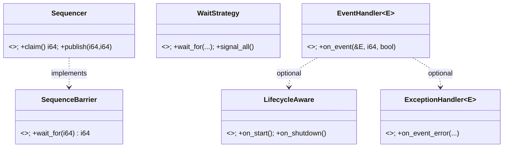
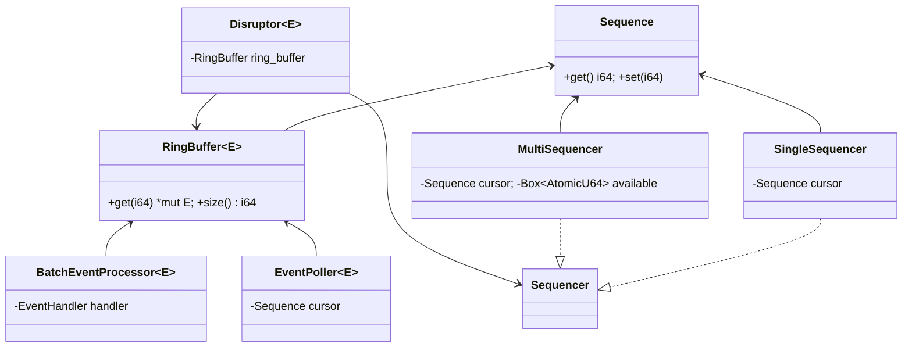

# C4: Code -- Core Type Signatures and Trait Hierarchy

> **Key takeaway**: 6 core traits + key structs form the type skeleton of Disruptor-RS.

This document defines the core type signatures, trait hierarchy, and key methods in the target architecture.
In the C4 model, the Code layer shows design decisions at the actual code level.

---

## 1. Trait Hierarchy Overview



---

## 2. disruptor-core Types

### 2.1 Sequence

The sequence number is the core coordination primitive of the Disruptor.
The target architecture promotes the current `type Sequence = i64` to a newtype:

```rust
/// Cache-line-padded atomic sequence number.
/// Eliminates false sharing between adjacent Sequences.
pub struct Sequence(CachePadded<AtomicI64>);

impl Sequence {
    /// Create a Sequence with initial value -1 (unpublished).
    pub fn new() -> Self;

    /// Store the sequence number with Release semantics.
    pub fn set(&self, value: i64);

    /// Load the sequence number with Relaxed semantics.
    pub fn get(&self) -> i64;

    /// CAS operation, used for lock-free claim in MultiSequencer.
    pub fn compare_and_set(&self, expected: i64, new: i64) -> Result<i64, i64>;
}
```

**Correspondence with current implementation**: The `Cursor` struct in `src/cursor.rs`. Memory layout: 8-byte `AtomicI64` + 56-byte padding = 1 cache line (64 bytes).

### 2.2 RingBuffer\<E\>

Pre-allocated ring buffer, initialized at construction time, zero allocation at runtime.

```rust
pub struct RingBuffer<E> {
    entries: Box<[UnsafeCell<E>]>,  // Pre-allocated event slots
    mask: i64,                       // Bitwise AND mask
}
unsafe impl<E> Sync for RingBuffer<E> {}

impl<E> RingBuffer<E> {
    pub fn new<F: FnMut() -> E>(size: usize, factory: F) -> Self;
    pub fn get(&self, sequence: i64) -> *mut E;
    pub fn size(&self) -> i64;
}
```

Indexing formula: $\text{index}(s) = s \mathbin{\&} (2^n - 1)$, where $\text{size} = 2^n$.

**Correspondence with current implementation**: `src/ringbuffer.rs`.

### 2.3 SequenceBarrier

The sequence dependency coordination interface. Consumers wait for new readable events through the barrier.

```rust
/// Sequence dependency coordination trait.
/// Both producers and consumers can serve as barrier sources.
pub trait SequenceBarrier: Send + Sync {
    /// Wait for `sequence` to become readable, returning the highest currently available sequence number.
    /// A return value >= sequence means the range [sequence, return_value] is readable.
    fn wait_for(&self, sequence: i64) -> i64;
}
```

**Correspondence with current implementation**: The `Barrier` trait in `src/barrier.rs`, with method `get_after()`.

**Target change**: The method evolves from `get_after()` (non-blocking poll) to `wait_for()` (can block in cooperation with WaitStrategy).

---

## 3. disruptor-seq Types

### 3.1 Sequencer trait

```rust
pub trait Sequencer: Send + Sync {
    fn claim(&self) -> i64;                       // Claim the next writable sequence number
    fn claim_batch(&self, n: usize) -> i64;       // Batch claim
    fn publish(&self, lo: i64, hi: i64);          // Publish the range [lo, hi]
    fn remaining_capacity(&self) -> i64;
    fn is_available(&self, sequence: i64) -> bool;
    fn highest_published(&self, lo: i64, hi: i64) -> i64;
}
```

### 3.2 SingleSequencer

```rust
/// Single-producer Sequencer. No CAS contention, optimal performance.
pub struct SingleSequencer {
    next_value: Sequence,       // Next sequence number to allocate
    cached_gate: i64,           // Cached slowest consumer position
    cursor: Sequence,           // Producer cursor
    gate_barriers: Vec<Arc<Sequence>>,
    buffer_size: i64,
    wait_strategy: Box<dyn WaitStrategy>,
}
```

### 3.3 MultiSequencer

```rust
/// Multi-producer Sequencer. Allocates sequence numbers via CAS.
pub struct MultiSequencer {
    cursor: Sequence,             // CAS-incremented global cursor
    available: Box<[AtomicU64]>,  // Availability bitmap
    index_mask: usize,
    index_shift: usize,           // log2(size)
    gate_barriers: Vec<Arc<Sequence>>,
    buffer_size: i64,
    wait_strategy: Box<dyn WaitStrategy>,
}
```

**Availability bitmap**: Each bit encodes the odd/even round publish state. Publishing flips the bit via XOR:

$$
\text{flag}(s) = \left\lfloor \frac{s}{2^n} \right\rfloor \bmod 2
$$

---

## 4. disruptor-wait Types

### 4.1 WaitStrategy trait

```rust
/// Wait strategy trait. Called by consumers when there are no new events.
/// Must be Copy + Send + Sync, allowing zero-cost copying across threads.
pub trait WaitStrategy: Send + Sync + Copy {
    /// Wait for `sequence` to become readable.
    /// `cursor`: Producer cursor.
    /// `dependents`: Upstream consumer sequence numbers.
    /// `barrier`: SequenceBarrier reference.
    fn wait_for(
        &self,
        sequence: i64,
        cursor: &Sequence,
        dependents: &[&Sequence],
        barrier: &dyn SequenceBarrier,
    ) -> i64;

    /// Notify all waiters (used by Blocking-type strategies).
    fn signal_all(&self);
}
```

**Correspondence with current implementation**: The `WaitStrategy` trait in `src/wait_strategies.rs`.
The current interface is simpler: `fn wait_for(&self, sequence: Sequence)`.
The target architecture adds `cursor`/`dependents`/`barrier` parameters to support blocking strategies.

---

## 5. disruptor-consumer Types

### 5.1 EventHandler trait

```rust
/// Event handler trait. Replaces the current FnMut closure.
pub trait EventHandler<E>: Send {
    /// Process a single event.
    ///
    /// - `event`: Event reference from the RingBuffer
    /// - `sequence`: The event's sequence number
    /// - `end_of_batch`: Whether the current batch has ended
    fn on_event(&mut self, event: &E, sequence: i64, end_of_batch: bool);

    /// Optional: Callback at the start of a batch. Default is no-op.
    fn on_batch_start(&mut self, _batch_size: i64) {}

    /// Optional: Timeout callback (used with TimeoutBlocking strategy).
    fn on_timeout(&mut self, _sequence: i64) {}
}
```

**Correspondence with current implementation**: The `FnMut(&E, Sequence, bool)` closure parameter.

### 5.2 LifecycleAware and ExceptionHandler

```rust
pub trait LifecycleAware {
    fn on_start(&mut self);
    fn on_shutdown(&mut self);
}

pub trait ExceptionHandler<E> {
    fn on_event_error(&mut self, error: Box<dyn std::error::Error>, sequence: i64, event: &E);
    fn on_start_error(&mut self, error: Box<dyn std::error::Error>);
    fn on_shutdown_error(&mut self, error: Box<dyn std::error::Error>);
}
```

### 5.3 EventPoller and EventGuard

```rust
pub struct EventPoller<E> {
    ring_buffer: Arc<RingBuffer<E>>,
    sequencer: Arc<dyn Sequencer>,
    sequence: Sequence,
}

/// RAII guard. Notifies the Disruptor that consumption is complete on Drop.
pub struct EventGuard<'a, E> {
    poller: &'a mut EventPoller<E>,
    sequence: i64,
    available: i64,
}

impl<E> EventPoller<E> {
    pub fn poll(&mut self) -> Result<EventGuard<'_, E>, Polling>;
    pub fn take(&mut self, limit: u64) -> Result<EventGuard<'_, E>, Polling>;
    pub fn has_available(&self) -> bool;
}
```

---

## 6. Type Relationship Diagram



---

## 7. Memory Ordering Conventions

The correctness of Disruptor-RS depends on precise memory ordering. The following table shows the ordering used for each operation:

| Operation | Ordering | Reason |
|-----------|----------|--------|
| Producer publishes sequence number | `Release` | Ensures event writes are visible to Consumers |
| Consumer reads barrier | `Relaxed` + subsequent `Acquire` fence | Separates polling from synchronization to reduce overhead |
| Consumer updates cursor | `Release` | Notifies downstream Consumers/Producers |
| MultiSequencer CAS | `AcqRel` / `Relaxed` | Success path requires Acquire+Release |
| Shutdown signal | `Relaxed` | Eventual consistency is sufficient; immediate visibility is not required |

**Publish-consume happens-before chain**:

$$
\text{Producer write}(e) \xrightarrow{\text{Release}} \text{cursor.store}(s) \xrightarrow{\text{fence(Acquire)}} \text{Consumer read}(e)
$$

---

## 8. Generic Constraints Summary

| Type Parameter | Constraint | Reason |
|----------------|-----------|--------|
| `E` (Event) | `Send + Sync + 'static` | Events in the RingBuffer are shared across threads |
| `W` (WaitStrategy) | `Copy + Send` | Copied to each Consumer thread |
| `EH` (EventHandler) | `Send + 'static` | Moved to a Consumer thread for execution |
| `F` (Factory) | `FnMut() -> E` | Initializes RingBuffer slots at construction time |
| `B` (Barrier) | `Send + Sync + 'static` | Dependency barrier shared across threads |
