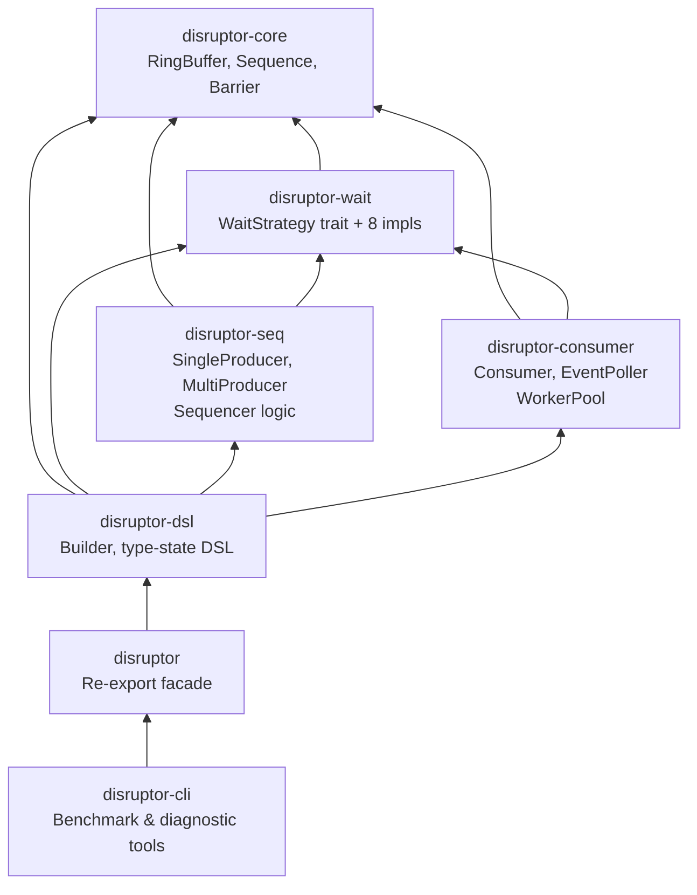

# ADR-0001: Split Monolithic Crate into 7-Crate Workspace

> **Key Takeaway**: Split the current monolithic `disruptor` crate into 7 workspace members, enabling independent version management, parallel compilation, and selective dependencies, at the cost of increased cross-crate boundary complexity.

## Status

Proposed

## Date

2026-04-03

## Context

Currently disruptor-rs is a monolithic crate with all modules packaged in a single `disruptor` package:

```
disruptor/
  src/
    lib.rs
    cursor.rs
    ringbuffer.rs
    barrier.rs
    consumer.rs
    producer.rs
    producer/single.rs
    producer/multi.rs
    wait_strategies.rs
    builder.rs
    builder/single.rs
    builder/multi.rs
    affinity.rs
    consumer/event_poller.rs
```

This introduces the following problems:

1. **Version coupling**: Modifying the `WaitStrategy` implementation requires publishing a new version of the entire crate, even if the core data structures are unchanged
2. **Compile time**: Modifying `builder.rs` triggers recompilation of the entire crate, including unrelated `wait_strategies.rs`
3. **Dependency granularity**: Users must depend on the entire crate, even if they only need the core ring buffer
4. **Test isolation**: Cannot independently test the `cursor` module without compiling the `producer` module
5. **Feature gating**: Nightly-only features (such as `portable_simd`) cannot be isolated to a specific crate

As v5 plans to add 6 new WaitStrategy implementations, WorkerPool, and CLI tools, the scalability bottleneck of the monolithic structure will become more pronounced.

## Decision

Split the `disruptor` crate into the following 7 workspace members:



### Workspace Structure

```toml
# Root Cargo.toml
[workspace]
resolver = "3"
members = [
    "crates/disruptor-core",
    "crates/disruptor-wait",
    "crates/disruptor-seq",
    "crates/disruptor-consumer",
    "crates/disruptor-dsl",
    "crates/disruptor",
    "crates/disruptor-cli",
]
```

### Crate Responsibilities

| Crate | Contents | Public API | Version Strategy |
|---|---|---|---|
| `disruptor-core` | `RingBuffer`, `Sequence` (formerly `Cursor`), `Barrier` trait, `CachePadded` re-export | Minimal core types | Rarely changes, stable |
| `disruptor-wait` | `WaitStrategy` trait + 8 implementations | `BusySpin`, `Yielding`, `Sleeping`, `Blocking`, etc. | Increment minor when adding strategies |
| `disruptor-seq` | `SingleProducerSequencer`, `MultiProducerSequencer`, `ProducerBarrier` | Sequencer logic | Increment when core algorithm changes |
| `disruptor-consumer` | `Consumer`, `EventPoller`, `EventGuard`, `WorkerPool` (new) | Consumer API | Increment when adding consumption patterns |
| `disruptor-dsl` | Builder type-state machine, `ProcessorSettings` | `build_single_producer()`, `build_multi_producer()` | Increment when DSL changes |
| `disruptor` | Facade crate, re-exports all public types | User-facing unified entry point | Follows `disruptor-dsl` |
| `disruptor-cli` | Benchmark runner, latency histogram tool | CLI binary | Iterates independently |

### Cross-Crate Boundary Design

Key issue: `RingBuffer::get()` returns `*mut E`, which can only be used crate-internally (`pub(crate)`). After splitting, it needs to be promoted to `pub` or exposed through a trait.

Solution: Introduce the `SlotAccess` trait in `disruptor-core`:

```rust
// disruptor-core/src/lib.rs
pub trait SlotAccess<E> {
    /// Get a pointer to the slot corresponding to the sequence.
    /// Callers must ensure aliasing rules are not violated.
    fn get(&self, sequence: Sequence) -> *mut E;
    fn size(&self) -> i64;
}
```

## Consequences

### Positive Consequences

- **Independent version management**: Adding `YieldingWaitStrategy` to `disruptor-wait` only requires publishing `disruptor-wait` 0.2.0, without affecting `disruptor-core`
- **Parallel compilation**: `cargo build -j` can compile crates with no dependency relationship in parallel
- **Selective dependencies**: Advanced users can depend on only `disruptor-core` + `disruptor-seq`, without pulling in the DSL
- **Test isolation**: `cargo test -p disruptor-core` only compiles and tests the core module
- **Feature isolation**: Nightly-only features are confined to `disruptor-seq` (SIMD) or `disruptor-wait` (allocator_api)

### Negative Consequences

- **Cross-crate complexity**: `pub(crate)` visibility no longer applies, requiring redesign of internal API boundaries
- **Release coordination**: Multi-crate releases need tool support (`cargo-release` or `cargo-workspaces`)
- **Orphan rule constraints**: Cannot implement a `disruptor-wait` trait for a `disruptor-core` type in `disruptor-consumer`
- **Documentation fragmentation**: `docs.rs` will generate separate pages for each crate

### Neutral Consequences

- The facade crate `disruptor` is transparent to end users -- they continue to `use disruptor::*`
- CI matrix needs per-crate test steps added

## Alternatives Considered

| Alternative | Description | Reason for Rejection |
|---|---|---|
| Keep monolithic | Do not split, continue using `mod` structure | Cannot solve version coupling and compile time issues |
| 2-crate split | `disruptor-core` + `disruptor` | Insufficient granularity, `disruptor` is still too large |
| Feature flag alternative | Use Cargo features to gate modules | Features are additive and cannot reduce compile scope |
| Git submodule | Each component as a separate repo | Terrible developer experience, PRs require cross-repo coordination |

## References

- Cargo workspaces: https://doc.rust-lang.org/cargo/reference/workspaces.html
- `cargo-release`: https://github.com/crate-ci/cargo-release
- Tokio workspace structure reference: https://github.com/tokio-rs/tokio
