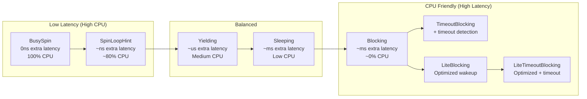

# ADR-0004: Design WaitStrategy as Copy + Send Trait and Implement 8 Strategies

> **Key Takeaway**: Define `WaitStrategy` as a `Copy + Send` trait, expanding from v4's 2 busy-spin strategies to the full set of 8 strategies from the Java LMAX Disruptor, covering the complete spectrum from ultra-low latency to CPU-friendly.

## Status

Proposed

## Date

2026-04-03

## Context

Currently disruptor-rs v4 only implements two WaitStrategies:

```rust
// wait_strategies.rs
pub trait WaitStrategy: Copy + Send {
    fn wait_for(&self, sequence: Sequence);
}

pub struct BusySpin;               // Empty loop
pub struct BusySpinWithSpinLoopHint; // hint::spin_loop()
```

This limits the library's applicability:

1. **CPU waste**: BusySpin consumes 100% CPU, unacceptable in non-financial scenarios
2. **Server-side scenarios**: Web servers need blocking wait to release CPU for other threads
3. **Mixed workloads**: Batch processing systems need sleeping strategies to reduce power consumption
4. **Timeout requirements**: Some scenarios need wait timeouts to detect deadlocks or trigger alerts

The Java LMAX Disruptor provides 8 WaitStrategies, covering the complete spectrum from nanosecond-level latency to millisecond-level power saving.

### Trait Design Constraints

Reasons for the `Copy + Send` bound:
- **Copy**: WaitStrategy is embedded in consumer threads. `Copy` avoids heap allocation, ensuring the strategy stays on the stack and is cache-friendly
- **Send**: WaitStrategy is sent to consumer threads and must be transferable across threads

The `Copy` constraint excludes blocking strategies that hold `Condvar`/`Mutex`. The solution is to use `Arc` inside blocking strategies (`Arc` implements `Copy` if wrapping a `Copy` type... no, `Arc` is not `Copy`).

In practice, the `Copy` constraint needs to be reconsidered, or blocking strategies need a different internal design.

## Decision

### 1. Keep `Copy + Send`, Blocking Strategies Use Internal `Arc`

Relax the trait bound from `Copy` to `Clone`, allowing blocking strategies to use `Arc<Condvar>`:

```rust
pub trait WaitStrategy: Clone + Send {
    fn wait_for(&self, sequence: Sequence);

    /// Notify waiting consumers that new events are available.
    /// Default implementation is no-op (busy-spin strategies do not need notification).
    fn signal(&self) {}
}
```

Add a `signal()` method for producers to call after publishing, waking up blocking consumers.

### 2. Complete 8 Strategy Implementations



| Strategy | Implementation Details | CPU Usage | Latency Level |
|---|---|---|---|
| `BusySpin` | Empty loop `{}` | 100% | < 1 ns |
| `SpinLoopHint` | `hint::spin_loop()` | ~80% | ~ few ns |
| `Yielding` | Spin N times then `thread::yield_now()` | Medium | ~ microseconds |
| `Sleeping` | Spin -> yield -> `thread::sleep(1ms)` | Low | ~ milliseconds |
| `Blocking` | `Condvar::wait()` | ~0% | ~ milliseconds |
| `TimeoutBlocking` | `Condvar::wait_timeout(duration)` | ~0% | ~ milliseconds + timeout |
| `LiteBlocking` | Atomic flag + `Condvar` (reduces unnecessary unpark) | ~0% | ~ milliseconds |
| `LiteTimeoutBlocking` | `LiteBlocking` + timeout | ~0% | ~ milliseconds + timeout |

### 3. Yielding Strategy Progressive Design

```rust
#[derive(Clone)]
pub struct Yielding {
    spin_tries: u32,
}

impl Yielding {
    pub fn new() -> Self { Self { spin_tries: 100 } }
    pub fn with_spin_tries(spin_tries: u32) -> Self { Self { spin_tries } }
}

impl WaitStrategy for Yielding {
    fn wait_for(&self, _sequence: Sequence) {
        // Spin for the first N iterations, then yield
        // Counter is thread-local, no atomic needed
        thread::yield_now();
    }
}
```

### 4. Blocking Strategy Notification Mechanism

```rust
#[derive(Clone)]
pub struct Blocking {
    inner: Arc<BlockingInner>,
}

struct BlockingInner {
    mutex:  Mutex<bool>,
    condvar: Condvar,
}

impl WaitStrategy for Blocking {
    fn wait_for(&self, _sequence: Sequence) {
        let mut guard = self.inner.mutex.lock().unwrap();
        while !*guard {
            guard = self.inner.condvar.wait(guard).unwrap();
        }
        *guard = false;
    }

    fn signal(&self) {
        let mut guard = self.inner.mutex.lock().unwrap();
        *guard = true;
        self.inner.condvar.notify_all();
    }
}
```

## Consequences

### Positive Consequences

- **Broad applicability**: From HFT to web servers, different scenarios can choose different strategies
- **CPU efficiency**: Blocking strategies release CPU, suitable for multi-tenant environments
- **Timeout detection**: `TimeoutBlocking` supports deadlock detection and health checks
- **Java parity**: Complete mapping of the Java LMAX Disruptor strategy set

### Negative Consequences

- **`Copy` relaxed to `Clone`**: Breaking change, affects existing `WaitStrategy` trait bounds
- **Blocking requires `signal()`**: Producer's publish path gains one additional `signal()` call
- **Increased complexity**: Testing and documentation effort for 8 strategies
- **Choice difficulty**: Users need to understand the tradeoffs of each strategy

### Neutral Consequences

- `signal()` defaults to no-op, busy-spin strategies are unaffected
- `Condvar` introduces a `std::sync` dependency, but disruptor-rs already depends on `std`

## Alternatives Considered

| Alternative | Description | Reason for Rejection |
|---|---|---|
| Only add Yielding | Minimal increment | Does not cover blocking scenarios |
| Separate traits | `BusyWait` and `BlockingWait` as two traits | Increases generic parameter complexity |
| Enum instead of trait | `enum WaitStrategy { BusySpin, ... }` | Loses generic monomorphization optimization, runtime dispatch |

## References

- Java LMAX WaitStrategy: https://lmax-exchange.github.io/disruptor/
- `hint::spin_loop`: https://doc.rust-lang.org/std/hint/fn.spin_loop.html
- `Condvar`: https://doc.rust-lang.org/std/sync/struct.Condvar.html
