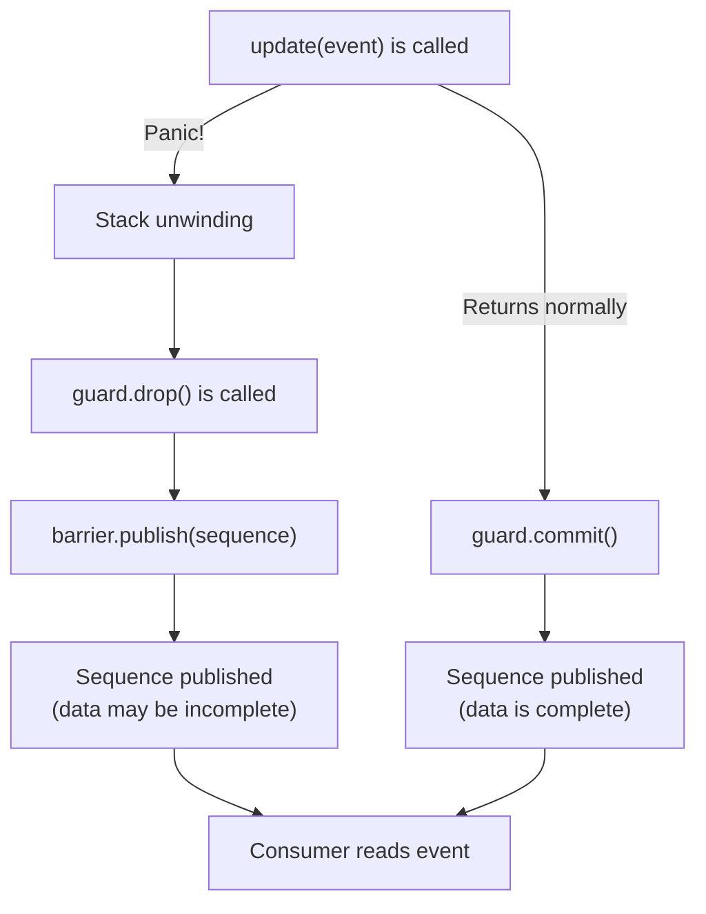
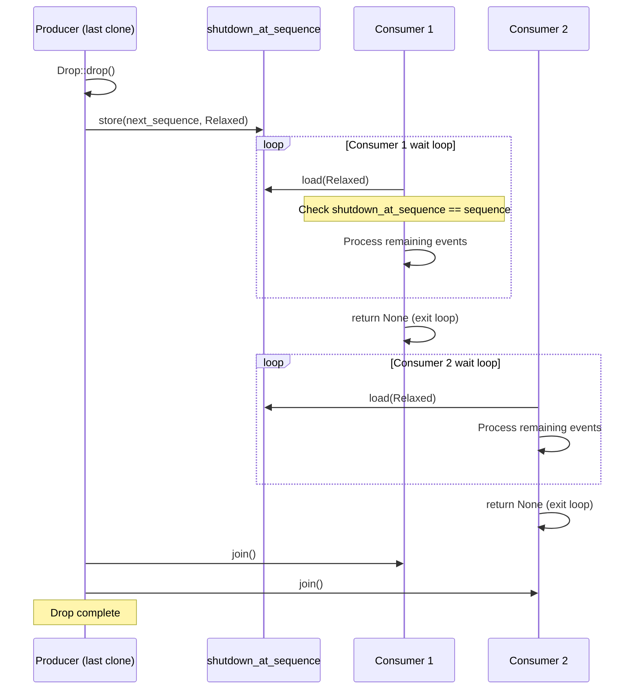
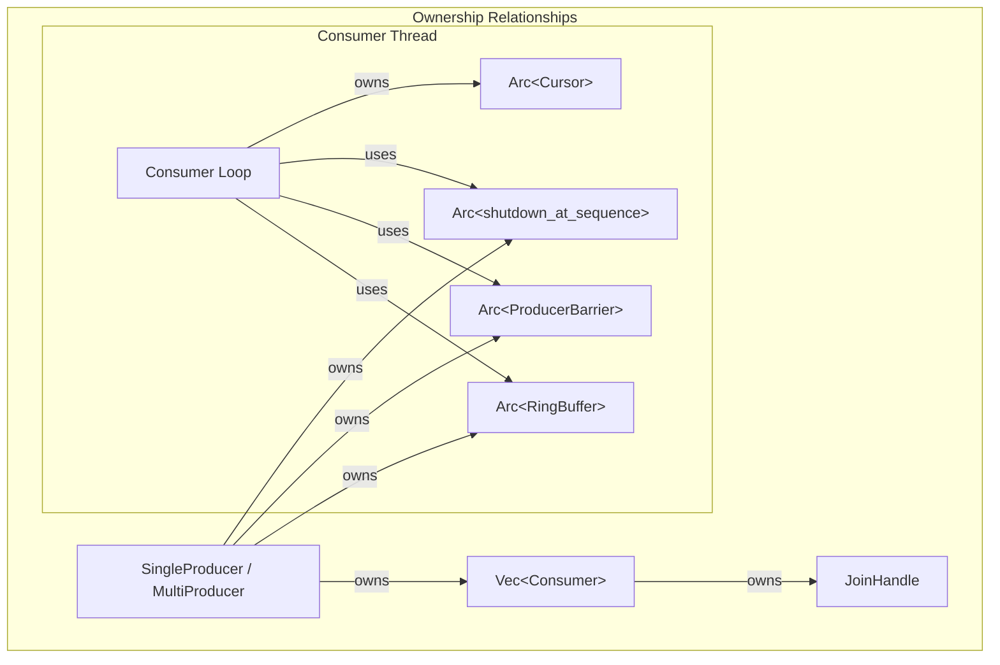

# Error Handling, Panic Safety, and Lifecycle Management

> **Key takeaway**: The RAII publish guard is the safety cornerstone of the Disruptor -- it prevents panics from creating sequence holes that would deadlock the entire system. Lifecycle management achieves zero-coordination shutdown through the `Drop` trait and the `shutdown_at_sequence` atomic signal.

- `PublishGuard` / `SinglePublishGuard` force-publish in Drop, preventing sequence holes
- Only two error types: `RingBufferFull` (single event) and `MissingFreeSlots` (batch)
- Shutdown proceeds via producer Drop -> `shutdown_at_sequence` store -> consumer poll and exit
- MultiProducer reference counting ensures shutdown is triggered only when the last clone is dropped

---

## 1. Error Classification

### 1.1 Publish Errors

| Error Type | Trigger Condition | Source Method | Information |
|-----------|------------------|--------------|-------------|
| `RingBufferFull` | No free slots in the ring buffer | `try_publish` | No additional data |
| `MissingFreeSlots(u64)` | Insufficient free slots for batch publish | `try_batch_publish` | Number of missing slots |

```rust
#[derive(Debug, Error, PartialEq)]
#[error("Ring Buffer is full.")]
pub struct RingBufferFull;

#[derive(Debug, Error, PartialEq)]
#[error("Missing free slots in Ring Buffer: {0}")]
pub struct MissingFreeSlots(pub u64);
```

### 1.2 Polling States

| State | Meaning | Source Method |
|-------|---------|--------------|
| `Polling::NoEvents` | No events currently available | `EventPoller::poll`, `take` |
| `Polling::Shutdown` | The Disruptor has shut down | `EventPoller::poll`, `take` |

```rust
#[derive(Debug, Error, PartialEq)]
pub enum Polling {
    #[error("No available events.")]
    NoEvents,
    #[error("Disruptor is shut down.")]
    Shutdown,
}
```

### 1.3 Error Handling Strategy

```mermaid
flowchart TD
    A["try_publish / try_batch_publish"] -->|Ok| B["Publish succeeded"]
    A -->|Err(RingBufferFull)| C{"Application-level decision"}
    A -->|Err(MissingFreeSlots)| C
    C -->|"Critical system"| D["Panic / safe shutdown"]
    C -->|"Droppable data"| E["Discard event"]
    C -->|"Can wait"| F["Retry (i.e., publish semantics)"]
```

`publish` and `batch_publish` are spin-loop wrappers around the `try_` variants:

```rust
fn publish<F>(&mut self, update: F) {
    while self.next_sequences(1).is_err() { /* Empty. */ }
    self.apply_update(update);
}
```

The source code comments explicitly state: `RingBufferFull` indicates that consumers cannot keep up with the producer -- in latency-sensitive systems, the correct approach is often to panic and perform a safe shutdown (e.g., cancel all orders), rather than silently waiting.

---

## 2. RAII Publish Guard

### 2.1 Problem: Sequence Holes

Consider the following scenario (without a guard):

```
1. Producer claims sequence 5
2. Producer panics while writing event data
3. Sequence 5 is never published
4. Consumer waits for sequence 5 -> permanently blocked
5. Subsequent producer waits for consumer to advance -> permanently blocked
6. The entire Disruptor deadlocks
```

This is a **critical severity** bug -- a single event handler panic causes the entire system to irrecoverably deadlock.

### 2.2 SinglePublishGuard

```rust
struct SinglePublishGuard<'a> {
    barrier:   &'a SingleProducerBarrier,
    sequence:  Sequence,
    committed: bool,
}
```

**Normal path**: `commit()` proactively publishes and sets `committed = true`.

```rust
impl SinglePublishGuard<'_> {
    fn commit(mut self) {
        self.barrier.publish(self.sequence);
        self.committed = true;
    }
}
```

**Panic path**: `Drop` checks `committed`; if false, it force-publishes.

```rust
impl Drop for SinglePublishGuard<'_> {
    fn drop(&mut self) {
        if !self.committed {
            self.barrier.publish(self.sequence);
        }
    }
}
```

### 2.3 MultiProducer's PublishGuard

The MultiProducer guard is more complex because it needs to handle both single and batch cases:

```rust
struct PublishGuard<'a> {
    barrier:   &'a MultiProducerBarrier,
    lower:     Sequence,
    count:     i64,
    committed: bool,
}
```

**Single event construction**:

```rust
fn single(barrier: &'a MultiProducerBarrier, sequence: Sequence) -> Self {
    Self { barrier, lower: sequence, count: 1, committed: false }
}
```

**Batch construction**:

```rust
fn range(barrier: &'a MultiProducerBarrier, lower: Sequence, count: i64) -> Self {
    Self { barrier, lower, count, committed: false }
}
```

**Commit logic**:

```rust
fn commit(mut self) {
    if self.count == 1 {
        self.barrier.publish(self.lower);  // Release ordering
    } else {
        fence(Ordering::Release);
        self.barrier.publish_range_relaxed(self.lower, self.count);
    }
    self.committed = true;
}
```

**Drop logic** (panic path):

```rust
impl Drop for PublishGuard<'_> {
    fn drop(&mut self) {
        if !self.committed {
            if self.count == 1 {
                self.barrier.publish(self.lower);
            } else {
                fence(Ordering::Release);
                self.barrier.publish_range_relaxed(self.lower, self.count);
            }
        }
    }
}
```

### 2.4 Guard Usage Pattern

```rust
fn apply_update<F>(&mut self, update: F) -> Sequence {
    let sequence = self.claimed_sequence;
    // 1. Create guard (if update panics, guard's Drop will publish)
    let guard = PublishGuard::single(&self.producer_barrier, sequence);
    // 2. Get mutable reference to the event
    let event_ptr = self.ring_buffer.get(sequence);
    let event     = unsafe { &mut *event_ptr };
    // 3. Call user's update closure (may panic)
    update(event);
    // 4. Normal path: commit and mark committed=true
    guard.commit();
    sequence
}
```

### 2.5 Data Integrity After Panic

The event data published by the guard during a panic is **incomplete**. The user's `update` closure may have written only half the data.

This is an intentional tradeoff:

| Choice | Outcome |
|--------|---------|
| Publish incomplete data | Consumer may read a half-finished event, but the system does not deadlock |
| Do not publish | System deadlocks; all threads are permanently blocked |

**Incomplete data is better than deadlock**. Consumers can detect incomplete data through application-level logic (such as checksums or version numbers). Deadlock is unrecoverable.

### 2.6 Protection Against Panic Cascading in Drop

What if `barrier.publish()` also panics inside Drop? Rust's behavior is: a panic inside Drop causes a double panic, which aborts the process.

In disruptor-rs, the `publish` implementation consists of pure atomic operations (`cursor.store` or `fetch_xor`), which do not panic. Therefore, publishing inside Drop is safe.



---

## 3. Lifecycle State Machine

### 3.1 Three-Phase Lifecycle

```mermaid
stateDiagram-v2
    [*] --> Setup: build_single/multi_producer()
    Setup --> Setup: handle_events_with() / and_then()
    Setup --> Publish: .build()
    Publish --> Publish: publish() / try_publish()
    Publish --> Shutdown: Producer::drop()
    Shutdown --> [*]: All consumers exit
```

**Phase 1: Setup**

The Builder pattern constructs the Disruptor. During this phase:
- Consumer threads are spawned
- The ring buffer is pre-allocated
- The barrier chain is assembled

**Phase 2: Publish**

The producer publishes events via `publish` / `try_publish`. During this phase:
- Consumer threads run their event loops
- Ring buffer slots are repeatedly written to and read from

**Phase 3: Shutdown**

The producer is dropped. During this phase:
- `shutdown_at_sequence` is set
- Consumers process remaining events and then exit
- The producer's `Drop` implementation waits for all consumers to join

### 3.2 Non-Restartable

The Disruptor is single-use:

> The Disruptor in this library can only be used once. I.e. it cannot be rewound and restarted.

Sequences increase monotonically with no reset mechanism. If a restart is needed, create a new Disruptor instance.

---

## 4. Shutdown Signal Propagation

### 4.1 SingleProducer Shutdown

```rust
impl<E, C> Drop for SingleProducer<E, C> {
    fn drop(&mut self) {
        // Tell consumers to exit after processing up to self.sequence
        self.shutdown_at_sequence.store(self.sequence, Ordering::Relaxed);
        // Wait for all consumer threads to finish
        self.consumers.iter_mut().for_each(|c| c.join());
    }
}
```

`self.sequence` is the next sequence that would have been published. When a consumer reaches this value, it knows there are no more events.

### 4.2 MultiProducer Shutdown

MultiProducer is more complex because it can be cloned:

```rust
impl<E, C> Drop for MultiProducer<E, C> {
    fn drop(&mut self) {
        let mut shared = self.shared_producer.lock().unwrap();
        let old_count  = shared.counter.fetch_sub(1, Ordering::AcqRel);
        if old_count == 1 {
            // Last producer clone is being dropped
            let sequence = self.producer_barrier.current() + 1;
            self.shutdown_at_sequence.store(sequence, Ordering::Relaxed);
            shared.consumers.iter_mut().for_each(|c| c.join());
        }
    }
}
```

**Only the last clone triggers shutdown**. The reference count is maintained by `SharedProducer.counter`.

### 4.3 Shutdown Signal Propagation Diagram



### 4.4 Consumer-Side Shutdown Check

```rust
fn wait_for_events<B, W>(
    sequence: Sequence,
    shutdown_at_sequence: &CachePadded<AtomicI64>,
    barrier: &B,
    wait_strategy: &W,
) -> Option<Sequence> {
    let mut available = barrier.get_after(sequence);
    while available < sequence {
        // Critical: check for shutdown within the wait loop
        if shutdown_at_sequence.load(Ordering::Relaxed) == sequence {
            return None;  // Triggers thread exit
        }
        wait_strategy.wait_for(sequence);
        available = barrier.get_after(sequence);
    }
    fence(Ordering::Acquire);
    Some(available)
}
```

`Relaxed` ordering is safe here -- shutdown is an eventually-consistent signal. The consumer may spin a few extra loop iterations before seeing the shutdown, which is perfectly acceptable.

### 4.5 EventPoller Shutdown Check

```rust
pub fn take(&mut self, limit: u64) -> Result<EventGuard<'_, E, B>, Polling> {
    let sequence = self.cursor.relaxed_value() + 1;

    if sequence == self.shutdown_at_sequence.load(Ordering::Relaxed) {
        return Err(Polling::Shutdown);
    }
    // ...
}
```

EventPoller does not run in a Disruptor-managed thread, so shutdown is communicated to the caller by returning `Polling::Shutdown`. The caller is responsible for exiting.

---

## 5. MultiProducer Reference Counting

### 5.1 Clone Count

```rust
struct SharedProducer {
    consumers: Vec<Consumer>,
    counter:   AtomicI64,
}
```

`counter` tracks the number of active MultiProducer clones.

### 5.2 Clone Operation

```rust
impl<E, C> Clone for MultiProducer<E, C> {
    fn clone(&self) -> Self {
        let shared = self.shared_producer.lock().unwrap();
        let count  = shared.counter.fetch_add(1, Ordering::AcqRel);

        // Overflow protection
        if count > i64::MAX / 2 {
            process::abort();
        }
        // ... clone all Arcs ...
    }
}
```

### 5.3 Overflow Protection

```rust
if count > i64::MAX / 2 {
    process::abort();
}
```

Why `abort` instead of `panic`?

- `panic` triggers stack unwinding, which may call `Drop` and decrement the counter
- When the counter is near overflow, `fetch_sub` in `Drop` may not bring the counter to zero
- `abort` is deterministic -- it immediately terminates the process with no subsequent complex behavior

Why check `i64::MAX / 2` instead of `i64::MAX`?

To provide headroom. Users may `clone` again after `clone` but before `drop`. `i64::MAX / 2` provides a sufficient safety margin.

### 5.4 Drop Count

```rust
impl<E, C> Drop for MultiProducer<E, C> {
    fn drop(&mut self) {
        let mut shared = self.shared_producer.lock().unwrap();
        let old_count  = shared.counter.fetch_sub(1, Ordering::AcqRel);
        if old_count == 1 {
            // This is the last active producer
            // Trigger shutdown
        }
    }
}
```

`old_count == 1` means the counter was 1 before `fetch_sub`, becoming 0 after. At this point, no other active producers exist, and shutdown can proceed safely.

### 5.5 `mem::forget` Attack

If a user calls `mem::forget` after cloning, the counter is incremented but never decremented. This means the Disruptor will never shut down.

```rust
let producer2 = producer1.clone();  // counter: 1 -> 2
std::mem::forget(producer2);         // counter stays at 2 forever
drop(producer1);                     // counter: 2 -> 1, does not trigger shutdown
// Disruptor leaks
```

This is a known limitation of safe code in Rust -- `mem::forget` is safe (not unsafe). The overflow protection (`i64::MAX / 2` check) exists precisely to prevent the counter from overflowing in extreme cases of `forget` + `clone` loops.

---

## 6. Consumer Join Semantics

### 6.1 Consumer Structure

```rust
pub struct Consumer {
    join_handle: Option<JoinHandle<()>>,
}

impl Consumer {
    pub(crate) fn join(&mut self) {
        if let Some(h) = self.join_handle.take() {
            h.join().expect("Consumer should not panic.");
        }
    }
}
```

`join_handle` is wrapped in `Option` so that `take()` can be used in `join()` to obtain ownership. `JoinHandle::join()` requires `self` (passed by value); `take()` extracts the `JoinHandle` from `&mut self`.

### 6.2 Handling Consumer Panics

```rust
h.join().expect("Consumer should not panic.");
```

If a consumer thread panics, `join` returns `Err`, and the `expect` here causes the producer thread to panic as well.

This is intentional: a consumer panic is a severe error that should not be silently ignored. Through `expect`, the panic propagates to the producer thread (typically the main thread), ensuring the application is aware of the error.

---

## 7. State and Resource Ownership Diagram



**Key point**: The producer owns `Vec<Consumer>` (containing JoinHandles). When the producer is dropped, it joins all consumers. This ensures:

1. Consumers exit after the producer (all events are processed)
2. Consumer thread resources are released after join
3. No orphaned threads occur

---

## 8. Comparison with Java Disruptor

| Dimension | Java Disruptor | disruptor-rs |
|-----------|---------------|--------------|
| Exception handling | `ExceptionHandler` interface | Panic + RAII guard |
| Lifecycle callbacks | `LifecycleAware.onStart/onShutdown` | Closure capture + `Drop` |
| Shutdown | `disruptor.shutdown()` explicit call | `Producer::drop()` automatic trigger |
| Sequence holes | `InsufficientCapacityException` may cause them | Guard force-publishes in Drop |
| Reference counting | GC managed | Manual `AtomicI64` counting |
| Thread management | `Executor` submission | Direct spawn + join |

### 8.1 Java's ExceptionHandler

Java Disruptor provides the `ExceptionHandler<T>` interface:

```java
public interface ExceptionHandler<T> {
    void handleEventException(Throwable ex, long sequence, T event);
    void handleOnStartException(Throwable ex);
    void handleOnShutdownException(Throwable ex);
}
```

disruptor-rs has no equivalent mechanism. Rust's panic triggers stack unwinding by default, and the RAII guard ensures the sequence is published. If "handle and continue" semantics are needed, you must use `catch_unwind` inside the event handler:

```rust
let handler = |event: &Event, seq, eob| {
    if let Err(e) = std::panic::catch_unwind(std::panic::AssertUnwindSafe(|| {
        // Processing logic that may panic
        process(event);
    })) {
        eprintln!("Handler panicked at sequence {}: {:?}", seq, e);
        // Log the error but continue processing
    }
};
```

This is more explicit than Java's ExceptionHandler -- the error handling boundary is controlled by the user rather than implicitly managed by the framework.
