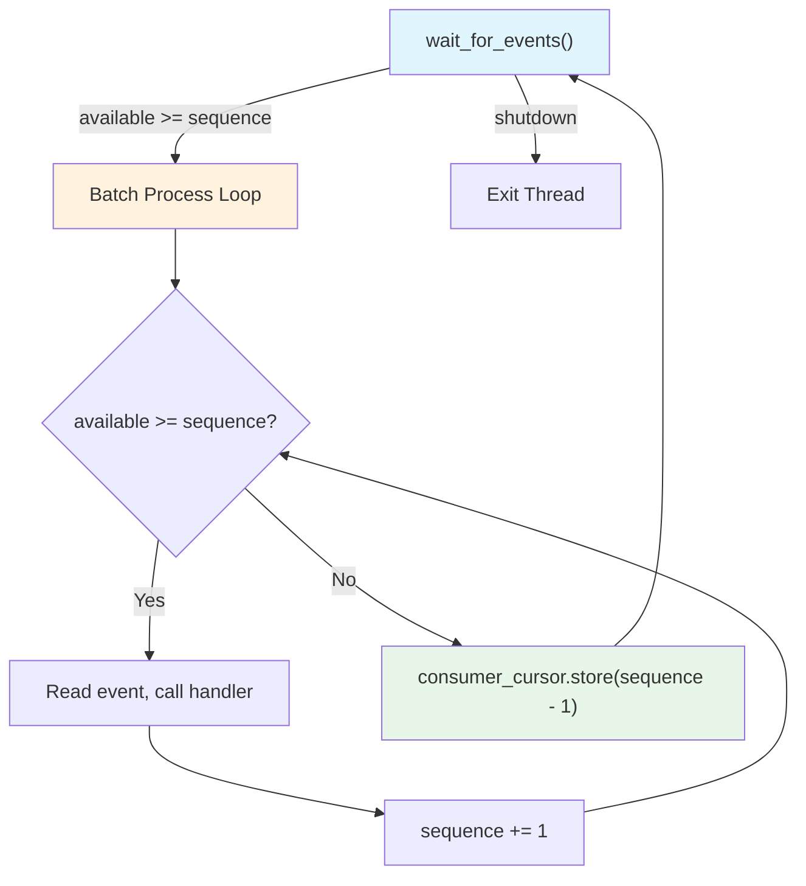
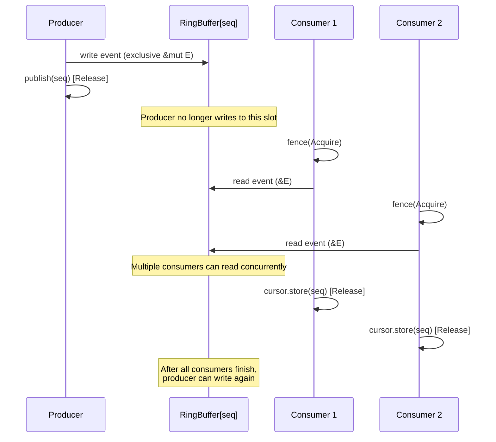

# Event Processing: Event Processors and Batch Processing Design

> **Key takeaway**: The consumer event loop maximizes throughput through a three-phase "wait -> batch process -> store cursor" design. Blanket impl of closures as event handlers avoids the vtable call overhead of trait objects.

- Event processors are `FnMut(&E, Sequence, bool)` closures, monomorphized at compile time
- Batch processing handles $\text{available} - \text{current}$ events in a single loop iteration
- Stateful processors are supported via `FnMut(&mut S, &E, Sequence, bool)`, with state initialized within the consumer thread
- Cursor updates are performed only once after the entire batch is processed

---

## 1. Event Handler Design

### 1.1 Closures as Handlers

disruptor-rs does not define a separate `EventHandler` trait. Instead, the event handler is a closure matching a specific signature:

```rust
FnMut(&E, Sequence, bool)
```

Meaning of the three parameters:

| Parameter | Type | Meaning |
|-----------|------|---------|
| `event` | `&E` | Shared reference to the current event (read-only) |
| `sequence` | `Sequence` | The event's global sequence number |
| `end_of_batch` | `bool` | Whether this is the last event in the currently available batch |

### 1.2 Why Closures Instead of a Trait

Java Disruptor defines an `EventHandler<T>` interface:

```java
public interface EventHandler<T> {
    void onEvent(T event, long sequence, boolean endOfBatch);
}
```

disruptor-rs uses the closure signature directly, for these reasons:

1. **Rust closures automatically implement `Fn` traits**: Each closure is a unique type, and the compiler generates monomorphized code for it
2. **Zero syntactic overhead**: Users do not need to define a struct and impl a trait; they simply write `|e, seq, eob| { ... }`
3. **Monomorphization = inlining**: The closure body is inlined into the event loop at compile time, eliminating function call overhead

```rust
// User code
let handler = |e: &Event, seq: Sequence, end_of_batch: bool| {
    if end_of_batch {
        // flush batch
    }
};
let producer = build_single_producer(8, factory, BusySpin)
    .handle_events_with(handler)
    .build();
```

### 1.3 Stateful Handlers

For processing logic that needs to maintain state across events, an extended signature is provided:

```rust
FnMut(&mut S, &E, Sequence, bool)
```

Paired with a state initialization closure:

```rust
FnOnce() -> S
```

Usage example:

```rust
let handler = |state: &mut MyState, event: &Event, _seq, _eob| {
    state.accumulator += event.value;
};
let init_state = || MyState { accumulator: 0 };

builder.handle_events_and_state_with(handler, init_state);
```

**Why state initialization executes within the consumer thread**: `initialize_state` is `FnOnce`, called inside `thread::spawn`. This ensures:

1. The state's memory allocation occurs on the consumer thread's stack/heap (NUMA-friendly)
2. The state does not need to be `Send` to the consumer thread -- it is created inside the thread
3. The state's lifetime is exactly aligned with the thread's lifetime

---

## 2. BatchEventProcessor Event Loop

### 2.1 Core Loop

```rust
pub(crate) fn start_processor<E, EP, W, B>(
    mut event_handler: EP,
    builder: &mut Shared<E, W>,
    barrier: Arc<B>,
) -> (Arc<Cursor>, Consumer) {
    // ... setup ...
    thread_builder.spawn(move || {
        let mut sequence = 0;
        while let Some(available) = wait_for_events(
            sequence, &shutdown_at_sequence, barrier.as_ref(), &wait_strategy
        ) {
            while available >= sequence {
                let end_of_batch = available == sequence;
                let event_ptr    = ring_buffer.get(sequence);
                let event        = unsafe { &*event_ptr };
                event_handler(event, sequence, end_of_batch);
                sequence += 1;
            }
            consumer_cursor.store(sequence - 1);
        }
    })
}
```

### 2.2 Three-Phase Flow



**Phase 1: Wait**
```rust
wait_for_events(sequence, &shutdown_at_sequence, barrier.as_ref(), &wait_strategy)
```
Waits until `barrier.get_after(sequence) >= sequence`. Returns the `available` sequence number.

**Phase 2: Batch Process**
```rust
while available >= sequence {
    let end_of_batch = available == sequence;
    // process event
    sequence += 1;
}
```
Processes all events from `sequence` to `available` in a single loop.

**Phase 3: Store Cursor**
```rust
consumer_cursor.store(sequence - 1);
```
After batch processing completes, updates the cursor in a single operation.

### 2.3 `wait_for_events` in Detail

```rust
fn wait_for_events<B, W>(
    sequence:             Sequence,
    shutdown_at_sequence: &CachePadded<AtomicI64>,
    barrier:              &B,
    wait_strategy:        &W,
) -> Option<Sequence> {
    let mut available = barrier.get_after(sequence);
    while available < sequence {
        if shutdown_at_sequence.load(Ordering::Relaxed) == sequence {
            return None;  // shutdown
        }
        wait_strategy.wait_for(sequence);
        available = barrier.get_after(sequence);
    }
    fence(Ordering::Acquire);  // Critical: establishes happens-before
    Some(available)
}
```

Note the position of `fence(Acquire)`: it executes after confirming available events exist but before reading event data. This guarantees the consumer can see the complete event data written by the producer.

---

## 3. Batch Processing Optimization

### 3.1 Batch Size Calculation

$$\text{batch\_size} = \text{available} - \text{current} + 1$$

Where `current` is the next sequence the consumer expects, and `available` is the highest available sequence returned by the barrier.

### 3.2 Why Batch Processing Is Efficient

**Reason 1: Reduced cursor update frequency**

Each `consumer_cursor.store()` is a Release store. In multi-consumer scenarios, this triggers cache line transfers. Batch processing reduces $N$ stores for $N$ events to just 1.

$$\text{store count} = \frac{\text{total\_events}}{\text{avg\_batch\_size}}$$

**Reason 2: Reduced barrier query frequency**

Each `barrier.get_after()` may involve cross-core cache line reads. Batch processing handles all available events after a single wait, reducing barrier query frequency.

**Reason 3: CPU cache friendly**

When processing multiple events consecutively, adjacent slots in the ring buffer are likely on the same cache line. This exploits spatial locality.

### 3.3 Throughput Model

Let the event arrival rate be $\lambda$, wait overhead be $t_w$, per-event processing overhead be $t_p$, and cursor store overhead be $t_s$.

**Without batch processing**:

$$\text{throughput}_{\text{no\_batch}} = \frac{1}{t_w + t_p + t_s}$$

**With batch processing** (average batch size $B$):

$$\text{throughput}_{\text{batch}} = \frac{B}{t_w + B \cdot t_p + t_s} = \frac{1}{t_p + \frac{t_w + t_s}{B}}$$

As $B \to \infty$:

$$\text{throughput}_{\text{batch}} \to \frac{1}{t_p}$$

Batch processing shifts the throughput bottleneck from "waiting + processing + synchronization" to "pure processing".

### 3.4 `end_of_batch` Signal

`end_of_batch` lets the handler know the boundary of the current batch:

```rust
let end_of_batch = available == sequence;
```

You can use this signal to implement application-level batch optimizations:

```rust
let handler = |state: &mut Buffer, event: &Event, _seq, end_of_batch: bool| {
    state.buffer.push(event.data.clone());
    if end_of_batch {
        // Batch flush to reduce system call count
        state.socket.send_batch(&state.buffer);
        state.buffer.clear();
    }
};
```

---

## 4. Event Access Safety Model

### 4.1 Reference Type

The consumer obtains `&E` (shared reference), not `&mut E`.

```rust
let event_ptr = ring_buffer.get(sequence);
let event     = unsafe { &*event_ptr };
```

`ring_buffer.get()` returns `*mut E`, but the consumer converts it to `&E`. This is safe because:

1. The producer has already published this sequence (Release store)
2. The consumer has already executed `fence(Acquire)`
3. The producer will not overwrite this slot until the consumer updates its cursor

### 4.2 Safety Timeline



### 4.3 `unsafe` in Stateful Processors

```rust
pub(crate) fn start_processor_with_state<E, EP, W, B, S, IS>(
    mut event_handler: EP,
    // ...
    initialize_state: IS,
) {
    thread_builder.spawn(move || {
        let mut state = initialize_state();
        // ...
        event_handler(&mut state, event, sequence, end_of_batch);
    });
}
```

The state `S` is created within the thread, and `&mut S` is only used within a single thread. This does not require `S: Send` -- it never crosses thread boundaries.

---

## 5. Consumer Thread Management

### 5.1 Thread Creation

```rust
let thread_builder = thread::Builder::new().name(thread_name.clone());
let join_handle = thread_builder.spawn(move || {
    set_affinity_if_defined(affinity, thread_name.as_str());
    // event loop...
}).expect("Should spawn thread.");
```

Each consumer owns a dedicated OS thread. The thread name and CPU affinity can be configured via the builder.

### 5.2 CPU Affinity

```rust
pub fn pin_at_core(mut self, id: usize) -> Self {
    self.shared().pin_at_core(id);
    self
}
```

Pins the consumer thread to a specific core. Benefits:

| Property | With Affinity | Without Affinity |
|----------|--------------|-----------------|
| Cache coherence | L1/L2 cache retains hot data | OS may migrate thread to a cold core |
| NUMA | Accesses nearby memory | May cross NUMA nodes |
| Latency jitter | Minimized | Affected by OS scheduling |

### 5.3 Thread Lifecycle

```mermaid
stateDiagram-v2
    [*] --> Spawned: thread::spawn
    Spawned --> SetAffinity: set_affinity_if_defined
    SetAffinity --> InitState: initialize_state() [stateful mode]
    SetAffinity --> EventLoop: [stateless mode]
    InitState --> EventLoop
    EventLoop --> EventLoop: wait -> process -> store
    EventLoop --> Exiting: shutdown_at_sequence == sequence
    Exiting --> [*]: thread exits
```

---

## 6. Comparison of Two Consumption Models

### 6.1 Managed Consumer vs EventPoller

| Dimension | Managed Consumer | EventPoller |
|-----------|-----------------|-------------|
| Thread management | Created and managed by Disruptor | User-controlled |
| Wait strategy | WaitStrategy trait | User-implemented |
| Event delivery | Push model (handler called automatically) | Pull model (user calls poll) |
| Batch processing | Automatic batching | EventGuard iterator |
| Cursor update | Automatic store after batch ends | Store on EventGuard Drop |
| Use case | Simple event processing pipelines | Scenarios requiring integration into existing event loops |

### 6.2 EventPoller's Pull Model

```rust
match event_poller.poll() {
    Ok(mut events) => {
        for event in &mut events {
            // process event
        }
    }, // EventGuard dropped here -> cursor updated
    Err(Polling::NoEvents) => { /* ... */ },
    Err(Polling::Shutdown) => { break; },
}
```

EventGuard's `Drop` implementation:

```rust
impl<E, B> Drop for EventGuard<'_, E, B> {
    fn drop(&mut self) {
        self.parent.cursor.store(self.available);
    }
}
```

Note: `Drop` stores `available` (not the actually-iterated-to sequence). Even if the user does not iterate through all events, the cursor still advances to `available`. This is intentional -- skipping events is allowed.

---

## 7. Comparison with Java EventProcessor

| Dimension | Java Disruptor | disruptor-rs |
|-----------|---------------|--------------|
| Handler interface | `EventHandler<T>` interface | `FnMut(&E, Sequence, bool)` |
| Processor type | `BatchEventProcessor` class | `start_processor` function |
| Lifecycle callbacks | `onStart()`, `onShutdown()` | None (closure capture + Drop) |
| Exception handling | `ExceptionHandler` interface | Panic = thread termination |
| Stateful processing | Naturally holds state when implementing the interface | Explicit `start_processor_with_state` |
| Thread model | `Executor` submits Runnable | Direct `thread::spawn` |
| Dynamic dispatch | Interface virtual methods | Compile-time monomorphization |

### 7.1 Java's `onStart`/`onShutdown`

Java Disruptor's `LifecycleAware` interface provides `onStart()` and `onShutdown()` callbacks. The equivalent patterns in disruptor-rs:

- `onStart` -> `initialize_state` closure (executed at thread startup)
- `onShutdown` -> The `Drop` implementation of state `S` (executed when the thread exits)

```rust
struct MyState {
    connection: TcpStream,
}

impl Drop for MyState {
    fn drop(&mut self) {
        self.connection.shutdown(Shutdown::Both).ok();
        // onShutdown equivalent logic
    }
}

let init = || MyState {
    connection: TcpStream::connect("127.0.0.1:8080").unwrap(),
    // onStart equivalent logic
};
```

This is more aligned with Rust's RAII conventions than explicit lifecycle callbacks.

---

## 8. Critical Path Performance Analysis

The hot path of the event loop (code executed once per event):

```rust
// Hot path begins
let end_of_batch = available == sequence;  // 1 comparison instruction
let event_ptr    = ring_buffer.get(sequence);  // 1 AND + 1 load
let event        = unsafe { &*event_ptr };  // 0 instructions (compiler optimized)
event_handler(event, sequence, end_of_batch);  // Inlined user code
sequence += 1;  // 1 add
// Hot path ends
```

In the optimal case with `BusySpin` + monomorphization, the hot path consists of only 3-4 machine instructions plus the user's processing logic. This is the fundamental reason the Disruptor pattern can achieve extremely low latency.
