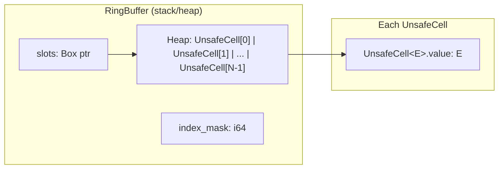
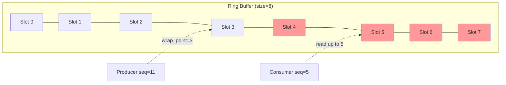
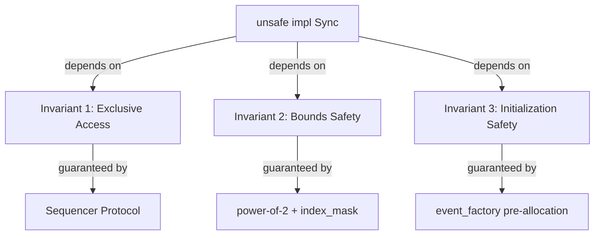

# Ring Buffer: Memory Model and Safety Invariants

> **Key takeaway**: The ring buffer achieves zero-copy, O(1)-indexed lock-free event storage through power-of-2 size constraints and an `UnsafeCell` array, guaranteeing memory safety via compile-time and runtime invariants.

- `Box<[UnsafeCell<E>]>` pre-allocated storage eliminates runtime allocation overhead
- Power-of-2 constraint reduces modulo operations to a single bitwise AND instruction
- Safety invariants are guaranteed externally by the Sequencer protocol, not by the ring buffer itself
- Compared to Java Disruptor's `RingBuffer<T>`, the Rust version replaces GC padding with the type system

---

## 1. Memory Layout

### 1.1 Data Structure Definition

```rust
pub struct RingBuffer<E> {
    slots:      Box<[UnsafeCell<E>]>,
    index_mask: i64,
}
```

You need to understand three design choices:

**`Box<[UnsafeCell<E>]>` instead of `Vec<UnsafeCell<E>>`**: `Box<[T]>` is a fixed-length heap-allocated slice. Since the ring buffer does not change size after construction, `Box<[T]>` stores one fewer field (`capacity`) than `Vec<T>`, making its semantics more precise.

**`UnsafeCell<E>` instead of `Cell<E>` or `RefCell<E>`**: The ring buffer needs to return `*mut E` while holding `&self` (interior mutability). `Cell` does not support referencing inner values, and `RefCell` incurs runtime borrow-checking overhead. `UnsafeCell` is the only zero-cost option.

**`index_mask: i64`**: A precomputed mask that avoids recalculating `size - 1` on every index operation.

### 1.2 Memory Layout Diagram



### 1.3 Pre-allocation Strategy

All slots are pre-filled at construction time via the `event_factory` closure:

```rust
let slots: Box<[UnsafeCell<E>]> = (0..size)
    .map(|_i| UnsafeCell::new(event_factory()))
    .collect();
```

Benefits of pre-allocation:

| Property | Pre-allocation | On-demand Allocation |
|----------|---------------|---------------------|
| Publish latency | Deterministic (no allocation) | Non-deterministic (may trigger allocator) |
| Cache warm-up | Completed at construction | Gradual at runtime |
| Memory fragmentation | Contiguous allocation | Potentially fragmented |
| Initialization overhead | Concentrated at construction | Amortized across publishes |

---

## 2. Power-of-2 Constraint

### 2.1 Constraint Validation

```rust
if !size.is_power_of_two() { panic!("Size must be power of 2.") }
```

Enforced at construction time. Panics if not satisfied; there is no fallback via `Result`.

### 2.2 Mathematical Proof

**Proposition**: When $n = 2^k$ ($k \in \mathbb{N}$), for any non-negative integer $s$:

$$s \mod n = s \mathbin{\&} (n - 1)$$

**Proof**:

Let $n = 2^k$. Then the binary representation of $n - 1$ consists of $k$ ones:

$$n - 1 = \underbrace{111\ldots1}_{k}$$

Any non-negative integer $s$ can be decomposed as:

$$s = q \cdot 2^k + r, \quad 0 \le r < 2^k$$

where $r = s \mod 2^k$. The binary representation of $r$ occupies at most the lower $k$ bits. Performing bitwise AND:

$$s \mathbin{\&} (2^k - 1) = s \mathbin{\&} \underbrace{111\ldots1}_{k} = r = s \mod 2^k \quad \blacksquare$$

### 2.3 Performance Impact

| Operation | Instruction count (x86-64) | Latency (cycles) |
|-----------|---------------------------|-------------------|
| `s % n` (general division) | 1 `div` | 20-90 |
| `s & (n - 1)` | 1 `and` | 1 |

At hundreds of millions of index operations per second, this difference is significant.

---

## 3. Index Calculation

### 3.1 Formula

$$index = sequence \mathbin{\&} (size - 1)$$

Code implementation:

```rust
#[inline]
pub(crate) fn get(&self, sequence: Sequence) -> *mut E {
    let index = (sequence & self.index_mask) as usize;
    let slot  = unsafe { self.slots.get_unchecked(index) };
    slot.get()
}
```

### 3.2 Safety Argument for `get_unchecked`

`get_unchecked` skips bounds checking. Safety is guaranteed by the following invariants:

1. `index_mask = size - 1`, where `size` is the length of `slots`
2. The result of `sequence & index_mask` is in the range $[0, size - 1]$
3. Therefore `index` is always within the bounds of `slots`

This is a **structural invariant**: as long as `index_mask` is immutable after construction (it is an `i64`, immutable), the index will never go out of bounds.

### 3.3 Sequence-to-Slot Mapping Example

Using `size = 8` (`index_mask = 7 = 0b111`) as an example:

| Sequence | Binary | `& 0b111` | Slot Index |
|----------|--------|-----------|------------|
| 0 | `000` | `000` | 0 |
| 1 | `001` | `001` | 1 |
| 7 | `111` | `111` | 7 |
| 8 | `1000` | `000` | 0 |
| 9 | `1001` | `001` | 1 |
| 15 | `1111` | `111` | 7 |
| 16 | `10000` | `000` | 0 |

Sequences increase monotonically; slot indices are reused cyclically.

---

## 4. Free Slot Calculation

### 4.1 Formula

$$\text{free\_slots} = \text{highest\_consumer} - (\text{producer} - \text{size})$$

Code implementation:

```rust
#[inline]
fn wrap_point(&self, sequence: Sequence) -> Sequence {
    sequence - self.size()
}

#[inline]
pub(crate) fn free_slots(&self, producer: Sequence, highest_read_by_consumers: Sequence) -> i64 {
    let wrap_point = self.wrap_point(producer);
    highest_read_by_consumers - wrap_point
}
```

### 4.2 Wrap Point Semantics

The `wrap_point` is the position one full cycle behind the producer's current sequence. If the slowest consumer has not yet read past the wrap point, the producer cannot continue writing -- otherwise it would overwrite unconsumed data.



In the diagram above, `free_slots(11, 5) = 5 - (11 - 8) = 5 - 3 = 2`.

---

## 5. Cache Line Padding Strategy

### 5.1 Problem: False Sharing

When multiple threads frequently read and write different variables on the **same cache line** (typically 64 bytes), it causes the cache line to be repeatedly invalidated and transferred between cores. This is called false sharing.

### 5.2 Solution

The ring buffer itself does not need padding -- the `slots` array is not modified after construction (only the contents of the inner `UnsafeCell` are modified). The critical padding is on the `Cursor`:

```rust
pub(crate) struct Cursor {
    counter: CachePadded<AtomicI64>
}
```

`CachePadded` (from `crossbeam_utils`) ensures that the `AtomicI64` occupies its own cache line. This prevents the producer's cursor and consumer's cursor from being placed on the same cache line.

### 5.3 Padding Locations

| Component | Padded? | Reason |
|-----------|---------|--------|
| `Cursor.counter` | Yes | Frequently read/written by multiple threads |
| `shutdown_at_sequence` | Yes | Polled by all consumers |
| `RingBuffer.slots` | No | Metadata is immutable; slot contents are isolated by protocol |
| `RingBuffer.index_mask` | No | Read-only |

---

## 6. Safety Invariants

### 6.1 `unsafe impl Sync`

```rust
unsafe impl<E> Sync for RingBuffer<E> {}
```

`RingBuffer` manually implements `Sync` because the compiler cannot automatically derive `Sync` for types containing `UnsafeCell`. This `unsafe impl` transfers safety responsibility to the user.

### 6.2 Three Key Invariants

**Invariant 1: Exclusive Access**

At any point in time, each slot is either being written by exactly one producer or being read by one or more consumers, but not both simultaneously.

This is guaranteed by the Sequencer protocol:
- The producer only writes to slots corresponding to sequences that have been claimed but not yet published
- Consumers only read slots corresponding to sequences that have been published
- `fence(Ordering::Acquire)` on the consumer side establishes happens-before relationships

**Invariant 2: Bounds Safety**

The index used by `get_unchecked` is always in the range $[0, \text{size} - 1]$, guaranteed by the mathematical properties of `index_mask`.

**Invariant 3: Initialization Safety**

All slots are initialized at construction time. `event_factory` generates a valid value for each slot. Consumers will never read uninitialized memory.

### 6.3 Invariant Dependency Graph



---

## 7. Comparison with Java RingBuffer

| Dimension | Java Disruptor | disruptor-rs |
|-----------|---------------|--------------|
| Storage type | `Object[]` + padding | `Box<[UnsafeCell<E>]>` |
| Indexing method | Same (bitwise AND) | Same (bitwise AND) |
| Padding | Manual `long p1..p7` in `RingBufferPad` base class | `CachePadded` at the Cursor level |
| GC impact | Object array may be moved by GC | No GC; address is fixed after heap allocation |
| Generic erasure | `Object[]` + runtime type casting | Compile-time monomorphization, zero overhead |
| Safety guarantee | Runtime (`ArrayIndexOutOfBoundsException`) | Compile-time + `unsafe` contract |
| Memory overhead | 16-byte header per object | Zero extra overhead |
| False sharing protection | `Unsafe.putOrderedLong` + padding | `CachePadded<AtomicI64>` |

### 7.1 Rust-Specific Advantages

**Zero-cost abstraction**: `UnsafeCell` is fully equivalent to a raw pointer at runtime, with no wrapping overhead.

**Compile-time monomorphization**: `RingBuffer<E>` generates specialized code for each concrete type `E`. Java's `Object[]` requires runtime boxing and type casting.

**Deterministic memory layout**: Elements in `Box<[UnsafeCell<E>]>` are laid out contiguously in memory. Java's `Object[]` stores references, and the actual objects may be scattered across the heap.

---

## 8. Design Rationale for `get()` Returning a Raw Pointer

```rust
pub(crate) fn get(&self, sequence: Sequence) -> *mut E {
    let index = (sequence & self.index_mask) as usize;
    let slot  = unsafe { self.slots.get_unchecked(index) };
    slot.get()
}
```

`get()` returns `*mut E` rather than `&mut E` for the following reasons:

1. **Deferred borrow decision**: The caller decides based on context whether to create `&mut E` (producer write) or `&E` (consumer read)
2. **Avoiding lifetime entanglement**: Raw pointers carry no lifetime, avoiding conflicts between the `RingBuffer`'s borrow and the slot content's borrow
3. **Preserving `&self`**: The method signature is `&self` rather than `&mut self`, allowing multiple threads to call simultaneously (thread safety is guaranteed by the Sequencer protocol)

This is the standard pattern for interior mutability in Rust: `UnsafeCell::get()` itself returns `*mut T`.
