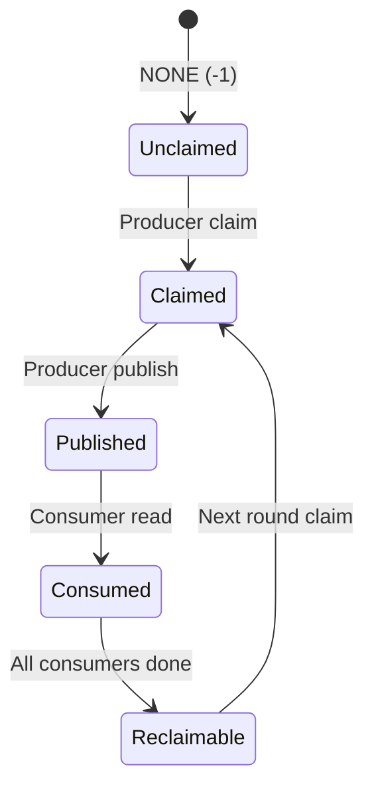
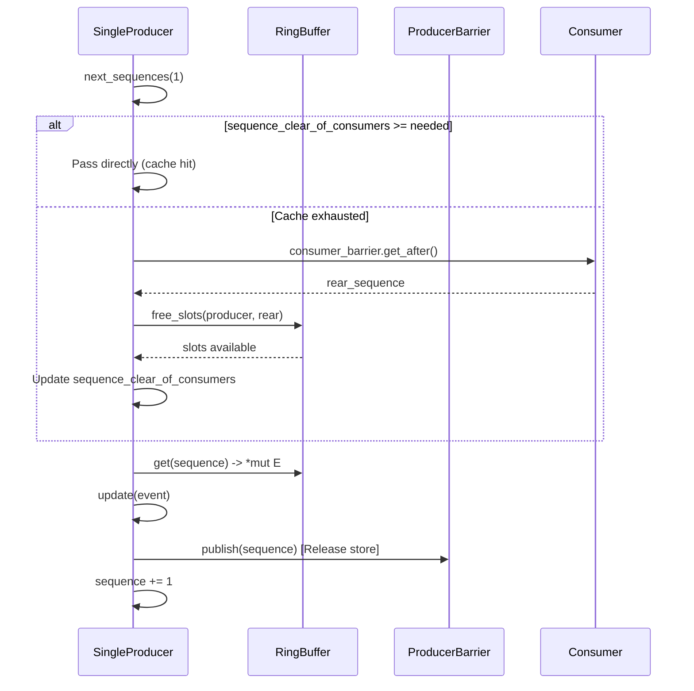
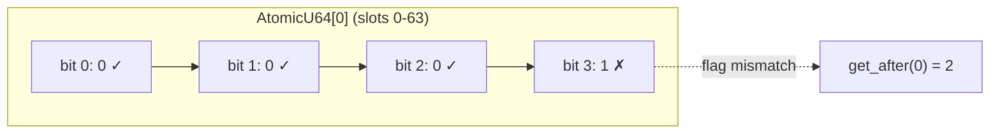
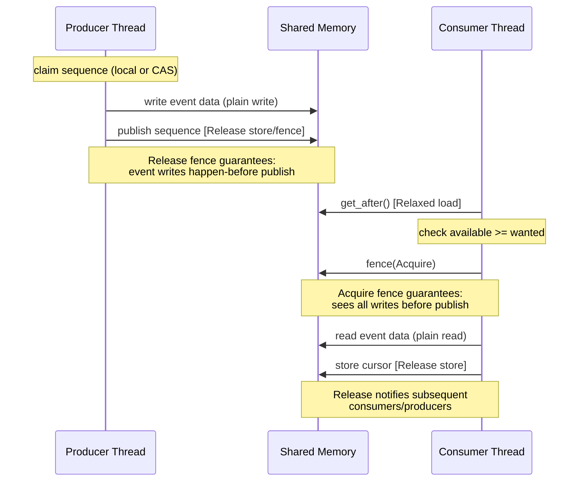

# Sequencing: Sequence Numbers and the Sequencer Mechanism

> **Key takeaway**: Sequence is the Disruptor's global clock, Cursor is its atomically-backed carrier, and the Sequencer linearizes concurrent writes into a total order through a two-phase claim-publish protocol.

- `Sequence` is a type alias for `i64`, monotonically increasing, with NONE = -1 representing uninitialized
- `Cursor` uses `CachePadded<AtomicI64>` to eliminate false sharing
- SingleSequencer requires no CAS; it amortizes checks using cached `sequence_clear_of_consumers`
- MultiSequencer uses a CAS loop for claiming + availability bitmap (XOR round tracking) for publishing

---

## 1. Sequence Type Design

### 1.1 Type Definition

```rust
pub type Sequence = i64;
```

Sequence is a type alias for `i64`, not a newtype wrapper. This choice has clear rationale:

| Approach | Pros | Cons |
|----------|------|------|
| `type Sequence = i64` | Zero syntactic overhead, seamless with arithmetic | No type safety |
| `struct Sequence(i64)` | Type safety | Requires implementing traits for every arithmetic operation |
| `NonNegI64` | Encodes invariant | NONE = -1 breaks the constraint |

In disruptor-rs, sequences frequently participate in addition, subtraction, comparison, and bitwise operations. The trait implementation cost of a newtype exceeds its type safety benefit.

### 1.2 Sequence Semantics

$$\text{Sequence} \in \{-1\} \cup \mathbb{N}_0$$

- $-1$ (`NONE`): Initial state -- not yet claimed or published
- $0, 1, 2, \ldots$: Global ordinal of the $n$-th event
- Theoretical upper bound: $2^{63} - 1$ (approximately $9.2 \times 10^{18}$)

```rust
pub const NONE: Sequence = -1;
```

### 1.3 Sequence Lifecycle



Each sequence goes through a claim -> publish -> consume cycle. After the ring buffer wraps around, the same slot is assigned a new sequence value.

---

## 2. Cursor: Atomically-Backed Sequence Carrier

### 2.1 Structure

```rust
pub(crate) struct Cursor {
    counter: CachePadded<AtomicI64>
}
```

`CachePadded` ensures the `AtomicI64` occupies an entire cache line (typically 64 bytes).

### 2.2 Operations and Memory Ordering

| Operation | Method | Ordering | Purpose |
|-----------|--------|----------|---------|
| CAS | `compare_exchange` | Success: `AcqRel`, Failure: `Relaxed` | MultiProducer claim |
| Store | `store` | `Release` | Publish sequence |
| Load | `relaxed_value` | `Relaxed` | Fast read of current value |

### 2.3 Rationale for Memory Ordering Choices

**`store(Release)`**: When the producer publishes sequence $s$, store-release guarantees that all prior write operations (writes to event data) complete before the store. When a consumer pairs this with `fence(Acquire)` after reading, it sees the complete event data.

**`compare_exchange(AcqRel, Relaxed)`**: On CAS success, `AcqRel` is needed -- Acquire ensures visibility of prior publishes, Release ensures subsequent writes are visible to other threads. On CAS failure, `Relaxed` suffices -- failure only means a retry is needed, with no synchronization requirements.

**`relaxed_value(Relaxed)`**: The Barrier's `get_after` uses Relaxed semantics to read the cursor. This does not violate safety because the caller executes `fence(Acquire)` after reading to establish happens-before. This separation avoids fence overhead when synchronization is not needed (e.g., checking free slots).

### 2.4 Why Not `SeqCst`

Sequential Consistency provides the strongest guarantee but at a high cost. On x86-64, a `SeqCst` store inserts an `MFENCE` instruction (approximately 33 cycles). A `Release` store is a plain store (0 extra cycles -- x86's TSO model naturally provides release semantics).

The Disruptor protocol does not require a total order -- only happens-before relationships between producers and consumers. `Release`/`Acquire` pairing is sufficient.

---

## 3. Barrier Trait

### 3.1 Definition

```rust
pub trait Barrier: Send + Sync {
    fn get_after(&self, prev: Sequence) -> Sequence;
}
```

`Barrier` is the most fundamental abstraction in the Disruptor. It answers one question: **"Starting from `prev`, what is the farthest sequence that can be seen?"**

### 3.2 Relaxed Semantics Contract

`get_after` reads the cursor using Relaxed semantics. This means:

1. The return value may be **stale** (the observed sequence may be smaller than the actual value)
2. The caller **must** execute `fence(Acquire)` before using the return value to access event data

This contract is explicitly stated in the source code comments:

> Note, to establish proper happens-before relationships (and thus proper synchronization), the caller must issue a `std::sync::atomic::fence` with `Ordering::Acquire`.

### 3.3 Barrier Implementation Matrix

| Implementation | Tracking Target | Algorithm | Use Case |
|----------------|----------------|-----------|----------|
| `SingleProducerBarrier` | 1 producer cursor | Direct relaxed load | Consumer tracking a single producer |
| `MultiProducerBarrier` | Availability bitmap | Per-bit scan | Consumer tracking multiple producers |
| `SingleConsumerBarrier` | 1 consumer cursor | Direct relaxed load | Downstream consumer tracking 1 upstream |
| `MultiConsumerBarrier` | N consumer cursors | Fold to find min | Downstream consumer or producer tracking multiple upstreams |

---

## 4. SingleSequencer: Lock-Free Single Producer

### 4.1 Core Design

SingleProducer is the sole writer, therefore:

- **No CAS needed**: There is no contention, so a simple increment suffices
- **Sequence stored in a local variable**: `self.sequence` is a plain `i64`, not atomic

```rust
pub struct SingleProducer<E, C> {
    sequence:                    Sequence,
    sequence_clear_of_consumers: Sequence,
    // ...
}
```

### 4.2 Amortized Free-Slot Check

Before each publish, it is necessary to confirm that consumers have not fallen too far behind. However, calling `consumer_barrier.get_after()` frequently causes cache line bouncing.

Solution: cache `sequence_clear_of_consumers`.

```rust
fn next_sequences(&mut self, n: usize) -> Result<Sequence, MissingFreeSlots> {
    let n_next = self.sequence - 1 + n;

    if self.sequence_clear_of_consumers < n_next {
        // Only actually check consumer position when the cache is exhausted
        let rear_sequence_read = self.consumer_barrier.get_after(last_published);
        let free_slots = self.ring_buffer.free_slots(last_published, rear_sequence_read);
        // ...
        self.sequence_clear_of_consumers = last_published + free_slots;
    }
    Ok(n_next)
}
```

**Amortized analysis**: Let the ring buffer size be $N$, and assume the consumer can always keep up with the producer. In the worst case, only 1 consumer position check is needed per $N$ publishes. Each check costs $O(1)$, so the amortized cost is $O(1/N)$.

### 4.3 Publish Flow



---

## 5. MultiSequencer: CAS Loop + Availability Bitmap

### 5.1 CAS Claim Phase

Multiple producers compete to claim sequence number ranges. Lock-free contention is achieved via a CAS loop:

```rust
fn next_sequences(&mut self, n: usize) -> Result<Sequence, MissingFreeSlots> {
    let mut current = self.producer_barrier.current();
    let mut n_next  = current + n;

    loop {
        // ... free-slot check ...
        match self.producer_barrier.compare_exchange(current, n_next) {
            Ok(_) => {
                self.claimed_sequence = n_next;
                break;
            }
            Err(new_current) => {
                current = new_current;
                n_next  = current + n;
            }
        }
    }
    Ok(n_next)
}
```

After a successful CAS, the range $(\text{current}, \text{n\_next}]$ is the producer's **exclusive space**.

### 5.2 Availability Bitmap Design

Why can't a simple cursor represent "published"? Because after producer A claims sequence 5, producer B may claim 6 and publish it first. If a single cursor is used, after B publishes 6 the cursor becomes 6, but 5 has not been published yet -- a consumer seeing cursor=6 would attempt to read both 5 and 6, encountering the incomplete 5.

Solution: **per-slot availability bitmap**.

```rust
pub struct MultiProducerBarrier {
    cursor:      Cursor,
    available:   Box<[AtomicU64]>,
    index_mask:  usize,
    index_shift: usize,
}
```

Each `AtomicU64` tracks the availability state of 64 slots. Each bit corresponds to one slot.

### 5.3 XOR Round Tracking

Key question: how does a bit value of 0 or 1 distinguish "published in the current round" from "published in the previous round"?

Answer: XOR toggling. Each round of publishing flips the corresponding bit.

```rust
fn calculate_availability_flag(&self, sequence: Sequence) -> u64 {
    let round = (sequence >> self.index_shift) as u64;
    round & 1  // 0 for even rounds, 1 for odd rounds
}
```

**Initial state**: All bits are 1 (`!0_u64`). Round 0 is an even round, with an expected flag of 0. A bit value of 1 means "not published in the current round".

**Publish operation**: XOR flips the corresponding bit.

$$\text{bit}' = \text{bit} \oplus 1$$

| Round | Bit value before | After XOR | Expected flag |
|-------|-----------------|-----------|---------------|
| Round 0 (even) | 1 | 0 | 0 |
| Round 1 (odd) | 0 | 1 | 1 |
| Round 2 (even) | 1 | 0 | 0 |

**Check operation** (`get_after`): Reads the bit value and compares it with the expected flag for the current round. A mismatch indicates the slot has not yet been published in the current round.

### 5.4 Availability Scan Algorithm

`get_after` scans bit by bit starting from `prev` until it finds the first mismatching bit:

```rust
fn get_after(&self, prev: Sequence) -> Sequence {
    let mut availability_flag = self.calculate_availability_flag(prev);
    // ... setup ...
    loop {
        if availability & 1 != availability_flag {
            return highest_available - 1;
        }
        highest_available += 1;
        // advance to next bit...
    }
}
```



### 5.5 Batch Publish Optimization

During batch publishing, for multiple bits within the same `AtomicU64`, the flip mask is accumulated first and then applied via a single `fetch_xor`:

```rust
fn publish_range_relaxed(&self, from: Sequence, n: i64) {
    let mut flip_mask = 0_u64;
    for i in 0..n {
        flip_mask |= 1 << bit_index;
        if bit_index < 63 {
            bit_index += 1;
        } else {
            availability.fetch_xor(flip_mask, Ordering::Relaxed);
            // reset and move to next AtomicU64
        }
    }
    if flip_mask > 0 {
        availability.fetch_xor(flip_mask, Ordering::Relaxed);
    }
}
```

This consolidates the publishing of $n$ slots within the same `AtomicU64` into **1 atomic operation**.

---

## 6. ProducerBarrier Trait

### 6.1 Definition

```rust
pub trait ProducerBarrier: Barrier {
    fn publish(&self, sequence: Sequence);
}
```

`ProducerBarrier` extends `Barrier`. It serves both as the interface producers use to publish and as the interface consumers use to query available sequences.

### 6.2 Implementation Comparison

| Operation | SingleProducerBarrier | MultiProducerBarrier |
|-----------|----------------------|---------------------|
| `publish` | `cursor.store(Release)` | `fetch_xor(mask, Release)` |
| `get_after` | `cursor.relaxed_value()` | Bitmap scan loop |
| State | 1 Cursor | 1 Cursor + N AtomicU64s |

---

## 7. Complete Memory Ordering Overview

The diagram below shows the ordering relationships of all memory operations during a complete publish-consume cycle:



Key synchronization pair:

$$\text{Producer: Release store/fence} \xrightarrow{\text{happens-before}} \text{Consumer: Acquire fence}$$

This ensures that when the consumer reads an event, it sees the complete data written by the producer.

---

## 8. Comparison with Java Sequencer

| Dimension | Java Disruptor | disruptor-rs |
|-----------|---------------|--------------|
| Sequence type | `class Sequence` (padded long) | `type Sequence = i64` |
| Single producer | `SingleProducerSequencer` | Inlined in `SingleProducer` |
| Multi producer | `MultiProducerSequencer` | `MultiProducerBarrier` |
| Availability | `int[]` (one int per slot, storing flag) | `AtomicU64[]` (one bit per slot) |
| Publish operation | `Unsafe.putOrderedLong` | `AtomicI64::store(Release)` |
| CAS | `Unsafe.compareAndSwapLong` | `AtomicI64::compare_exchange` |

### 8.1 Bitmap Compression Advantage

Java uses `int[]`, with each slot occupying 4 bytes. disruptor-rs uses bit-level packing, with each slot occupying 1 bit.

For a ring buffer with $N = 65536$:
- Java: $65536 \times 4 = 262144$ bytes = 256 KB
- Rust: $65536 / 64 \times 8 = 8192$ bytes = 8 KB

**32x memory compression** means availability data fits more easily into L1 cache (typically 32-48 KB), significantly reducing cache misses.
