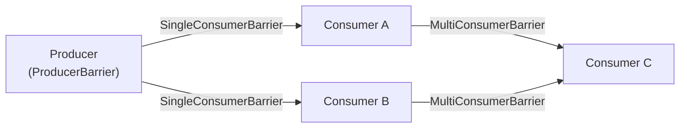
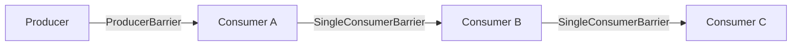
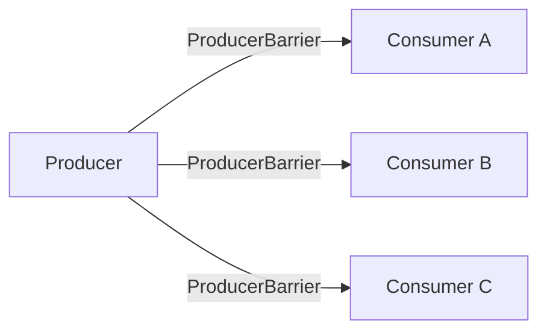
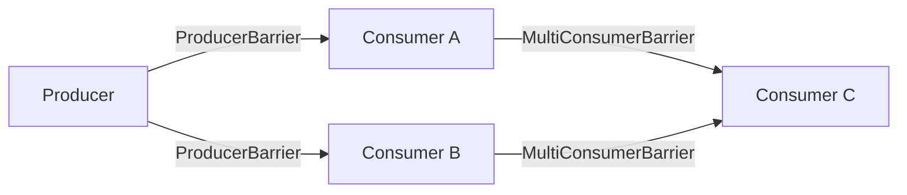
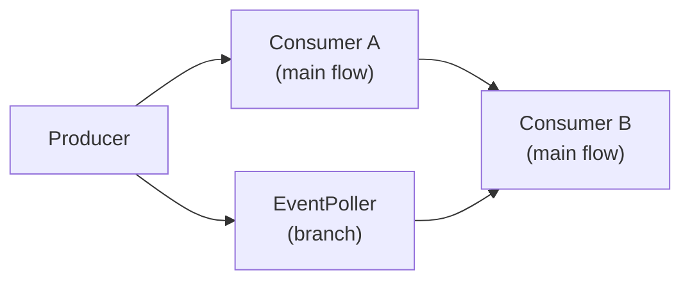
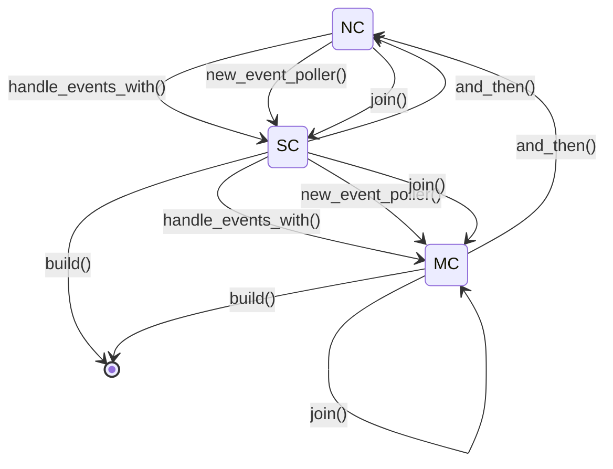
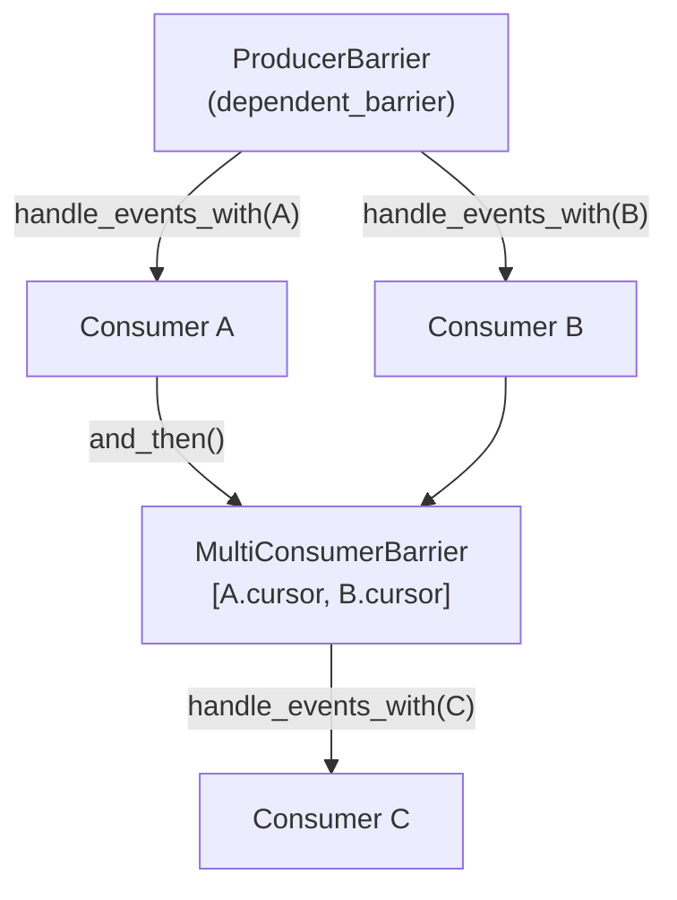

# Topology: Consumer Dependency DAG and Topology Patterns

> **Key takeaway**: The Disruptor constructs a directed acyclic graph (DAG) through Barrier chain composition. The four operations `and_then()` / `handle_events_with()` / `new_branch()` / `join()` cover all common topology patterns, and a typestate machine prevents cyclic dependencies at compile time.

- DAG edges are represented by `Barrier` implementations: `SingleConsumerBarrier` for single dependencies, `MultiConsumerBarrier` for multiple dependencies
- Four basic topologies: Pipeline, Parallel, Diamond, Hexagon
- The Builder's `PhantomData<State>` typestate (NC/SC/MC) controls the legal sequence of operations at compile time
- `new_branch()` + `join()` supports fork-join patterns in the DAG

---

## 1. DAG Model

### 1.1 Nodes and Edges

In the Disruptor's DAG:

- **Node** = Producer or Consumer (event handler / event poller)
- **Edge** = Barrier (data dependency relationship)

Edge semantics: if an edge exists from node A to node B, B can only process events that A has already finished processing.



### 1.2 Barrier Composition Rules

| Upstream count | Barrier type | Implementation |
|---------------|-------------|----------------|
| 1 | `SingleConsumerBarrier` | Directly reads 1 cursor |
| N | `MultiConsumerBarrier` | Reads N cursors and takes the min |

```rust
// Single dependency
pub struct SingleConsumerBarrier {
    cursor: Arc<Cursor>
}

// Multiple dependencies
pub struct MultiConsumerBarrier {
    cursors: Vec<Arc<Cursor>>
}
```

`MultiConsumerBarrier`'s `get_after` returns the **minimum** sequence across all upstreams:

$$\text{available} = \min_{i=1}^{N}(\text{cursor}_i.\text{relaxed\_value}())$$

This ensures downstream only processes events that **all** upstreams have completed.

---

## 2. Four Topology Patterns

### 2.1 Pipeline (Serial): A -> B -> C



**Semantics**: Events flow sequentially through A, B, C. B only processes events that A has already processed.

**Build code**:

```rust
let producer = build_single_producer(8, factory, BusySpin)
    .handle_events_with(handler_a)
    .and_then()
    .handle_events_with(handler_b)
    .and_then()
    .handle_events_with(handler_c)
    .build();
```

**Barrier chain**:

| Consumer | Dependency | Barrier Type |
|----------|-----------|-------------|
| A | Producer | `ProducerBarrier` (default at build time) |
| B | A | `SingleConsumerBarrier(A.cursor)` |
| C | B | `SingleConsumerBarrier(B.cursor)` |

**Use case**: Events requiring multiple ordered stages (e.g., decode -> business processing -> persistence).

### 2.2 Parallel: A | B | C



**Semantics**: A, B, C independently process all events in parallel. No dependencies between them.

**Build code**:

```rust
let producer = build_single_producer(8, factory, BusySpin)
    .handle_events_with(handler_a)
    .handle_events_with(handler_b)
    .handle_events_with(handler_c)
    .build();
```

**Barrier chain**:

| Consumer | Dependency | Barrier Type |
|----------|-----------|-------------|
| A | Producer | `ProducerBarrier` |
| B | Producer | `ProducerBarrier` |
| C | Producer | `ProducerBarrier` |

The producer's consumer barrier tracks the slowest among A, B, C (`MultiConsumerBarrier`), preventing overwriting of unconsumed data.

**Use case**: The same event needs different processing perspectives (e.g., logging + metric collection + forwarding).

### 2.3 Diamond: A | B -> C



**Semantics**: A and B process in parallel; C waits for both A and B to complete before processing.

**Build code**:

```rust
let producer = build_single_producer(8, factory, BusySpin)
    .handle_events_with(handler_a)
    .handle_events_with(handler_b)
    .and_then()
    .handle_events_with(handler_c)
    .build();
```

**Barrier chain**:

| Consumer | Dependency | Barrier Type |
|----------|-----------|-------------|
| A | Producer | `ProducerBarrier` |
| B | Producer | `ProducerBarrier` |
| C | A, B | `MultiConsumerBarrier([A.cursor, B.cursor])` |

`and_then()` collects all consumer cursors from the current stage and builds a `MultiConsumerBarrier` (if 2+ cursors) or `SingleConsumerBarrier` (if 1 cursor) as the dependency for the next stage.

**Use case**: Aggregating results from multiple parallel stages (e.g., A validates, B enriches, C merges output).

### 2.4 Hexagon: Branch + Join



**Semantics**: The main flow A -> B executes serially, while a branch EventPoller processes in parallel. B waits for both A and the EventPoller to complete.

**Build code**:

```rust
let mut builder = build_single_producer(8, factory, BusySpin);
let branch = builder.new_branch();  // Create branch

let builder = builder
    .handle_events_with(handler_a)
    .and_then();

let (event_poller, builder) = builder.join(branch);  // Merge branch

let producer = builder
    .handle_events_with(handler_b)
    .build();
```

**`new_branch()` + `join()` mechanism**:

1. `new_branch()` creates a `Branch` object containing an EventPoller
2. The Branch's cursor is added to the current stage's cursor list at `join()` time
3. Subsequent `and_then()` or `build()` calls incorporate the branch cursor into the downstream barrier

---

## 3. Builder Operation Semantics

### 3.1 `handle_events_with()`

**Purpose**: Add a consumer to the current stage.

**Effects**:
1. Spawns the consumer thread
2. The consumer's cursor is added to the current stage's cursor list
3. The consumer's barrier = the current `dependent_barrier`

```rust
fn add_event_handler<EH>(&mut self, event_handler: EH) {
    let barrier            = self.dependent_barrier();
    let (cursor, consumer) = start_processor(event_handler, self.shared(), barrier);
    self.shared().add_consumer_and_cursor(consumer, cursor);
}
```

### 3.2 `and_then()`

**Purpose**: End the current stage and begin a new one. Consumers in the new stage depend on all consumers from the current stage.

**Effects**:
1. Collects all consumer cursors from the current stage
2. Builds a new `dependent_barrier`
3. Clears the cursor list

```rust
// SC (single consumer) case
pub fn and_then(mut self) -> SPBuilder<NC, E, W, SingleConsumerBarrier> {
    let consumer_cursors  = self.shared().current_consumer_cursors.as_mut().unwrap();
    let dependent_barrier = Arc::new(
        SingleConsumerBarrier::new(consumer_cursors.remove(0))
    );
    SPBuilder { dependent_barrier, .. }
}

// MC (multiple consumers) case
pub fn and_then(mut self) -> SPBuilder<NC, E, W, MultiConsumerBarrier> {
    let consumer_cursors  = self.shared().current_consumer_cursors.replace(vec![]).unwrap();
    let dependent_barrier = Arc::new(
        MultiConsumerBarrier::new(consumer_cursors)
    );
    SPBuilder { dependent_barrier, .. }
}
```

### 3.3 `new_branch()`

**Purpose**: Fork a branch from the current flow. Returns a `Branch` object.

```rust
pub fn new_branch(&mut self) -> Branch<E, B> {
    self.build_branch()
}
```

The Branch contains an EventPoller whose barrier is the `dependent_barrier` at the time of creation.

### 3.4 `join()`

**Purpose**: Merge a branch back into the main flow.

```rust
pub fn join<B2>(mut self, branch: Branch<E, B2>)
    -> (EventPoller<E, B2>, SPBuilder<MC, E, W, B>)
{
    self.add_cursor_from_branch(&branch);
    (branch.into_poller(), SPBuilder { .. })
}
```

Effect: The Branch's cursor is added to the current stage's cursor list. Subsequent `and_then()` calls will incorporate it into the downstream barrier.

---

## 4. Typestate Machine

### 4.1 State Definitions

```rust
pub struct NC;  // No Consumers
pub struct SC;  // Single Consumer
pub struct MC;  // Multiple Consumers
```

The `State` parameter of `SPBuilder<State, E, W, B>` controls which operations are available at compile time:



### 4.2 Compile-Time Constraints

| State | Available Operations | Unavailable Operations |
|-------|---------------------|----------------------|
| `NC` | `handle_events_with`, `new_event_poller`, `join` | `build`, `and_then` |
| `SC` | `handle_events_with`, `and_then`, `build`, `new_event_poller`, `join` | - |
| `MC` | `handle_events_with`, `and_then`, `build`, `new_event_poller`, `join` | - |

In the `NC` state, `build()` is not allowed -- at least one consumer is required. This is enforced at compile time rather than at runtime.

### 4.3 Barrier Type Transitions

The return type of `and_then()` varies based on the current consumer count:

```
SC::and_then() -> SPBuilder<NC, E, W, SingleConsumerBarrier>
MC::and_then() -> SPBuilder<NC, E, W, MultiConsumerBarrier>
```

This is **automatic compile-time selection** -- if there is only one upstream consumer, the more efficient `SingleConsumerBarrier` is used; with multiple upstreams, `MultiConsumerBarrier` is used.

---

## 5. Cycle Prevention

### 5.1 Why the DAG Must Not Have Cycles

If A depends on B and B depends on A, the two would wait for each other to advance their cursors -- resulting in deadlock.

### 5.2 Compile-Time Prevention Mechanism

The Builder API design makes cyclic dependencies **syntactically inexpressible**:

1. `handle_events_with()` creates a new consumer whose barrier is the **current** `dependent_barrier`
2. `and_then()` creates a new `dependent_barrier` containing the cursors of previously created consumers
3. There is no way to pass a later-created consumer's cursor back to an earlier-created consumer

```rust
// You cannot write code like this:
let builder = build_single_producer(8, factory, BusySpin)
    .handle_events_with(handler_a)  // A's barrier is already fixed
    .and_then()
    .handle_events_with(handler_b)  // B depends on A
    // Cannot make A depend on B -- A is already created
    .build();
```

The Builder is a **unidirectional construction process**: each step can only add new nodes and new dependencies going forward. The barriers of already-created nodes cannot be modified. This structurally guarantees the DAG is acyclic.

### 5.3 Cycle Risk with EventPoller

EventPoller runs in a user-controlled thread. Theoretically, users could call producer.publish() within EventPoller's processing logic, creating a logical cycle:

```
Producer -> EventPoller -> (user code) -> Producer
```

But this is not a cycle at the **Barrier level**. The EventPoller's cursor update does not depend on the producer, and the producer's publish does not depend on the EventPoller's cursor (unless the EventPoller is a member of the producer's final consumer barrier).

In practice, if the EventPoller is the sole consumer and simultaneously calls producer.publish(), it may cause self-locking when the ring buffer is full. This is an application-level design issue, not a bug in the Disruptor framework.

---

## 6. Dependent Barrier Propagation

### 6.1 Initial State

When constructing the Disruptor, the first consumer's barrier is the `ProducerBarrier` (`SingleProducerBarrier` or `MultiProducerBarrier`):

```rust
pub fn build_single_producer<E, W, F>(size, event_factory, wait_strategy)
    -> SPBuilder<NC, E, W, SingleProducerBarrier>
{
    let producer_barrier  = Arc::new(SingleProducerBarrier::new());
    let dependent_barrier = Arc::clone(&producer_barrier);
    SPBuilder::new(size, event_factory, wait_strategy, producer_barrier, dependent_barrier)
}
```

### 6.2 Propagation Chain



| Step | `dependent_barrier` type | Value |
|------|------------------------|-------|
| Initial | `Arc<SingleProducerBarrier>` | producer barrier |
| `handle_events_with(A)` | Unchanged | Same as above (A uses this barrier) |
| `handle_events_with(B)` | Unchanged | Same as above (B also uses this barrier) |
| `and_then()` | `Arc<MultiConsumerBarrier>` | `[A.cursor, B.cursor]` |
| `handle_events_with(C)` | Unchanged | Same as above (C uses the multi barrier) |

---

## 7. Producer's Consumer Barrier

### 7.1 Ring Buffer Wrap-Around Protection

The producer must not overwrite slots that have not been consumed by all consumers. The producer's `consumer_barrier` tracks the consumers in the **last stage**:

```rust
// Determined at build() time
pub fn build(mut self) -> SingleProducer<E, MultiConsumerBarrier> {
    let consumer_cursors = self.shared().current_consumer_cursors.take().unwrap();
    let consumer_barrier = MultiConsumerBarrier::new(consumer_cursors);
    SingleProducer::new(
        // ...
        consumer_barrier,
    )
}
```

### 7.2 Why Only the Last Stage Needs Tracking

Why does the producer only need to track consumers in the last stage of the DAG?

In a Pipeline A -> B -> C:

$$\text{C.cursor} \le \text{B.cursor} \le \text{A.cursor}$$

C's cursor is always <= B's cursor (because C depends on B). So tracking C is sufficient -- if C has processed up to sequence $s$, then A and B have processed at least up to $s$ as well.

In a Parallel A | B | C:

$$\text{producer\_safe} = \min(\text{A.cursor}, \text{B.cursor}, \text{C.cursor})$$

The three have no dependency relationships, so the minimum must be taken. `MultiConsumerBarrier` does exactly this.

---

## 8. Topology Pattern Comparison Summary

| Topology | Parallelism | Latency | Code Pattern | Typical Scenario |
|----------|------------|---------|-------------|-----------------|
| Pipeline | 1 (serial) | $N \times t_{\text{stage}}$ | `and_then()` chain | Multi-stage ordered processing |
| Parallel | N (fully parallel) | $\max(t_i)$ | Consecutive `handle_events_with` | Multiple perspectives on the same event |
| Diamond | Partially parallel | $\max(t_A, t_B) + t_C$ | Parallel + `and_then()` | Aggregation after parallel processing |
| Hexagon | Branch parallel | Depends on branch | `new_branch()` + `join()` | Side branches from a long pipeline |

### 8.1 Latency Formulas

**Pipeline (A -> B -> C)**:

$$t_{\text{total}} = t_A + t_B + t_C$$

**Parallel (A | B | C)**:

$$t_{\text{total}} = \max(t_A, t_B, t_C)$$

**Diamond (A | B -> C)**:

$$t_{\text{total}} = \max(t_A, t_B) + t_C$$

In all patterns, ring buffer transfer overhead (cache coherence) is included within each stage's $t_i$.
