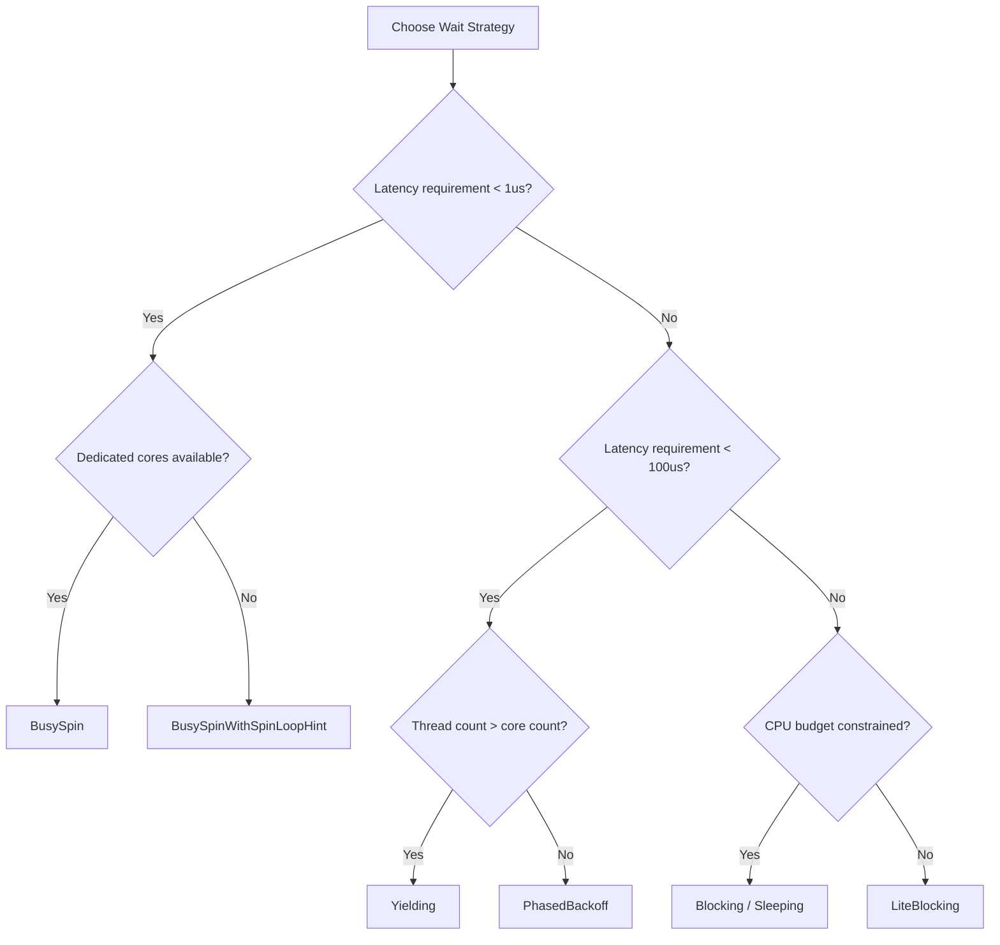

# Wait Strategy: Design and Selection

> **Key takeaway**: The wait strategy is the sole tuning knob in the Disruptor for balancing latency against CPU usage. Through trait abstraction and `Copy + Send` constraints, strategies are monomorphized at compile time with zero-overhead dispatch at runtime.

- 2 strategies are currently implemented: `BusySpin` and `BusySpinWithSpinLoopHint`
- The architecture supports extension to 8 strategies, covering the full spectrum from ultra-low latency to low CPU usage
- The `Copy` constraint ensures strategies can be lightweight-copied to each consumer thread
- Strategy selection depends on the ratio of consumer threads to available cores

---

## 1. WaitStrategy Trait Design

### 1.1 Trait Definition

```rust
pub trait WaitStrategy: Copy + Send {
    fn wait_for(&self, sequence: Sequence);
}
```

Design rationale for the three constraints:

| Constraint | Reason |
|------------|--------|
| `Copy` | Strategy instances need to be copied to each consumer thread. `Copy` guarantees the copy is bitwise and zero-cost |
| `Send` | Strategy instances need to be transferred across threads (from the builder thread to consumer threads) |
| `wait_for(&self, sequence)` | Accepts a target sequence, allowing the strategy to make adaptive decisions based on wait distance |

### 1.2 Why Not `Clone` Instead of `Copy`

`Clone` allows arbitrarily complex cloning logic (such as heap allocation). For a component like a wait strategy that is used frequently on the hot path, `Copy`'s bitwise semantics provide a compile-time guarantee: no allocation will be accidentally introduced.

### 1.3 Call Site Analysis

The wait strategy is called within the consumer event loop:

```rust
fn wait_for_events<B, W>(
    sequence: Sequence,
    shutdown_at_sequence: &CachePadded<AtomicI64>,
    barrier: &B,
    wait_strategy: &W,
) -> Option<Sequence>
where
    W: WaitStrategy,
{
    let mut available = barrier.get_after(sequence);
    while available < sequence {
        if shutdown_at_sequence.load(Ordering::Relaxed) == sequence {
            return None;
        }
        wait_strategy.wait_for(sequence);  // <-- wait strategy called here
        available = barrier.get_after(sequence);
    }
    fence(Ordering::Acquire);
    Some(available)
}
```

Note: `W: WaitStrategy` is a generic parameter; the compiler generates specialized code for each concrete strategy. `BusySpin::wait_for` is a no-op, and the compiler can fully inline and eliminate it.

---

## 2. Implemented Strategies

### 2.1 BusySpin

```rust
#[derive(Copy, Clone)]
pub struct BusySpin;

impl WaitStrategy for BusySpin {
    #[inline]
    fn wait_for(&self, _sequence: Sequence) {
        // Do nothing, true busy spin.
    }
}
```

**Principle**: The consumer repeatedly calls `barrier.get_after()` in a tight loop. The CPU core is 100% utilized, but latency reaches its theoretical minimum -- the only source of latency is the cache coherence protocol propagating the producer's store.

**Latency characteristics**:

$$t_{\text{latency}} \approx t_{\text{cache\_coherence}} \approx 10\text{-}70 \text{ ns (cross-core)}$$

### 2.2 BusySpinWithSpinLoopHint

```rust
#[derive(Copy, Clone)]
pub struct BusySpinWithSpinLoopHint;

impl WaitStrategy for BusySpinWithSpinLoopHint {
    fn wait_for(&self, _sequence: Sequence) {
        hint::spin_loop();
    }
}
```

**Principle**: Executes `hint::spin_loop()` on each loop iteration, which maps to:
- x86-64: `PAUSE` instruction
- AArch64: `YIELD` instruction

**Effects of `PAUSE`**:
1. Signals to the CPU that a spin-wait is in progress, allowing hyperthreads to yield resources
2. Avoids pipeline flushes caused by memory order violations (approximately 20-cycle penalty)
3. Reduces power consumption

**Latency characteristics**:

$$t_{\text{latency}} \approx t_{\text{cache\_coherence}} + t_{\text{PAUSE}} \approx 10\text{-}140 \text{ ns}$$

`PAUSE` latency varies significantly across microarchitectures:

| Microarchitecture | `PAUSE` latency |
|-------------------|----------------|
| Skylake | ~140 cycles |
| Ice Lake | ~140 cycles |
| Zen 3 | ~65 cycles |
| Zen 4 | ~64 cycles |

---

## 3. Extension Strategy Designs

The following 6 strategies are common extension directions for the Disruptor pattern. They are not yet implemented in the current codebase, but the trait design fully supports them.

### 3.1 Yielding

```rust
// Reference implementation
#[derive(Copy, Clone)]
pub struct Yielding;

impl WaitStrategy for Yielding {
    fn wait_for(&self, _sequence: Sequence) {
        std::thread::yield_now();
    }
}
```

**Principle**: Calls the operating system's `sched_yield()`, giving up the current thread's time slice to other threads of the same priority.

**Use case**: When the number of consumer threads exceeds available cores, to avoid spin-waiting that wastes time allocated to other threads.

**Latency characteristics**:

$$t_{\text{latency}} \approx t_{\text{context\_switch}} \approx 1\text{-}10 \text{ }\mu\text{s}$$

### 3.2 Sleeping

```rust
// Reference implementation
#[derive(Copy, Clone)]
pub struct Sleeping {
    sleep_ns: u64,
}

impl WaitStrategy for Sleeping {
    fn wait_for(&self, _sequence: Sequence) {
        std::thread::sleep(Duration::from_nanos(self.sleep_ns));
    }
}
```

**Principle**: The thread enters a sleep state and is woken by the operating system at a scheduled time.

**Latency characteristics**:

$$t_{\text{latency}} \approx t_{\text{sleep\_granularity}} \approx 50\text{-}1000 \text{ }\mu\text{s}$$

Note: Most operating systems have a minimum sleep granularity far greater than the requested value. Linux's default timer tick is 1ms.

### 3.3 Blocking

```rust
// Reference implementation (requires Arc, does not satisfy Copy)
// In practice, needs to be wrapped into a Copy-able handle
pub struct Blocking {
    // Uses Condvar to wait for notification
}
```

**Principle**: The consumer blocks on a `Condvar`. After publishing, the producer wakes it via `notify_one`.

**Note**: `Condvar` is not `Copy`. Implementing a `Blocking` strategy requires sharing `Arc<(Mutex, Condvar)>`, which conflicts with the current `Copy` constraint. It may be necessary to separate the notification mechanism from the WaitStrategy.

**Latency characteristics**:

$$t_{\text{latency}} \approx t_{\text{futex\_wake}} \approx 3\text{-}20 \text{ }\mu\text{s}$$

### 3.4 TimeoutBlocking

A variant of Blocking that automatically wakes up after a specified timeout. Suitable for consumers that need to perform periodic heartbeats or health checks.

### 3.5 LiteBlocking

Degrades to Blocking after spinning a certain number of times. Reduces CPU consumption during idle periods while maintaining low latency when events arrive.

### 3.6 PhasedBackoff

Multi-phase backoff strategy:

```
Phase 1: BusySpin (N1 iterations)
  ↓ still no events
Phase 2: SpinHint (N2 iterations)
  ↓ still no events
Phase 3: Yield / Sleep / Block
```

**Principle**: Exploits the statistical characteristics of event arrival times. Most events arrive within a short time window (captured by Phase 1); after a prolonged absence of events, the strategy degrades to a low-CPU mode.

---

## 4. Strategy Decision Flow



---

## 5. Strategy Selection Matrix

| Strategy | Latency | CPU Usage | Best Scenario | Limitations |
|----------|---------|-----------|---------------|-------------|
| **BusySpin** | ~10-70ns | 100% of core | Ultra-low-latency trading systems with dedicated cores for consumers | Wastes an entire core |
| **SpinHint** | ~10-140ns | ~95% | Low-latency systems allowing hyperthread sharing | Latency affected by PAUSE instruction |
| **Yielding** | ~1-10us | Variable | Thread count exceeds core count | Affected by OS scheduler |
| **Sleeping** | ~50us-1ms | ~0% | Low-frequency event streams | Limited by OS timer granularity |
| **Blocking** | ~3-20us | ~0% | General-purpose server scenarios | Requires producer-side notification |
| **TimeoutBlocking** | ~3-20us | ~0% | Consumers needing periodic heartbeats | Adds timeout configuration complexity |
| **LiteBlocking** | ~100ns-20us | Adaptive | Bursty traffic patterns | Difficult to tune parameters |
| **PhasedBackoff** | ~100ns-10us | Adaptive | Uncertain arrival rates | Three-phase parameters need tuning |

---

## 6. Performance Impact of Compile-Time Monomorphization

### 6.1 Generic Dispatch vs Dynamic Dispatch

The current design uses generics (static dispatch):

```rust
pub(crate) fn start_processor<E, EP, W, B>(
    event_handler: EP,
    builder: &mut Shared<E, W>,
    barrier: Arc<B>,
) -> (Arc<Cursor>, Consumer)
where
    W: 'static + WaitStrategy,
    // ...
```

The compiler generates an independent copy of `start_processor` for each `W`. `BusySpin::wait_for` is an empty function and will be fully inlined and eliminated.

If dynamic dispatch (`dyn WaitStrategy`) were used instead:
- Each call to `wait_for` would require a vtable lookup (approximately 5-10ns)
- Inlining optimizations would be blocked
- In a spin loop, this overhead would be amplified millions of times

### 6.2 `#[inline]` Annotation

`BusySpin::wait_for` is annotated with `#[inline]`. Combined with generic monomorphization, the compiler can optimize the entire wait loop to:

```rust
// Equivalent code after BusySpin monomorphization
loop {
    let available = barrier.get_after(sequence);
    if available >= sequence { break; }
    if shutdown_at_sequence.load(Relaxed) == sequence { return None; }
    // wait_for is inlined as empty, entire line eliminated
}
```

---

## 7. Comparison with Java WaitStrategy

| Dimension | Java Disruptor | disruptor-rs |
|-----------|---------------|--------------|
| Interface | `WaitStrategy` (interface) | `WaitStrategy` (trait) |
| Dispatch | Virtual method call | Compile-time monomorphization |
| Built-in strategies | 7 | 2 (architecture supports extension) |
| Blocking support | `BlockingWaitStrategy` using ReentrantLock | Not implemented (Copy constraint limitation) |
| Notification mechanism | `SequenceBarrier.alert()` | `shutdown_at_sequence` polling |
| Allocation constraint | None (GC managed) | `Copy` prohibits heap allocation |

### 7.1 Java's `signalAllWhenBlocking`

Java Disruptor has a `WaitStrategy.signalAllWhenBlocking()` callback on the producer side. When the strategy is a Blocking type, the producer calls this method after publishing to wake waiting consumers.

disruptor-rs currently has no equivalent mechanism. To implement a Blocking strategy, the architecture would need to be extended:

1. Option A: Add notification logic to `ProducerBarrier::publish`
2. Option B: Relax the `Copy` constraint to `Clone`, allowing strategies to hold `Arc<Condvar>`
3. Option C: Orthogonalize notification from the wait strategy by introducing an independent `AlertStrategy`

---

## 8. Relationship Between EventPoller and WaitStrategy

EventPoller uses a pull model and does not depend on WaitStrategy:

```rust
pub fn poll(&mut self) -> Result<EventGuard<'_, E, B>, Polling> {
    self.take(u64::MAX)
}

pub fn take(&mut self, limit: u64) -> Result<EventGuard<'_, E, B>, Polling> {
    let available = self.dependent_barrier.get_after(sequence);
    if available < sequence {
        return Err(Polling::NoEvents);  // Returns immediately, no waiting
    }
    // ...
}
```

EventPoller returns `NoEvents` immediately, delegating the waiting decision to the caller. You can implement your own wait logic outside the poller:

```rust
loop {
    match poller.poll() {
        Ok(mut events) => { /* process */ },
        Err(Polling::NoEvents) => {
            // Here you are free to choose any wait strategy
            std::hint::spin_loop();
            // or std::thread::yield_now();
            // or condvar.wait();
        },
        Err(Polling::Shutdown) => break,
    }
}
```

This design confines the WaitStrategy concern to managed consumer threads, preserving EventPoller's flexibility.
