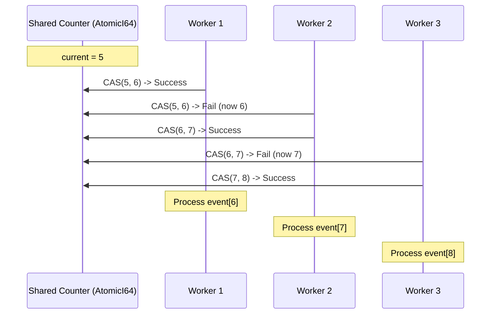
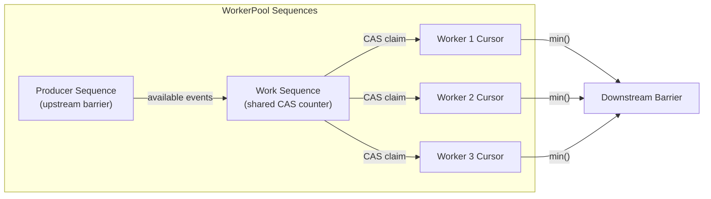
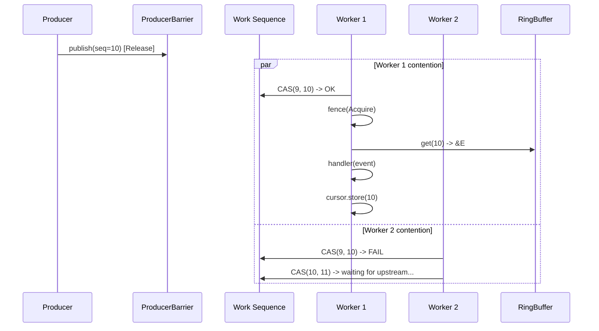
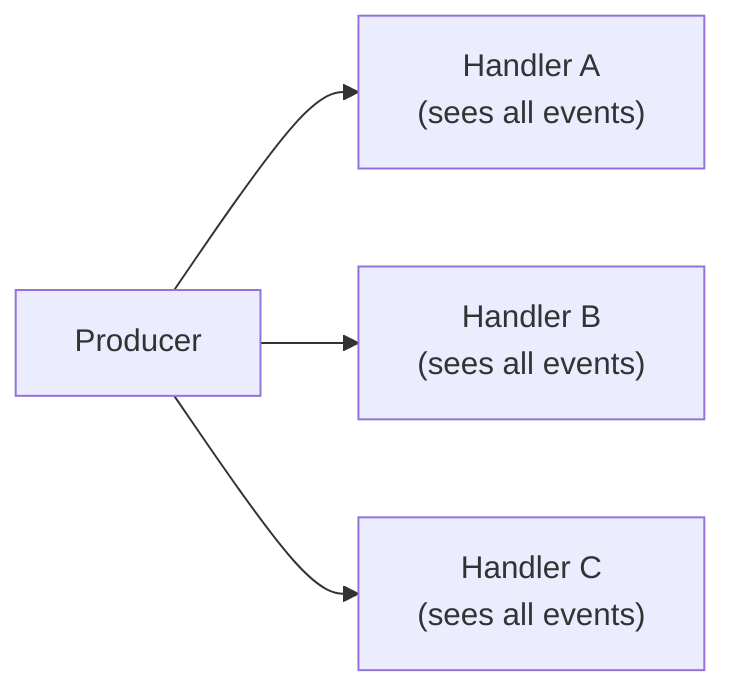
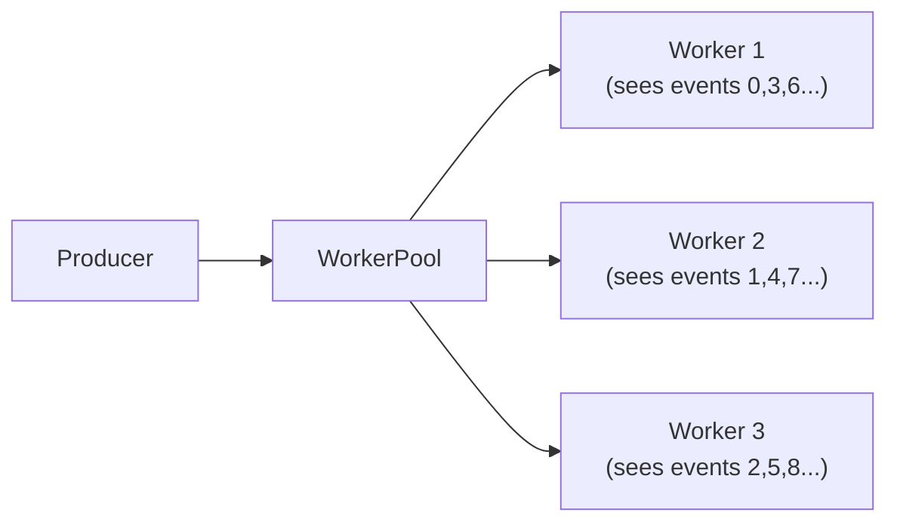
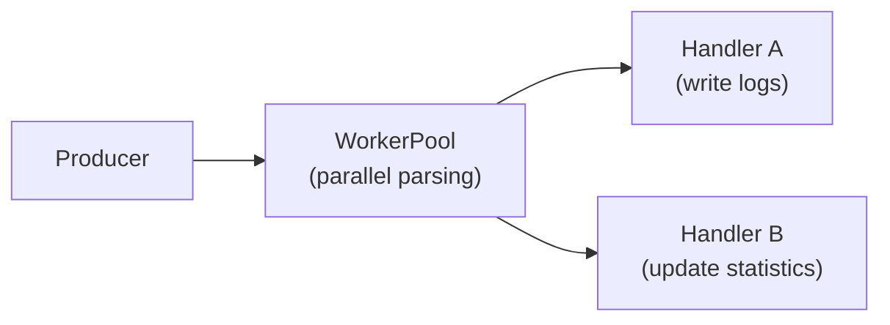

# WorkerPool: Parallel Consumption Design

> **Key takeaway**: WorkerPool achieves "each event is processed by exactly one worker" semantics through CAS-based sequence contention, complementing EventHandler's fan-out model (where each event is processed by all handlers).

- Each worker in the WorkerPool uses CAS on a shared sequence counter to compete for task assignment
- EventHandler = fan-out (broadcast), WorkerPool = work-stealing (divide and conquer)
- The current disruptor-rs does not have a built-in WorkerPool, but the architecture fully supports this pattern
- WorkerPool is suitable for CPU-intensive processing scenarios where events are independent of each other

---

## 1. WorkHandler Concept

### 1.1 Difference from EventHandler

EventHandler processes **all** events -- each event is processed by every handler. WorkHandler processes a **subset** of events -- each event is processed by exactly one worker.

| Property | EventHandler | WorkHandler |
|----------|-------------|-------------|
| Event distribution | Fan-out (broadcast) | Round-robin / contention |
| Times each event is processed | N times (N handlers) | Exactly 1 time |
| Semantics | Different processing perspectives on the same event | Parallelization of the same processing logic |
| Inter-thread dependency | None (each processes independently) | Requires sequence allocation coordination |

### 1.2 Simplified Handler Signature

WorkHandler does not need the `end_of_batch` parameter, since there is no batch semantics across workers:

```rust
// Conceptual signature (not currently implemented as a standalone trait)
FnMut(&E)
```

Compare with EventHandler:

```rust
FnMut(&E, Sequence, bool)  // event, sequence, end_of_batch
```

WorkHandler is simpler because:
- Workers do not care about the global sequence (they only process events assigned to them)
- There is no batch boundary concept (each worker advances independently)

---

## 2. CAS-Based Task Assignment

### 2.1 Core Mechanism

The key to WorkerPool is: multiple worker threads compete for a shared sequence counter. Each worker atomically claims the next sequence via CAS.



### 2.2 Pseudocode Implementation

Based on existing `Cursor` and `Barrier` primitives, a WorkerPool can be constructed as follows:

```rust
// Conceptual implementation
struct WorkerPool<E, B> {
    work_sequence:  Arc<Cursor>,       // Shared work counter
    ring_buffer:    Arc<RingBuffer<E>>,
    barrier:        Arc<B>,            // Upstream barrier
    worker_cursors: Vec<Arc<Cursor>>,  // Each worker's progress
}

// Event loop for each worker thread
fn worker_loop<E, B, W, WH>(
    work_sequence:  Arc<Cursor>,
    ring_buffer:    Arc<RingBuffer<E>>,
    barrier:        Arc<B>,
    worker_cursor:  Arc<Cursor>,
    mut handler:    WH,
    wait_strategy:  W,
) where
    B: Barrier,
    W: WaitStrategy,
    WH: FnMut(&E),
{
    let mut processed_sequence = -1_i64;

    loop {
        // Step 1: CAS contention to claim a sequence
        let mut current = work_sequence.relaxed_value();
        loop {
            // Wait for upstream to have available events
            let available = barrier.get_after(current + 1);
            if available < current + 1 {
                wait_strategy.wait_for(current + 1);
                continue;
            }

            // CAS claim
            match work_sequence.compare_exchange(current, current + 1) {
                Ok(_) => {
                    processed_sequence = current + 1;
                    break;
                }
                Err(new_current) => {
                    current = new_current;
                }
            }
        }

        // Step 2: Process event
        fence(Ordering::Acquire);
        let event_ptr = ring_buffer.get(processed_sequence);
        let event = unsafe { &*event_ptr };
        handler(event);

        // Step 3: Update worker cursor
        worker_cursor.store(processed_sequence);
    }
}
```

### 2.3 Why CAS Instead of Partitioning

**CAS contention (work-stealing)**:

$$\text{worker}_i \text{ processes sequence } s \iff \text{CAS}(s-1, s) \text{ succeeds}$$

**Static partitioning (round-robin)**:

$$\text{worker}_i \text{ processes sequence } s \iff s \mod N = i$$

| Approach | Pros | Cons |
|----------|------|------|
| CAS contention | Automatic load balancing | CAS contention overhead |
| Static partitioning | Zero contention | Slow workers drag down the whole system |

CAS contention is preferable because:
- When event processing times are uneven, faster workers automatically process more events
- No need to know the number of workers in advance to determine a partitioning strategy
- Naturally compatible with the Disruptor's sequence model

---

## 3. Sequence Tracking

### 3.1 Three Roles of Sequences



- **Producer Sequence**: The published sequence from the upstream (producer or preceding consumer)
- **Work Sequence**: The shared task assignment counter (CAS contention point)
- **Worker Cursors**: The latest sequence each worker has finished processing

### 3.2 Downstream Barrier Calculation

Downstream consumers or the producer need to know the progress of the **slowest** worker in the WorkerPool. This uses `MultiConsumerBarrier`:

$$\text{downstream\_available} = \min_{i=1}^{N}(\text{worker\_cursor}_i)$$

This is fully consistent with the existing `MultiConsumerBarrier` implementation:

```rust
impl Barrier for MultiConsumerBarrier {
    fn get_after(&self, _lower_bound: Sequence) -> Sequence {
        self.cursors.iter().fold(i64::MAX, |min_sequence, cursor| {
            let sequence = cursor.relaxed_value();
            std::cmp::min(sequence, min_sequence)
        })
    }
}
```

### 3.3 Sequence Gap Problem

Workers may process events out of order. For example, Worker 1 claims sequence 5, and Worker 2 claims 6 and finishes first. At this point, Worker 2's cursor is 6, but 5 is not yet complete.

$$\min(\text{worker\_1} = 4, \text{worker\_2} = 6) = 4$$

Downstream can only see up to sequence 4. This is correct -- downstream should not see 5 (not yet completed).

**Key invariant**: Each worker's cursor **increases monotonically**. Worker 2 updating its cursor to 6 does not imply that 5 is complete -- but the $\min$ operation ensures downstream only sees the portion completed by all workers.

---

## 4. Task Assignment Sequence Diagram

### 4.1 Normal Flow



### 4.2 Uneven Load Scenario

```mermaid
gantt
    title Worker Processing Timeline
    dateFormat X
    axisFormat %s

    section Worker 1
    Event 5 (fast)   :done, w1e5, 0, 1
    Event 8 (fast)   :done, w1e8, 3, 4
    Event 9 (slow)   :active, w1e9, 4, 8

    section Worker 2
    Event 6 (slow)   :done, w2e6, 0, 4
    Event 10 (fast)  :done, w2e10, 8, 9

    section Worker 3
    Event 7 (fast)   :done, w3e7, 0, 1
    Event 11 (fast)  :done, w3e11, 8, 9
```



CAS contention automatically achieves load balancing: faster workers claim more tasks.

---

## 5. Comparison with EventHandler Fan-Out

### 5.1 Data Flow Comparison

**EventHandler (Fan-Out)**:



Each event is processed 3 times (once by each handler).

**WorkerPool (Work Distribution)**:



Each event is processed exactly 1 time.

### 5.2 Throughput Comparison

**EventHandler**:

$$\text{throughput}_{\text{fanout}} = \min_{i=1}^{N}(\text{handler}_i \text{ throughput})$$

The bottleneck is the slowest handler. Adding more handlers does not improve throughput.

**WorkerPool**:

$$\text{throughput}_{\text{pool}} \approx N \times \text{single\_worker\_throughput} - \text{CAS\_overhead}$$

Near-linear scaling until CAS contention becomes the bottleneck.

### 5.3 Selection Guide

| Scenario | Choice | Reason |
|----------|--------|--------|
| Same event needs different processing (logging + statistics + forwarding) | EventHandler | Each handler does something different |
| Parallelization of the same processing logic (CPU-intensive computation) | WorkerPool | Horizontally scales processing capacity |
| Events have ordering dependencies | EventHandler | WorkerPool does not guarantee processing order |
| Events are mutually independent | WorkerPool | Can safely process out of order |

---

## 6. Thread Management

### 6.1 Worker Thread Lifecycle

Each worker is a dedicated OS thread, managed the same way as managed consumer threads:

```mermaid
stateDiagram-v2
    [*] --> Spawned: thread::spawn
    Spawned --> Competing: Enter CAS loop
    Competing --> Processing: CAS success
    Processing --> Competing: cursor.store() complete
    Competing --> Shutdown: shutdown_at_sequence reached
    Shutdown --> [*]: thread exits
```

### 6.2 Shutdown Semantics

WorkerPool shutdown is the same as for regular consumers:

1. When the producer is dropped, it sets `shutdown_at_sequence`
2. Workers check the shutdown condition in the CAS loop
3. After all claimed sequences are processed, the worker exits

**Critical**: A worker must not exit after a successful CAS but before completing processing. Otherwise, that sequence becomes a "hole" that is never processed.

### 6.3 CPU Affinity Considerations

Worker threads in a WorkerPool engage in CAS contention with each other. If multiple workers are pinned to cores on the same NUMA node, CAS operation latency will be lower:

| Topology | CAS Latency | Suitable for WorkerPool |
|----------|------------|------------------------|
| Hyperthreads on the same core | ~10 cycles | Yes (but hyperthreads share resources) |
| Same NUMA node | ~30-40 cycles | Optimal |
| Cross NUMA node | ~100-200 cycles | Not recommended |

---

## 7. Hybrid Topologies

WorkerPool can be combined with EventHandler to form complex processing topologies:



In this topology:
1. The producer publishes raw events
2. The WorkerPool processes CPU-intensive parsing work in parallel
3. After parsing completes, Handler A and Handler B each process all parsed events

This combination leverages WorkerPool's parallel processing capability and EventHandler's fan-out capability.

### 7.1 Barrier Chaining

All worker cursors in a WorkerPool are aggregated via `MultiConsumerBarrier` into a single downstream barrier. Subsequent EventHandlers depend on this barrier:

```rust
// Pseudocode
let worker_cursors: Vec<Arc<Cursor>> = workers.iter()
    .map(|w| Arc::clone(&w.cursor))
    .collect();
let pool_barrier = MultiConsumerBarrier::new(worker_cursors);
// Subsequent handlers depend on pool_barrier
```

This is fully consistent with `and_then()` semantics -- a WorkerPool appears as a "composite node" in the Disruptor's DAG.

---

## 8. Comparison with Java WorkerPool

| Dimension | Java Disruptor | disruptor-rs (conceptual) |
|-----------|---------------|--------------------------|
| Interface | `WorkHandler<T>` | `FnMut(&E)` |
| Assignment mechanism | `WorkerPool.workSequence` CAS | Same (based on `Cursor` CAS) |
| Thread management | `Executor` submission | `thread::spawn` |
| Ordering guarantee | None (out-of-order processing) | None (out-of-order processing) |
| Dynamic scaling | Not supported | Not supported |
| Integration method | `disruptor.handleEventsWithWorkerPool()` | Builder API extension |

The Java version encapsulates all logic within the `WorkerPool` class. disruptor-rs can compose an equivalent implementation using the existing `Cursor`, `Barrier`, and `MultiConsumerBarrier` primitives, without introducing new atomic types or synchronization primitives.
