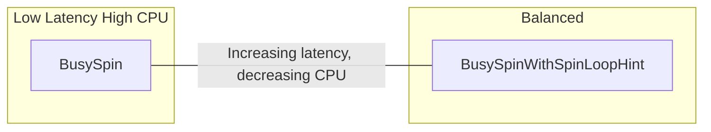

# Performance Tuning

> **Key takeaway**: Three pillars of latency optimization

- Wait strategy selection: BusySpin is fastest but uses 100% CPU
- CPU affinity: pin threads to cores to eliminate context switches
- Ring buffer sizing + batch publish: balance throughput and cache efficiency
- Compile-time optimization: `target-cpu=native`, LTO, `codegen-units=1`

---

## 1. Wait Strategy Selection

The wait strategy determines how a consumer waits when there are no new events.

| Strategy | Latency | CPU Usage | Use Case |
|----------|---------|-----------|----------|
| `BusySpin` | **Lowest** (ns level) | 100% | Ultra-low latency: HFT, real-time pricing |
| `BusySpinWithSpinLoopHint` | Low (slightly higher than BusySpin) | ~95% | Low latency with slight CPU savings |

### Usage

```rust
use disruptor::*;

// Lowest latency
let mut producer = build_single_producer(64, factory, BusySpin)
    .handle_events_with(handler)
    .build();

// Slightly lower CPU usage
let mut producer = build_single_producer(64, factory, BusySpinWithSpinLoopHint)
    .handle_events_with(handler)
    .build();
```

### Latency vs CPU Tradeoff



**Decision rules**:

- If you have dedicated cores (isolated CPUs), use `BusySpin`
- If CPU resources are tight or core count is limited, use `BusySpinWithSpinLoopHint`
- `BusySpin` works best when combined with `pin_at_core`

### Custom Wait Strategy

Implement the `WaitStrategy` trait:

```rust
use disruptor::wait_strategies::WaitStrategy;
use disruptor::Sequence;

#[derive(Copy, Clone)]
struct Yielding;

impl WaitStrategy for Yielding {
    fn wait_for(&self, _sequence: Sequence) {
        std::thread::yield_now();
    }
}
```

Requirements: `Copy + Clone + Send`.

---

## 2. CPU Affinity (Core Pinning)

Pin consumer threads to specific cores to eliminate OS scheduling jitter.

### Basic Usage

```rust
use disruptor::*;

let mut producer = build_single_producer(64, factory, BusySpin)
    .pin_at_core(1).thread_name("decoder")
    .handle_events_with(handler_a)
    .pin_at_core(2).thread_name("risk")
    .handle_events_with(handler_b)
    .build();
```

### Core Pinning Best Practices

1. **Isolate cores**: `isolcpus=1-4` (GRUB kernel parameter)
2. **Avoid Core 0**: Reserve it for OS interrupt handling
3. **Same NUMA node**: Check topology with `numactl --hardware`
4. **Avoid hyper-threading sibling cores**: Sharing a physical core causes resource contention

### Latency Impact of Core Pinning + BusySpin

Latency distribution without core pinning:

$$P_{99} \approx 2\text{--}10 \mu s \quad (\text{context switch jitter})$$

With core pinning:

$$P_{99} \approx 50\text{--}200 ns \quad (\text{cache-to-cache transfer})$$

---

## 3. Ring Buffer Size Selection

The ring buffer size must be a power of 2. It affects both latency and throughput.

### Size Constraints

- **SingleProducer**: minimum 2
- **MultiProducer**: minimum 64 (due to availability bitmap implementation)
- Must be $2^n$, otherwise the build will panic

### Selection Formula

$$\text{size} = 2^{\lceil \log_2(B \times M) \rceil}$$

Where:

- $B$ = expected burst batch size
- $M$ = safety multiplier (typically 2-4)

### Size vs Performance Tradeoff

| Too Small | Too Large |
|-----------|-----------|
| Frequent backpressure | Exceeds L1/L2 cache capacity |
| `try_publish` fails frequently | Increased cache misses |
| Suitable for: rare events, low throughput | Suitable for: large bursts, high throughput |

### Cache Calculation

$$\text{ring buffer memory} = \text{size} \times \text{sizeof(Event)}$$

L1 cache is typically 32-64 KB. If your Event is 64 bytes:

| Ring Buffer Size | Memory Usage | Cache Fit |
|-----------------|--------------|-----------|
| 64 | 4 KB | L1 |
| 256 | 16 KB | L1 |
| 1024 | 64 KB | L1/L2 boundary |
| 4096 | 256 KB | L2 |
| 65536 | 4 MB | L3 |

**Recommendation**: Start with 64 or 256, then adjust using benchmarks.

---

## 4. Batch Publishing Optimization

Batch publishing reduces the number of barrier synchronizations.

### Single vs Batch

```rust
// 10 barrier synchronizations
for i in 0..10 {
    producer.publish(|e| e.data = i);
}

// 1 barrier synchronization
producer.batch_publish(10, |iter| {
    for (i, e) in iter.enumerate() {
        e.data = i as i64;
    }
});
```

### Throughput Improvement

$$\text{throughput gain} \approx \frac{n}{1 + (n-1) \times r}$$

Where $n$ = batch size, $r$ = barrier synchronization overhead ratio.

When barrier synchronization is the bottleneck, batch_publish can improve throughput by 2-5x.

### Consumer-Side Batching

Use the `end_of_batch` flag for batch flushing:

```rust
let handler = |state: &mut Vec<i64>, e: &Event, _seq, end_of_batch| {
    state.push(e.data);
    if end_of_batch {
        // Batch write -- reduce system calls
        // write_batch_to_disk(state);
        state.clear();
    }
};
```

---

## 5. Compilation Optimization

### Cargo.toml profile

```toml
[profile.release]
opt-level = 3
lto = "fat"           # Link-Time Optimization
codegen-units = 1     # Single codegen unit for better optimization
panic = "abort"       # Reduce unwind overhead
```

### Environment Variables

```bash
# Optimize for the current CPU microarchitecture
RUSTFLAGS="-C target-cpu=native" cargo build --release
```

### .cargo/config.toml

```toml
[build]
rustflags = ["-C", "target-cpu=native"]
```

### Optimization Impact Reference

| Optimization | Throughput Improvement | Latency Improvement |
|-------------|----------------------|---------------------|
| `target-cpu=native` | 5-15% | 5-10% |
| LTO=fat | 10-20% | 5-15% |
| `codegen-units=1` | 5-10% | 5-10% |
| All three combined | 20-40% | 15-30% |

---

## 6. Benchmarking

disruptor-rs includes built-in criterion benchmarks:

```bash
cargo bench                  # All benchmarks
cargo bench --bench spsc     # Single producer single consumer
cargo bench --bench mpsc     # Multi producer single consumer
cargo bench --bench poller   # EventPoller
```

Analysis tools:

```bash
perf stat cargo bench --bench spsc          # perf statistics
cargo install flamegraph && cargo flamegraph --bench spsc  # Flame graph
```

Criterion HTML reports are automatically generated at `target/criterion/report/index.html`.

---

## 7. Common Performance Pitfalls

| Pitfall | BAD | GOOD |
|---------|-----|------|
| Blocking I/O in handler | `fs::write` per event | Use `end_of_batch` for batch flushing |
| Heap allocation on hot path | `String::from("hello")` | Fixed-size `[u8; N]` buffer |
| Oversized Event | `[u8; 4096]` (4KB) | $\leq$ 64 bytes (one cache line) |
| Ring buffer too large/small | `1 << 20` or `2` | 64-256, adjust with benchmarks |
| Using MultiProducer for single thread | No CAS needed but using multi | Use `build_single_producer` |

---

## 8. Performance Tuning Checklist

| Item | Check | Priority |
|------|-------|----------|
| Wait strategy | BusySpin + dedicated cores? | P0 |
| CPU affinity | Consumer threads pinned to cores? | P0 |
| Ring buffer size | Power of 2, matching burst size? | P1 |
| Handler | No blocking I/O? No heap allocation? | P1 |
| Batch publish | Batch publishing enabled? | P1 |
| Event size | $\leq$ 64 bytes? | P2 |
| Compile flags | native + LTO? | P2 |
| Producer type | Using SingleProducer for single thread? | P2 |
| NUMA | Same node? Avoiding cross-NUMA? | P3 |
| Hyper-threading | Avoiding sibling cores? | P3 |
