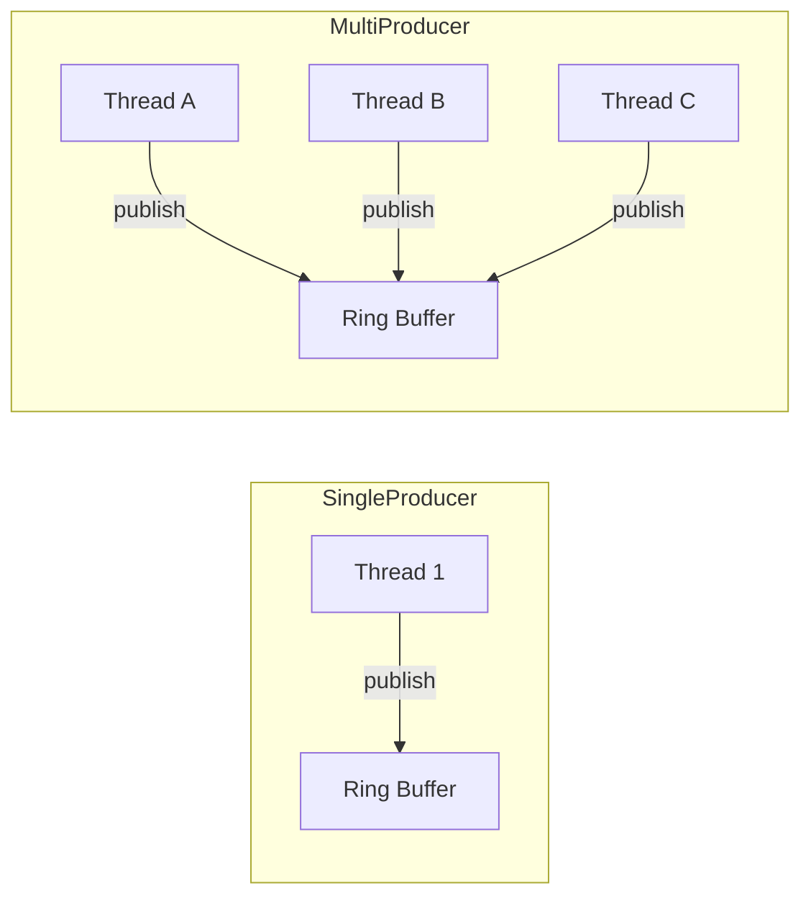
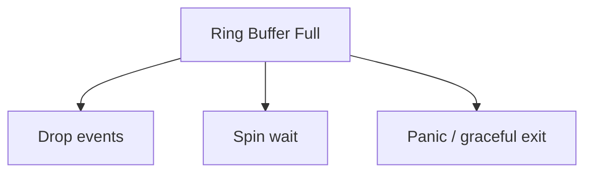

# Producer Guide

> **Key takeaway**: Choose the right Producer type and use the right publishing method

- Single producer: single-threaded publishing, zero coordination overhead, lowest latency
- Multi producer: multi-threaded publishing, coordinated via CAS, cloneable
- Prefer `try_publish` / `try_batch_publish` for explicit backpressure handling
- Producer drop triggers graceful shutdown

---

## 1. Single vs Multi Producer



| Feature | SingleProducer | MultiProducer |
|---------|---------------|---------------|
| Publishing threads | Only 1 | Any number |
| Coordination mechanism | None (no contention with single thread) | CAS (lock-free) |
| Latency | Lowest | Slightly higher |
| Clone | Not supported | Supported |
| Minimum ring buffer size | 2 | 64 |
| Build function | `build_single_producer` | `build_multi_producer` |

**Selection rule**: If only one thread publishes events, use `SingleProducer`. Otherwise use `MultiProducer`.

---

## 2. Building a Producer

### Single Producer

```rust
use disruptor::*;

struct Event { data: i64 }

let mut producer = build_single_producer(64, || Event { data: 0 }, BusySpin)
    .handle_events_with(|e: &Event, _seq, _eob| {
        // Process event
    })
    .build();
```

### Multi Producer

```rust
use disruptor::*;

struct Event { data: i64 }

// Note: Multi producer ring buffer minimum size is 64
let producer = build_multi_producer(64, || Event { data: 0 }, BusySpin)
    .handle_events_with(|e: &Event, _seq, _eob| {
        // Process event
    })
    .build();
```

---

## 3. Single Event Publishing

### `try_publish` -- Non-blocking, recommended

```rust
match producer.try_publish(|e| { e.data = 42; }) {
    Ok(sequence) => {
        // Successfully published at sequence
    }
    Err(RingBufferFull) => {
        // Ring buffer is full -- consumer cannot keep up
        // Your decision: drop? retry? panic?
    }
}
```

### `publish` -- Blocking spin

```rust
// Spins indefinitely if the ring buffer is full
producer.publish(|e| { e.data = 42; });
```

> `publish` busy spins when the ring buffer is full. In latency-sensitive scenarios, this means the publishing thread will be blocked if the consumer cannot keep up.

---

## 4. Batch Publishing

Batch publishing reduces the number of barrier synchronizations. This provides a significant throughput improvement.

### `try_batch_publish` -- Non-blocking

```rust
let batch_size = 10;

match producer.try_batch_publish(batch_size, |iter| {
    for (i, e) in iter.enumerate() {
        e.data = i as i64;
    }
}) {
    Ok(last_sequence) => {
        // Successfully published 10 events, last sequence = last_sequence
    }
    Err(MissingFreeSlots(missing)) => {
        // Needed 10 slots but `missing` slots are unavailable
    }
}
```

### `batch_publish` -- Blocking spin

```rust
producer.batch_publish(10, |iter| {
    // iter is guaranteed to yield exactly 10 events
    for e in iter {
        e.data = 1;
    }
});
```

> A batch size of 0 is a no-op.

---

## 5. Error Handling

Two error types:

### `RingBufferFull`

Returned by `try_publish`, indicating no free slots in the ring buffer.

```rust
use disruptor::RingBufferFull;

match producer.try_publish(|e| { e.data = 1; }) {
    Ok(_) => {}
    Err(RingBufferFull) => {
        // Strategy 1: Drop the event
        eprintln!("dropped event");
        // Strategy 2: Panic (recommended for low-latency scenarios)
        // panic!("consumer cannot keep up");
    }
}
```

### `MissingFreeSlots`

Returned by `try_batch_publish`, containing the number of missing slots.

```rust
use disruptor::MissingFreeSlots;

match producer.try_batch_publish(100, |iter| {
    for e in iter { e.data = 0; }
}) {
    Ok(_) => {}
    Err(MissingFreeSlots(n)) => {
        // Still need n more free slots
        eprintln!("need {} more slots", n);
    }
}
```

---

## 6. Backpressure Strategies

When the consumer cannot keep up with the producer, the ring buffer becomes full. You have three strategies:



| Strategy | Method | Use Case |
|----------|--------|----------|
| Spin wait | `publish` / `batch_publish` | Acceptable latency variance |
| Drop events | `try_publish` + ignore Err | Discardable monitoring data |
| Panic | `try_publish` + panic on Err | Financial trading (latency = risk) |

**Recommended for financial scenarios**: Use `try_publish`. If `RingBufferFull`, cancel pending orders / mark prices as indicative, then panic.

```rust
match producer.try_publish(|e| { e.data = new_price; }) {
    Ok(_) => {}
    Err(RingBufferFull) => {
        // 1. Cancel all pending orders
        // cancel_all_orders();
        // 2. Panic
        panic!("latency breach: consumer cannot keep up");
    }
}
```

---

## 7. Multi-Producer: Clone and Thread Safety

`MultiProducer` implements `Clone`. Each clone is an independent publishing handle.

```rust
use std::thread;
use disruptor::*;

struct Event { data: i64 }

let mut producer1 = build_multi_producer(64, || Event { data: 0 }, BusySpin)
    .handle_events_with(|e: &Event, _, _| { /* process */ })
    .build();

let mut producer2 = producer1.clone();
let mut producer3 = producer1.clone();

thread::scope(|s| {
    s.spawn(move || {
        for i in 0..1000 {
            producer1.publish(|e| e.data = i);
        }
    });
    s.spawn(move || {
        for i in 1000..2000 {
            producer2.publish(|e| e.data = i);
        }
    });
    s.spawn(move || {
        for i in 2000..3000 {
            producer3.publish(|e| e.data = i);
        }
    });
});
```

**Notes**:

- Each thread should have its own `MultiProducer` handle (via `clone()`)
- Do not share the same handle across threads -- `MultiProducer` is not `Sync`
- Clone overhead is minimal (Arc clone)

---

## 8. Shutdown Semantics (Drop)

When a Producer is dropped:

1. Sets the shutdown sequence
2. Waits for all consumers to finish processing published events
3. Joins all consumer threads

- **SingleProducer**: drop triggers shutdown
- **MultiProducer**: shutdown is triggered when the **last** clone is dropped

```rust
let mut p1 = build_multi_producer(64, factory, BusySpin)
    .handle_events_with(handler)
    .build();
let mut p2 = p1.clone();
drop(p1); // p2 still exists -- no shutdown triggered
drop(p2); // last one -- shutdown triggered
```

---

## 9. Performance Tips

- **Pre-compute**: Complete computations outside the `publish` closure; only do assignments inside
- **Batch publish**: `batch_publish` reduces barrier synchronization count, improving throughput 2-5x
- **Use SingleProducer for single threads**: No CAS; SPSC is 2-3x faster than MPSC
- **Event $\leq$ 64 bytes**: Keep it within one cache line
- **Ring buffer sizing**: Start with 64, adjust using benchmarks

See [Performance Tuning](performance-tuning.md) for details.
