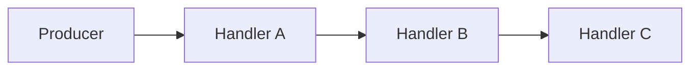
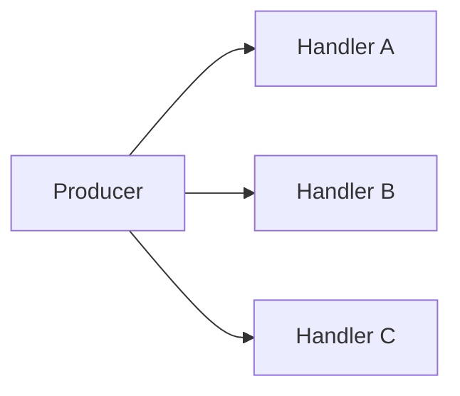
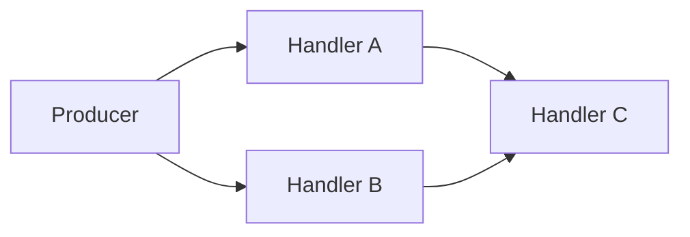
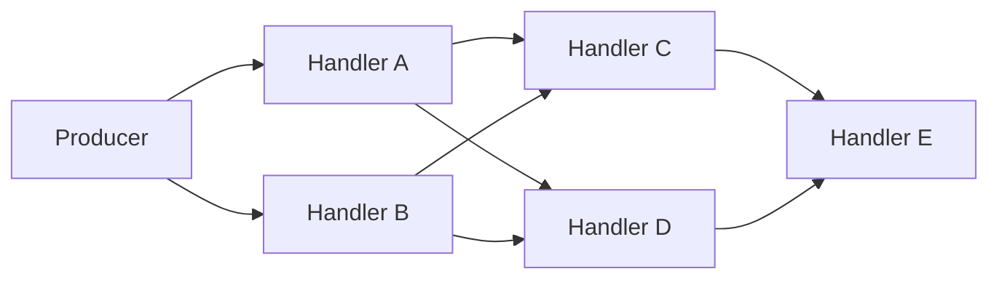
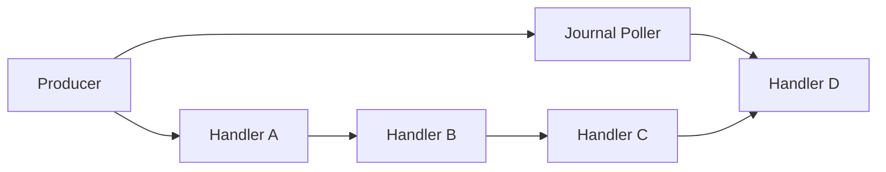
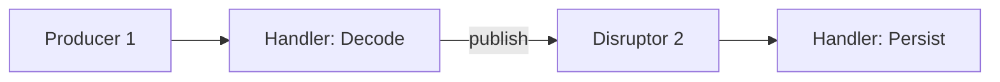
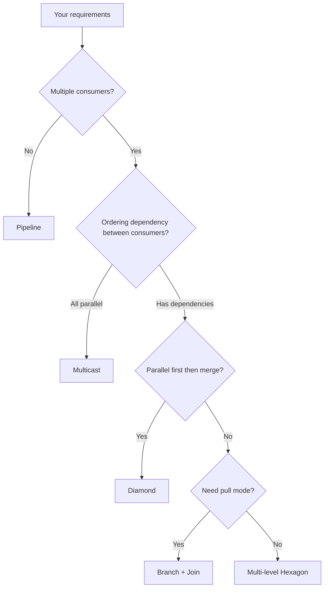

# Topology Patterns

> **Key takeaway**: Compose arbitrary DAGs with the builder API

- `handle_events_with`: add parallel consumers
- `and_then`: create sequential dependency barriers
- `new_branch` + `join`: build complex DAGs
- Each pattern includes a Mermaid diagram + complete code

---

## Pattern Overview

| Pattern | API | Use Case |
|---------|-----|----------|
| Pipeline | `and_then()` | Sequential processing stages |
| Parallel / Multicast | Multiple `handle_events_with` | Process the same event through multiple paths |
| Diamond | parallel + `and_then` | Parallel processing then merge |
| Hexagon | Multi-level diamond | Complex multi-stage DAG |
| Branch | `new_branch` + `join` | Long branches with deferred merging |
| Chained Disruptors | Output feeds input | Cross-Disruptor chaining |

---

## 1. Pipeline: A -> B -> C

Events pass through multiple processing stages in sequence. B must wait for A to finish before reading the same event.



### Code

```rust
use disruptor::*;

struct Event { data: i64 }

let handler_a = |e: &Event, _: Sequence, _: bool| {
    // Stage 1: Decode
};
let handler_b = |e: &Event, _: Sequence, _: bool| {
    // Stage 2: Validate
};
let handler_c = |e: &Event, _: Sequence, _: bool| {
    // Stage 3: Persist
};

let mut producer = build_single_producer(64, || Event { data: 0 }, BusySpin)
    .handle_events_with(handler_a)
    .and_then()                       // After A completes
    .handle_events_with(handler_b)
    .and_then()                       // After B completes
    .handle_events_with(handler_c)
    .build();

producer.publish(|e| e.data = 42);
```

**Execution order guarantee**: For the same event (same sequence), A runs before B, and B runs before C.

---

## 2. Parallel / Multicast: A | B | C

Multiple handlers read the same event in parallel. No ordering dependency.



### Code

```rust
use disruptor::*;

struct Event { data: i64 }

let handler_a = |e: &Event, _: Sequence, _: bool| { /* Logging */ };
let handler_b = |e: &Event, _: Sequence, _: bool| { /* Risk control */ };
let handler_c = |e: &Event, _: Sequence, _: bool| { /* Statistics */ };

let mut producer = build_single_producer(64, || Event { data: 0 }, BusySpin)
    .handle_events_with(handler_a)
    .handle_events_with(handler_b)
    .handle_events_with(handler_c)
    .build();

producer.publish(|e| e.data = 42);
```

**Key point**: Consecutive calls to `handle_events_with` (without inserting `and_then`) means parallel execution.

**Backpressure**: The producer waits for the **slowest** consumer to release a slot.

---

## 3. Diamond: A,B -> C

Two handlers process in parallel, then merge into a third handler.



### Code

```rust
use disruptor::*;

struct Event { data: i64 }

let handler_a = |e: &Event, _: Sequence, _: bool| { /* Path A */ };
let handler_b = |e: &Event, _: Sequence, _: bool| { /* Path B */ };
let handler_c = |e: &Event, _: Sequence, _: bool| { /* Merge */ };

let mut producer = build_single_producer(64, || Event { data: 0 }, BusySpin)
    .handle_events_with(handler_a)  // A in parallel
    .handle_events_with(handler_b)  // B in parallel
    .and_then()                     // Wait for both A and B to complete
    .handle_events_with(handler_c)  // C runs after A and B
    .build();

producer.publish(|e| e.data = 42);
```

**Semantics**: When `and_then()` is called after multiple parallel consumers, it creates a barrier that waits for **all** parallel consumers.

---

## 4. Hexagon: A,B -> C,D -> E

Two levels of parallel processing, with a merge after each level.



### Code

```rust
use disruptor::*;

struct Event { data: i64 }

let a = |e: &Event, _: Sequence, _: bool| { /* A */ };
let b = |e: &Event, _: Sequence, _: bool| { /* B */ };
let c = |e: &Event, _: Sequence, _: bool| { /* C */ };
let d = |e: &Event, _: Sequence, _: bool| { /* D */ };
let e_handler = |e: &Event, _: Sequence, _: bool| { /* E */ };

let mut producer = build_single_producer(64, || Event { data: 0 }, BusySpin)
    .handle_events_with(a)
    .handle_events_with(b)
    .and_then()                     // Wait for A and B
    .handle_events_with(c)
    .handle_events_with(d)
    .and_then()                     // Wait for C and D
    .handle_events_with(e_handler)
    .build();

producer.publish(|e| e.data = 1);
```

**General rule**: Multiple `handle_events_with` = parallel, `and_then` = barrier. Alternate between them to build any number of levels.

---

## 5. Branch + Join: DAG Topology

When you need a branch running in parallel with a multi-stage pipeline and merging at a later point, use `new_branch` + `join`.

### Typical Scenario: Journaling



Journal poller `J` runs in parallel with the pipeline A->B->C. Handler D waits for both J and C to complete.

### Code

```rust
use disruptor::*;

struct Event { data: i64 }

let a = |e: &Event, _: Sequence, _: bool| { /* stage A */ };
let b = |e: &Event, _: Sequence, _: bool| { /* stage B */ };
let c = |e: &Event, _: Sequence, _: bool| { /* stage C */ };
let d = |e: &Event, _: Sequence, _: bool| { /* stage D */ };

// 1. Create builder
let mut builder = build_single_producer(64, || Event { data: 0 }, BusySpin);

// 2. Create branch (branch starts consuming from the producer barrier)
let branch = builder.new_branch();

// 3. Build main pipeline
let builder = builder
    .handle_events_with(a)
    .and_then()
    .handle_events_with(b)
    .and_then()
    .handle_events_with(c);

// 4. Join branch -- D waits for both the branch and C
let (mut journal_poller, builder) = builder.join(branch);
let builder = builder.handle_events_with(d);

let mut producer = builder.build();

// 5. journal_poller polls in your thread
std::thread::spawn(move || {
    loop {
        match journal_poller.poll() {
            Ok(mut guard) => {
                for event in &mut guard {
                    // journal to disk
                }
            }
            Err(Polling::NoEvents) => std::hint::spin_loop(),
            Err(Polling::Shutdown) => break,
        }
    }
});

// 6. Publish events
for i in 0..100 {
    producer.publish(|e| e.data = i);
}
```

### `new_branch` vs `new_event_poller`

| Feature | `new_branch` | `new_event_poller` |
|---------|--------------|--------------------|
| Returns | `Branch` (opaque) | `(EventPoller, Builder)` |
| When poller is obtained | When `join` is called | Immediately |
| Can insert downstream barriers | Yes (can continue with `and_then` after `join`) | Yes |
| Use case | Long branches running in parallel with multi-stage pipelines | Simple pull consumption |

---

## 6. EventPoller Topology

Use `new_event_poller` to add pull-mode consumers. Can be mixed with managed consumers.

```rust
use disruptor::*;

struct Event { data: i64 }

// EventPoller + managed consumer in parallel
let builder = build_single_producer(64, || Event { data: 0 }, BusySpin)
    .handle_events_with(|e: &Event, _, _| { /* managed */ });

let (mut poller, builder) = builder.new_event_poller();
let mut producer = builder.build();
// Producer waits for the slower of the two.
```

See [Consumer Guide - EventPoller](consumer-guide.md#3-eventpoller-pull-mode) for details.

---

## 7. Chained Disruptors

Use the second Disruptor's producer as the handler state of the first:



```rust
use disruptor::*;

struct RawEvent { raw: Vec<u8> }
struct Decoded  { value: f64 }

let mut producer2 = build_single_producer(64, || Decoded { value: 0.0 }, BusySpin)
    .handle_events_with(|e: &Decoded, _, _| { println!("persist: {}", e.value); })
    .build();

let mut producer1 = build_single_producer(64, || RawEvent { raw: vec![] }, BusySpin)
    .handle_events_and_state_with(
        |p2: &mut SingleProducer<Decoded, _>, event: &RawEvent, _, _| {
            let val = event.raw.len() as f64;
            p2.publish(|e| e.value = val);
        },
        move || producer2,
    )
    .build();

producer1.publish(|e| { e.raw = vec![1, 2, 3]; });
```

---

## 8. Topology Selection Decision Tree



---

## 9. Important Notes

- **Event sharing**: Parallel consumers read the same `&E`; do not modify it via unsafe
- **Slot reclamation**: Slots are only reclaimed after all consumers (including EventPoller) have finished processing
- **Slowest determines backpressure**: One slow consumer slows down the entire Disruptor
- **`and_then` resets**: After `and_then`, you can continue adding parallel consumers
- **Typestate builder**: The compiler guarantees you cannot build without at least one consumer
