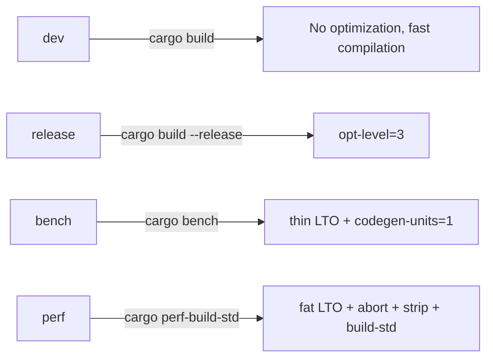

# Configuration Reference

> **Key takeaway**: The performance of disruptor-rs depends on three layers of configuration -- Cargo dependencies and features, compiler flags (`target-cpu=native`, LTO, `codegen-units=1`), and runtime parameters (ring buffer size, wait strategy, CPU affinity). Proper configuration can reduce latency by an order of magnitude.

---

## Cargo.toml Dependencies

```toml
[package]
name    = "disruptor"
version = "4.0.0"
edition = "2024"
rust-version = "1.85"

[dependencies]
crossbeam-utils = "0.8"   # CachePadded, prevents false sharing
core_affinity   = "0.8.1" # CPU affinity binding
thiserror       = "2.0"   # Error type derive macros

[dev-dependencies]
criterion  = { version = "0.5", features = ["html_reports"] }
crossbeam  = "0.8"        # For benchmark comparison
```

Currently there are no feature flags. All functionality is enabled by default.

---

## .cargo/config.toml Compiler Flags

### Global rustflags

```toml
[build]
rustflags = ["-C", "target-cpu=native", "-Z", "tune-cpu=native"]
rustc-wrapper = "sccache"
```

| Flag | Purpose |
|---|---|
| `-C target-cpu=native` | Enable all instruction sets of the current CPU (AVX-512, etc.) |
| `-Z tune-cpu=native` | Tune instruction scheduling for the current CPU microarchitecture (nightly only) |
| `rustc-wrapper = "sccache"` | Compilation cache to speed up incremental builds |

### Build profiles

```toml
[profile.perf]
inherits     = "release"
lto          = "fat"       # Full LTO
codegen-units = 1          # Single codegen unit, maximum optimization
panic        = "abort"     # No unwind overhead
strip        = "symbols"   # Strip symbols, reduce binary size

[profile.bench]
lto          = "thin"      # Thin LTO, balanced compile speed
codegen-units = 1
```

### Cargo aliases

```toml
[alias]
perf-build-std = "build --profile perf -Z build-std=core,alloc,std,proc_macro ..."
perf-bench-std = "bench --profile perf -Z build-std=core,alloc,std,proc_macro ..."
```

These aliases enable `-Z build-std` to recompile the standard library, applying `target-cpu=native` to `core`/`alloc`/`std`.

Usage:

```bash
# Regular release build
cargo build --release

# Maximum performance build (requires nightly + sccache disabled)
RUSTC_WRAPPER="" cargo perf-build-std

# Benchmark (thin LTO)
cargo bench

# Maximum performance benchmark
RUSTC_WRAPPER="" cargo perf-bench-std
```

### Unstable features

```toml
[unstable]
codegen-backend  = true    # Allow switching backends (cranelift, etc.)
trim-paths       = true    # Remove build paths, reproducible builds
profile-rustflags = true   # Allow per-profile rustflags
```

---

## rust-toolchain.toml

```toml
[toolchain]
channel    = "nightly"
components = ["clippy", "rustfmt", "rust-src", "rust-analyzer", "miri"]
targets    = ["x86_64-unknown-linux-gnu"]
```

| Component | Purpose |
|---|---|
| `clippy` | Static analysis |
| `rustfmt` | Code formatting |
| `rust-src` | Required for `build-std` to recompile the standard library |
| `rust-analyzer` | IDE support |
| `miri` | Undefined behavior detection (run `cargo miri test` in CI) |

---

## Ring Buffer Size Selection

The ring buffer size must be a **power of 2**. For `MultiProducer`, the minimum is **64**.

Selection guide:

$$\text{size} = 2^{\lceil \log_2(\text{expected\_burst}) \rceil}$$

| Scenario | Recommended Size | Rationale |
|---|---|---|
| Low-latency SPSC | 8 - 256 | Smaller buffer improves cache hit rate |
| Burst traffic | 1024 - 65536 | Absorb bursts and avoid `RingBufferFull` |
| Multi-producer | 64 - 4096 | >= 64 (bitmap alignment); larger sizes reduce CAS contention |

```rust
// 8 slots, single producer
build_single_producer(8, factory, BusySpin);

// 4096 slots, multi-producer
build_multi_producer(4096, factory, BusySpin);
```

---

## Wait Strategy Configuration

| Strategy | Latency | CPU Usage | Use Case |
|---|---|---|---|
| `BusySpin` | Lowest | 100% | Latency-sensitive: trading systems, real-time processing |
| `BusySpinWithSpinLoopHint` | Low | ~100% | Power saving or hyperthread-friendly scenarios |

You pass the wait strategy when constructing the builder:

```rust
// Lowest latency
build_single_producer(8, factory, BusySpin);

// With spin loop hint
build_single_producer(8, factory, BusySpinWithSpinLoopHint);
```

Wait strategies must implement `Copy + Send`. You can define custom ones:

```rust
use disruptor::{WaitStrategy, Sequence};

#[derive(Copy, Clone)]
struct YieldStrategy;

impl WaitStrategy for YieldStrategy {
    fn wait_for(&self, _sequence: Sequence) {
        std::thread::yield_now();
    }
}
```

---

## CPU Affinity Configuration

Use `pin_at_core(id)` to pin a consumer thread to a specific CPU core. `id` must be an existing core number on the system, otherwise it panics.

```rust
build_single_producer(8, factory, BusySpin)
    .pin_at_core(1).handle_events_with(handler_a)   // Core 1
    .pin_at_core(2).handle_events_with(handler_b)   // Core 2
    .build();
```

If pinning fails (e.g., insufficient permissions), a warning is printed to stderr but it does not panic.

---

## Thread Naming

Use `thread_name(name)` to set the name of the next consumer thread. If not set, names are auto-generated as `processor-1`, `processor-2`, ...

```rust
build_single_producer(8, factory, BusySpin)
    .thread_name("market-data")
    .handle_events_with(handler)
    .build();
```

Thread names are visible in tools like `top -H`, `htop`, and `perf record`.

---

## Build Profile Summary



| Profile | LTO | codegen-units | panic | Purpose |
|---|---|---|---|---|
| `dev` | off | 256 | unwind | Development and debugging |
| `release` | off | 16 | unwind | Regular release |
| `bench` | thin | 1 | unwind | Benchmarking |
| `perf` | fat | 1 | abort | Production deployment, maximum performance |
