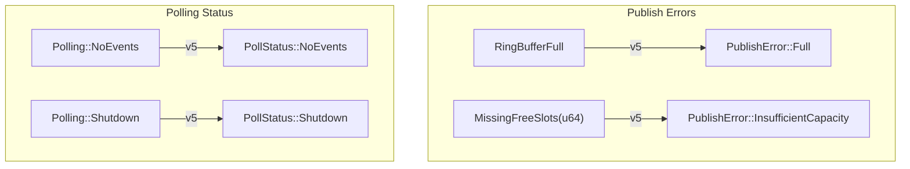

# Error Type Catalog

> **Key takeaway**: disruptor-rs defines 4 error/status types in two categories -- **publish errors** (`RingBufferFull`, `MissingFreeSlots`) and **polling status** (`Polling::NoEvents`, `Polling::Shutdown`). Publish errors indicate backpressure, while polling status indicates Disruptor lifecycle events.

---

## Overview



---

## Publish Errors

### `RingBufferFull`

```rust
#[derive(Debug, Error, PartialEq)]
#[error("Ring Buffer is full.")]
pub struct RingBufferFull;
```

**When it occurs**: When calling `try_publish()` and all ring buffer slots are occupied by unconsumed events.

**Root cause**: The consumer cannot keep up with the producer's publish rate. This is a **backpressure signal**, typically indicating that system latency is increasing.

**Handling strategies**:

| Strategy | Use Case | Code |
|---|---|---|
| Drop data | Non-critical data (metrics, etc.) | Ignore `Err` |
| Retry | Short bursts | Loop `try_publish` |
| Panic | Latency-sensitive systems | `try_publish(...).unwrap()` |
| Switch to `publish` | When spin-waiting is acceptable | Use the blocking variant |

```rust
use disruptor::*;

// Strategy 1: Drop
let _ = producer.try_publish(|e| { e.price = 42.0; });

// Strategy 2: Panic (recommended for trading systems)
producer.try_publish(|e| {
    e.price = 42.0;
}).expect("Ring buffer full -- consumer cannot keep up, aborting");

// Strategy 3: Use blocking variant (spin until space is available)
producer.publish(|e| { e.price = 42.0; });
```

---

### `MissingFreeSlots(pub u64)`

```rust
#[derive(Debug, Error, PartialEq)]
#[error("Missing free slots in Ring Buffer: {0}")]
pub struct MissingFreeSlots(pub u64);
```

**When it occurs**: When calling `try_batch_publish(n, ...)` and the ring buffer does not have enough free slots to accommodate the entire batch of `n` events.

**Inner value**: The `u64` represents the number of missing slots. Calculation:

$$\text{missing} = n - \text{free\_slots}(last\_published, rear\_consumer)$$

**Handling strategies**:

| Strategy | Code |
|---|---|
| Retry with smaller batch | Use the `missing` value to calculate the publishable count |
| Wait and retry | Loop calling `try_batch_publish` |
| Switch to `batch_publish` | Use the blocking variant |

```rust
use disruptor::*;

match producer.try_batch_publish(100, |iter| {
    for e in iter { e.price = 1.0; }
}) {
    Ok(seq) => println!("published up to sequence {seq}"),
    Err(MissingFreeSlots(missing)) => {
        eprintln!("need {missing} more free slots");
        // Optional: retry with smaller batch
    }
}
```

---

## Polling Status

### `Polling` (enum)

```rust
#[derive(Debug, Error, PartialEq)]
pub enum Polling {
    #[error("No available events.")]
    NoEvents,
    #[error("Disruptor is shut down.")]
    Shutdown,
}
```

**v5 target**: Renamed to `PollStatus`.

### `Polling::NoEvents`

**When it occurs**: When calling `EventPoller::poll()` or `EventPoller::take(n)` and there are no new events to read.

**Meaning**: The producer has not published new events, or the events published by the producer have not yet been marked as available by the upstream barrier.

**Handling**: Perform other work, or retry later.

```rust
match poller.poll() {
    Ok(mut events) => {
        for event in &mut events { /* process events */ }
    }
    Err(Polling::NoEvents) => {
        // No new events -- do other work or yield
        std::thread::yield_now();
    }
    Err(Polling::Shutdown) => { /* see below */ }
}
```

### `Polling::Shutdown`

**When it occurs**: All `Producer` instances have been dropped, and the poller's next sequence to read equals `shutdown_at_sequence`.

**Meaning**: The Disruptor lifecycle has ended. No more events will be published.

**Handling**: Exit the consumer loop and clean up resources.

```rust
loop {
    match poller.poll() {
        Ok(mut events) => {
            for event in &mut events { /* ... */ }
        }
        Err(Polling::NoEvents) => continue,
        Err(Polling::Shutdown) => {
            println!("Disruptor shut down, exiting consumer loop");
            break;
        }
    }
}
```

---

## Error Type Relationships

| Method | Return Type | Success Value | Error Value |
|---|---|---|---|
| `try_publish(f)` | `Result<Sequence, RingBufferFull>` | Published sequence | Ring buffer full |
| `try_batch_publish(n, f)` | `Result<Sequence, MissingFreeSlots>` | Last sequence in batch | Number of missing slots |
| `publish(f)` | `()` | -- | Does not return error (spins) |
| `batch_publish(n, f)` | `()` | -- | Does not return error (spins) |
| `EventPoller::poll()` | `Result<EventGuard, Polling>` | Event guard | NoEvents / Shutdown |
| `EventPoller::take(n)` | `Result<EventGuard, Polling>` | Event guard (at most n) | NoEvents / Shutdown |

---

## v4 -> v5 Migration

```rust
// v4
use disruptor::{RingBufferFull, MissingFreeSlots, Polling};

// v5 (planned)
use disruptor::{PublishError, PollStatus};
// PublishError::Full          replaces RingBufferFull
// PublishError::InsufficientCapacity  replaces MissingFreeSlots
// PollStatus::NoEvents        replaces Polling::NoEvents
// PollStatus::Shutdown        replaces Polling::Shutdown
```
