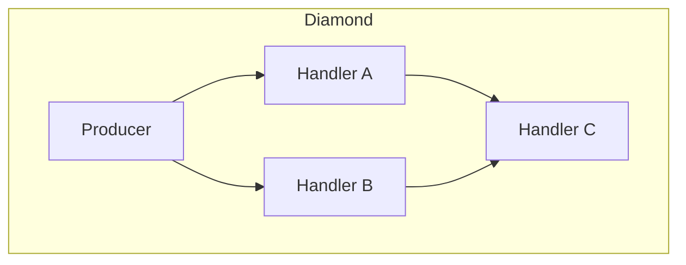
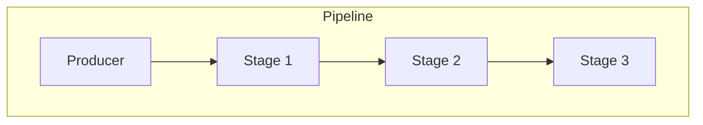
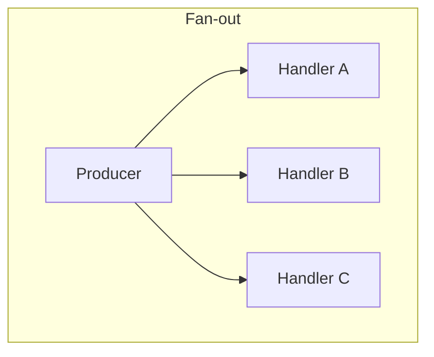
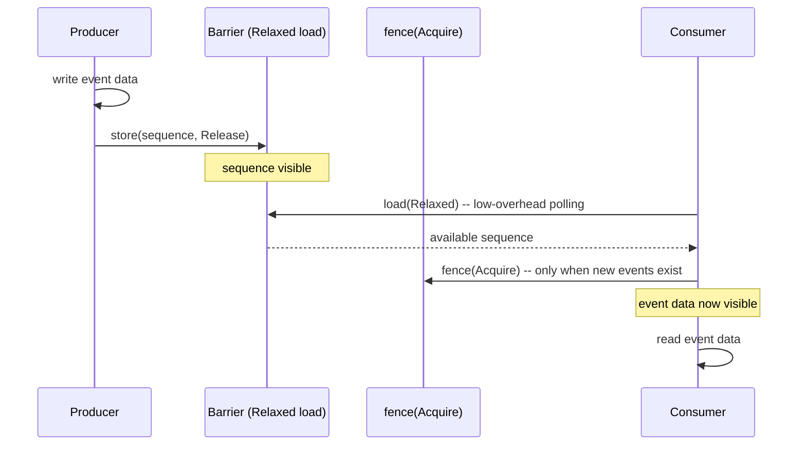

# Glossary: LMAX Java Disruptor vs. disruptor-rs

> **Key takeaway**: disruptor-rs implements the core semantics of the LMAX Disruptor, but simplifies the Java version's class hierarchy. This table maps the ~20 core types from Java to their Rust counterparts, helping you quickly transition from Java knowledge.

---

## Core Concept Mapping

| Term (English) | Java Class | Rust Current (v4) | Rust Target (v5) | Description |
|---|---|---|---|---|
| Sequence | `Sequence` | `type Sequence = i64` | `Sequence` (unchanged) | Monotonically increasing number assigned to events in the ring buffer. Initial value -1 means unpublished. |
| Ring Buffer | `RingBuffer<E>` | `RingBuffer<E>` (internal) | `RingBuffer<E>` (internal) | Fixed-size pre-allocated array, indexed in $O(1)$ via bitmask (`index & (size-1)`). Size must be a power of 2. |
| Sequence Barrier | `SequenceBarrier` | `trait Barrier` (internal) | `trait Barrier` (internal) | Coordinates dependencies between components. Consumers query the barrier for the latest available upstream sequence. |
| Sequencer | `Sequencer` | No direct equivalent | No direct equivalent | Abstract interface in Java that unifies single/multi producer sequence allocation logic. Replaced by the `ProducerBarrier` trait in Rust. |
| Single Producer Sequencer | `SingleProducerSequencer` | `SingleProducerBarrier` | `SingleSequencer` | Single-threaded sequence allocation. No CAS, pure sequential writes, lowest latency. |
| Multi Producer Sequencer | `MultiProducerSequencer` | `MultiProducerBarrier` | `MultiSequencer` | Multi-threaded sequence allocation. Uses CAS (`compare_exchange`) to contend for sequences, availability bitmap to track publish status. |
| Event Handler | `EventHandler<E>` | `FnMut(&E, Sequence, bool)` | Same | Callback that processes a single event. The `bool` parameter `end_of_batch` indicates whether this is the last event in the current batch. |
| Event Processor | `EventProcessor` | `Consumer` (internal) | `Consumer` (internal) | Loop that runs an event handler in a dedicated thread. The Disruptor automatically manages thread lifecycle. |
| Batch Event Processor | `BatchEventProcessor<E>` | `start_processor()` (internal) | Same | Concrete implementation class in Java. The consumer loop in Rust natively supports batch processing -- `while available >= sequence` loop. |
| Work Handler | `WorkHandler<E>` | -- (not implemented) | Planned | Multiple workers compete to consume events (each event is processed by only one worker). Different from EventHandler (every consumer sees all events). |
| Worker Pool | `WorkerPool<E>` | -- (not implemented) | Planned | Container managing a group of WorkHandlers. Assigns events to workers via CAS-based sequence contention. |
| Wait Strategy | `WaitStrategy` | `trait WaitStrategy` | Same | How consumers wait when no new events are available. Affects the latency/CPU tradeoff. |

---

## Wait Strategy Detailed Mapping

| Java Strategy | Java Class | Rust Current (v4) | Rust Target (v5) | Behavior |
|---|---|---|---|---|
| Busy Spin | `BusySpinWaitStrategy` | `BusySpin` | `BusySpin` | Empty loop. Lowest latency, 100% CPU. |
| Spin + Hint | -- | `BusySpinWithSpinLoopHint` | `SpinHint` | `core::hint::spin_loop()`. Allows CPU power saving. |
| Yielding | `YieldingWaitStrategy` | -- (user can customize) | Planned built-in | `Thread.yield()`. Reduces CPU but increases latency. |
| Sleeping | `SleepingWaitStrategy` | -- (user can customize) | Planned built-in | Three-phase progression: spin -> yield -> sleep. |
| Blocking | `BlockingWaitStrategy` | -- (user can customize) | Planned built-in | `Mutex` + `CondVar`. Lowest CPU usage, highest latency. |
| Timeout Blocking | `TimeoutBlockingWaitStrategy` | -- | Planned built-in | Blocking wait with timeout. |
| Lite Blocking | `LiteBlockingWaitStrategy` | -- | Planned built-in | Optimized blocking wait, reduces lock contention. |
| Phased Backoff | `PhasedBackoffWaitStrategy` | -- | Planned built-in | spin -> yield -> custom fallback strategy. |

---

## Build & Lifecycle Concepts

| Term (English) | Java Class | Rust Current (v4) | Rust Target (v5) | Description |
|---|---|---|---|---|
| Event Factory | `EventFactory<E>` | `FnMut() -> E` | Same | Factory closure called during ring buffer pre-allocation. Called once per slot. |
| Event Translator | `EventTranslator<E>` | `FnOnce(&mut E)` | Same | Update closure used during publishing. Mutates the pre-allocated event in place, avoiding allocation. |
| Disruptor | `Disruptor<E>` | `build_single_producer` / `build_multi_producer` | `Disruptor::single()` / `Disruptor::multi()` | Entry point builder function. In Java it is a class; in Rust it is a function that returns a builder. |
| Lifecycle Aware | `LifecycleAware` | `Drop` on `Producer` | Same | In Java, handlers can implement `onStart`/`onShutdown`. In Rust, `Producer::drop()` triggers shutdown and consumer threads are automatically joined. |
| Exception Handler | `ExceptionHandler<E>` | panic propagation | Same | Exception callback in Java. In Rust, handler panics propagate through `JoinHandle`. PublishGuard ensures that panics do not create sequence holes. |
| Event Poller | `EventPoller<E>` | `EventPoller<E, B>` | Same | Consumer API for user-controlled threads. Introduced in Java 3.4+, corresponding to Rust's `poll()` / `take()` methods. |

---

## Rust-Specific Concepts

| Term | Type | Description |
|---|---|---|
| EventGuard | `EventGuard<'p, E, B>` | RAII guard; advances the cursor on drop after iterating over events. Prevents event references from escaping (lifetime-bound). |
| Branch | `Branch<E, B>` | Branch handle for DAG topology construction. Supports parallel branching followed by merging via `new_branch()` / `join()`. |
| ProcessorSettings | `trait ProcessorSettings<E, W>` | Builder methods: `pin_at_core()`, `thread_name()`. In Java, this is achieved through `ThreadFactory`. |
| MutBatchIter | `MutBatchIter<'a, E>` | Iterator of `&mut E` provided during batch publishing. Guaranteed to yield exactly `n` events. |
| Cursor | `Cursor` (internal) | Wrapper around `CachePadded<AtomicI64>`. Provides `store(Release)`, `relaxed_value()`, `compare_exchange(AcqRel, Relaxed)`. |
| Availability Bitmap | `Box<[AtomicU64]>` (internal to MultiProducerBarrier) | Multi-producer publish tracking. 1 bit per slot, using even/odd round XOR encoding to indicate whether a slot has been published. |

---

## Topology Patterns

| Pattern | Java Construction | Rust Construction |
|---|---|---|
| Pipeline | `disruptor.handleEventsWith(a).then(b).then(c)` | `builder.handle_events_with(a).and_then().handle_events_with(b).and_then().handle_events_with(c)` |
| Fan-out | `disruptor.handleEventsWith(a, b, c)` | `builder.handle_events_with(a).handle_events_with(b).handle_events_with(c)` |
| Diamond | `disruptor.handleEventsWith(a, b).then(c)` | `builder.handle_events_with(a).handle_events_with(b).and_then().handle_events_with(c)` |

---

## Memory Ordering Mapping

| Operation | Java | Rust | Semantics |
|---|---|---|---|
| Publish sequence | `UNSAFE.putOrderedLong` (StoreStore) | `AtomicI64::store(Release)` / `fetch_xor(Release)` | Ensures event data is visible to consumers |
| Read sequence | `volatile read` | `AtomicI64::load(Relaxed)` + `fence(Acquire)` | Separates load and fence to reduce overhead |
| CAS contention | `UNSAFE.compareAndSwapLong` | `compare_exchange(AcqRel, Relaxed)` | Success: AcqRel; Failure: Relaxed retry |
| Reference counting (MultiProducer) | -- | `fetch_add(AcqRel)` / `fetch_sub(AcqRel)` | clone/drop count synchronization |
| Shutdown signal | Explicit `halt()` | `AtomicI64::store(Relaxed)` | Relaxed is sufficient -- eventually visible in the loop |
| Availability bitmap | `UNSAFE.putOrderedLong` | `AtomicU64::fetch_xor(Relaxed/Release)` | Single publish uses Release; batch uses `fence(Release)` + Relaxed |

### Memory Ordering Design Rationale

disruptor-rs uses a **separated fence pattern** rather than per-load Acquire:

The advantage of this pattern: when there are no new events, the consumer's polling loop only performs Relaxed loads (cost close to a regular memory read). An Acquire fence is executed only once when new events are discovered.

---

## Design Differences Summary

| Aspect | Java LMAX Disruptor | disruptor-rs |
|---|---|---|
| Language | Java (GC, volatile, Unsafe) | Rust (no GC, atomics, unsafe blocks) |
| Event allocation | Pre-allocated object array | Pre-allocated `Box<[UnsafeCell<E>]>` |
| Type safety | Runtime checks | Compile-time typestate (NC/SC/MC) |
| Thread management | `Executor` injection | Built-in `thread::spawn` + `JoinHandle` |
| Exception handling | `ExceptionHandler` callback | `PublishGuard` RAII + `JoinHandle` propagation |
| Lifecycle | Manual `start()`/`halt()` | `Drop` auto-shutdown + join |
| Cache padding | `Unsafe.putLong` manual padding | `crossbeam_utils::CachePadded` |
| Batch publishing | No native support | `batch_publish` / `try_batch_publish` |
| User-controlled consuming | `EventPoller` (3.4+) | `EventPoller` + `EventGuard` RAII |
| DAG construction | `handleEventsWith().then()` | `handle_events_with().and_then()` + `new_branch()`/`join()` |

---

## Common Abbreviations

| Abbreviation | Full Name |
|---|---|
| SPSC | Single Producer, Single Consumer |
| SPMC | Single Producer, Multiple Consumers |
| MPSC | Multiple Producers, Single Consumer |
| MPMC | Multiple Producers, Multiple Consumers |
| CAS | Compare-And-Swap |
| AcqRel | Acquire-Release |
| LTO | Link-Time Optimization |
| UB | Undefined Behavior |
| RAII | Resource Acquisition Is Initialization |
| EOB | End of Batch |
