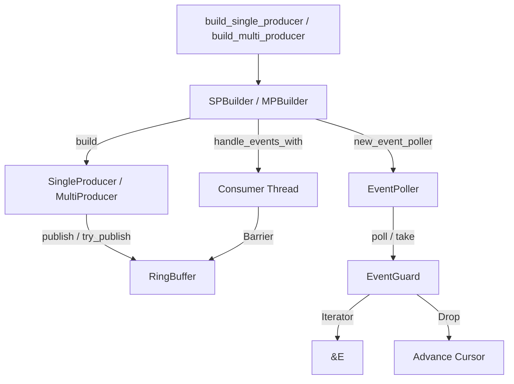

# Public API Reference

> **Key takeaway**: disruptor-rs exports approximately 20 public types, organized into five groups: **building** / **publishing** / **consuming** / **wait strategies** / **errors**. The v5 rename will align with LMAX terminology, but semantics remain unchanged.

This document lists the complete public API of the `disruptor` crate as of v4, with the v5 target name annotated next to each entry.
You can use this page as a quick reference -- it contains no tutorials, only signatures, descriptions, and minimal examples.

---

## Table of Contents

- [Type Aliases](#type-aliases)
- [Builder Functions](#builder-functions)
- [Builder & ProcessorSettings](#builder--processorsettings)
- [Producer Trait & Implementations](#producer-trait--implementations)
- [Barrier Types](#barrier-types)
- [Consumer Side: EventPoller / EventGuard / Branch](#consumer-side)
- [WaitStrategy](#waitstrategy)
- [Error Types](#error-types)

---

## Type Aliases

| Current (v4) | v5 Target | Definition |
|---|---|---|
| `Sequence` | `Sequence` (unchanged) | `pub type Sequence = i64;` |

`Sequence` is the monotonically increasing number assigned to events in the ring buffer. An initial value of `-1` means "not yet published".

---

## Builder Functions

### `build_single_producer`

```rust
pub fn build_single_producer<E, W, F>(
    size:          usize,       // Must be a power of 2
    event_factory: F,           // FnMut() -> E
    wait_strategy: W,           // impl WaitStrategy
) -> SPBuilder<NC, E, W, SingleProducerBarrier>
```

**v5 target**: `Disruptor::single(size, factory, wait_strategy)`

Creates a single-producer Disruptor builder. `size` must be a power of 2, otherwise it panics.

```rust
use disruptor::*;

struct Event { price: f64 }

let mut producer = build_single_producer(8, || Event { price: 0.0 }, BusySpin)
    .handle_events_with(|e: &Event, _seq, _eob| { /* ... */ })
    .build();
```

### `build_multi_producer`

```rust
pub fn build_multi_producer<E, W, F>(
    size:          usize,       // Must be a power of 2, >= 64
    event_factory: F,
    wait_strategy: W,
) -> MPBuilder<NC, E, W, MultiProducerBarrier>
```

**v5 target**: `Disruptor::multi(size, factory, wait_strategy)`

Creates a multi-producer Disruptor builder. `size` must be a power of 2 and >= 64.

```rust
use disruptor::*;

struct Event { price: f64 }

let mut p1 = build_multi_producer(64, || Event { price: 0.0 }, BusySpin)
    .handle_events_with(|e: &Event, _seq, _eob| {})
    .build();

let mut p2 = p1.clone(); // Multi-producer supports clone
```

---

## Builder & ProcessorSettings

### `SPBuilder<State, E, W, B>` / `MPBuilder<State, E, W, B>`

The builder uses a typestate pattern (`NC` -> `SC` -> `MC`) to ensure at least one consumer is added before `build()` can be called.

**Core methods (shared by both builders)**:

| Method | Returns | Description |
|---|---|---|
| `handle_events_with(handler)` | `Builder<SC/MC, ...>` | Add an event handler closure that runs in a dedicated thread |
| `handle_events_and_state_with(handler, init)` | `Builder<SC/MC, ...>` | Same as above, with thread-local state |
| `and_then()` | `Builder<NC, ...>` | End the current concurrent stage; subsequent handlers wait for all previous ones to complete before reading |
| `new_event_poller()` | `(EventPoller, Builder)` | Obtain an EventPoller for user-controlled consumer threads |
| `new_branch()` | `Branch<E, B>` | Create a DAG branch |
| `join(branch)` | `(EventPoller, Builder)` | Merge a branch and obtain the corresponding EventPoller |
| `build()` | `SingleProducer` / `MultiProducer` | Finalize the build and start consumer threads |

### `trait ProcessorSettings<E, W>`

```rust
pub trait ProcessorSettings<E, W>: Sized {
    fn pin_at_core(self, id: usize) -> Self;
    fn thread_name(self, name: &'static str) -> Self;
}
```

**v5 target**: Method names remain unchanged.

Sets CPU affinity and thread name for the next event handler to be added.

```rust
build_single_producer(8, factory, BusySpin)
    .pin_at_core(1)
    .thread_name("price-handler")
    .handle_events_with(handler)
    .build();
```

---

## Producer Trait & Implementations

### `trait Producer<E>`

```rust
pub trait Producer<E> {
    fn try_publish<F>(&mut self, update: F) -> Result<Sequence, RingBufferFull>
    where F: FnOnce(&mut E);

    fn publish<F>(&mut self, update: F)
    where F: FnOnce(&mut E);

    fn try_batch_publish<'a, F>(&'a mut self, n: usize, update: F)
        -> Result<Sequence, MissingFreeSlots>
    where E: 'a, F: FnOnce(MutBatchIter<'a, E>);

    fn batch_publish<'a, F>(&'a mut self, n: usize, update: F)
    where E: 'a, F: FnOnce(MutBatchIter<'a, E>);
}
```

The `try_` variants return an error when the ring buffer is full. The versions without the `try_` prefix spin-wait until space becomes available.

**Publishing limit**: $2^{63} - 1$ events. Behavior beyond this limit is undefined; the library does not perform bounds checking (for performance reasons).

### `SingleProducer<E, C>`

**v5 target**: Name unchanged.

```rust
pub struct SingleProducer<E, C> { /* ... */ }
impl<E, C: Barrier> Producer<E> for SingleProducer<E, C> { /* ... */ }
impl<E, C> Drop for SingleProducer<E, C> { /* ... */ } // Triggers shutdown
```

Single-threaded publishing. On drop, sets `shutdown_at_sequence` and joins all consumer threads.

### `MultiProducer<E, C>`

**v5 target**: Name unchanged.

```rust
pub struct MultiProducer<E, C> { /* ... */ }
impl<E, C: Barrier> Producer<E> for MultiProducer<E, C> { /* ... */ }
impl<E, C> Clone for MultiProducer<E, C> { /* ... */ }
impl<E, C> Drop for MultiProducer<E, C> { /* ... */ } // Shutdown when the last clone is dropped
```

Multi-threaded publishing. Create a handle for each thread via `clone()`. Uses a CAS loop (`compare_exchange`) to allocate sequences among producers.

```rust
let mut p2 = producer.clone();
std::thread::spawn(move || {
    p2.publish(|e| { e.price = 99.0; });
});
```

---

## Barrier Types

### `SingleProducerBarrier`

**v5 target**: `SingleSequencer`

```rust
pub struct SingleProducerBarrier { /* Cursor */ }
impl Barrier for SingleProducerBarrier { /* relaxed load */ }
```

Tracks the latest sequence published by the single producer.

### `MultiProducerBarrier`

**v5 target**: `MultiSequencer`

```rust
pub struct MultiProducerBarrier { /* Cursor + availability bitmap */ }
impl Barrier for MultiProducerBarrier { /* Scan availability bitmap */ }
```

Uses an availability bitmap (1 bit per slot, with even/odd round encoding) to track multi-producer publish status.

### `SingleConsumerBarrier`

```rust
pub struct SingleConsumerBarrier { /* Arc<Cursor> */ }
impl Barrier for SingleConsumerBarrier { /* relaxed load */ }
```

Tracks the progress of a single consumer.

### `MultiConsumerBarrier`

```rust
pub struct MultiConsumerBarrier { /* Vec<Arc<Cursor>> */ }
impl Barrier for MultiConsumerBarrier { /* fold min */ }
```

Tracks the progress of the slowest consumer among multiple consumers (takes the min).

---

## Consumer Side

### `EventPoller<E, B>`

```rust
pub struct EventPoller<E, B> { /* ... */ }

impl<E, B: Barrier> EventPoller<E, B> {
    pub fn poll(&mut self) -> Result<EventGuard<'_, E, B>, Polling>;
    pub fn take(&mut self, limit: u64) -> Result<EventGuard<'_, E, B>, Polling>;
    pub fn has_available(&self) -> bool;
}
```

Consumer API for user-controlled threads. `poll()` returns all available events; `take(n)` returns at most `n` events.

```rust
loop {
    match poller.poll() {
        Ok(mut events) => {
            for event in &mut events { /* process */ }
        } // EventGuard drop -> advances cursor
        Err(Polling::NoEvents) => { /* do other work */ }
        Err(Polling::Shutdown) => break,
    }
}
```

### `EventGuard<'p, E, B>`

```rust
pub struct EventGuard<'p, E, B> { /* ... */ }
impl<'g, E, B> Iterator for &'g mut EventGuard<'_, E, B> {
    type Item = &'g E;
}
impl<E, B> ExactSizeIterator for &mut EventGuard<'_, E, B> { }
impl<E, B> Drop for EventGuard<'_, E, B> { } // store cursor
```

RAII guard: iterates over events for reading, and notifies the Disruptor of read completion on drop. The lifetime is bound to `&'g mut` to prevent event references from escaping.

### `Branch<E, B>`

```rust
pub struct Branch<E, B> { /* contains EventPoller */ }
```

An opaque branch handle. Created via `builder.new_branch()`, merged via `builder.join(branch)` to obtain an EventPoller. Used for DAG topologies.

---

## WaitStrategy

### `trait WaitStrategy`

```rust
pub trait WaitStrategy: Copy + Send {
    fn wait_for(&self, sequence: Sequence);
}
```

Wait strategy for consumers when no new events are available.

### `BusySpin`

**v5 target**: Name unchanged.

```rust
#[derive(Copy, Clone)]
pub struct BusySpin;
```

Empty loop. Lowest latency, highest CPU usage.

### `BusySpinWithSpinLoopHint`

**v5 target**: `SpinHint`

```rust
#[derive(Copy, Clone)]
pub struct BusySpinWithSpinLoopHint;
```

Calls `std::hint::spin_loop()`. Allows the CPU to save power or switch hyperthreads, with slightly higher latency.

---

## Error Types

| Current (v4) | v5 Target | Signature |
|---|---|---|
| `RingBufferFull` | `PublishError::Full` | `pub struct RingBufferFull;` |
| `MissingFreeSlots(pub u64)` | `PublishError::InsufficientCapacity` | `pub struct MissingFreeSlots(pub u64);` |
| `Polling::NoEvents` | `PollStatus::NoEvents` | `enum Polling { NoEvents, Shutdown }` |
| `Polling::Shutdown` | `PollStatus::Shutdown` | Same as above |

All error types implement `Debug`, `Error`, `PartialEq`.

For detailed descriptions, see [error-catalog.md](./error-catalog.md).

---

## Dependency Graph



---

## Version Migration Quick Reference

| v4 Name | v5 Name | Change Type |
|---|---|---|
| `build_single_producer(...)` | `Disruptor::single(...)` | Function -> associated function |
| `build_multi_producer(...)` | `Disruptor::multi(...)` | Function -> associated function |
| `SingleProducerBarrier` | `SingleSequencer` | Rename |
| `MultiProducerBarrier` | `MultiSequencer` | Rename |
| `BusySpinWithSpinLoopHint` | `SpinHint` | Rename |
| `RingBufferFull` | `PublishError::Full` | struct -> enum variant |
| `MissingFreeSlots` | `PublishError::InsufficientCapacity` | struct -> enum variant |
| `Polling` | `PollStatus` | Rename |
| `Cursor` (internal) | `Sequence` (internal) | Internal rename |
