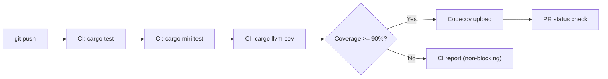

# Test Coverage Targets

> **Key Takeaway**: disruptor-rs targets overall line coverage >= 90%. Key concurrency modules (`producer/multi.rs`, `consumer.rs`) require >= 85% and must pass Miri and stress tests. CI collects coverage via `cargo-llvm-cov` and uploads to Codecov.

---

## Module Coverage Targets

| Module | Unit Test Target (%) | Integration Tests | Stress Tests | Miri |
|---|---|---|---|---|
| `cursor.rs` | >= 95 | -- | -- | Required |
| `ringbuffer.rs` | >= 95 | -- | -- | Required |
| `barrier.rs` | >= 90 | -- | -- | Required |
| `producer.rs` (trait + iter) | >= 85 | Required | -- | Required |
| `producer/single.rs` | >= 90 | Required | SPSC bench | Required |
| `producer/multi.rs` | >= 85 | Required | MPSC bench | Required |
| `consumer.rs` | >= 85 | Required | Multi-consumer | Required |
| `consumer/event_poller.rs` | >= 85 | Required | Poller bench | Required |
| `builder.rs` | >= 80 | Required | -- | Required |
| `builder/single.rs` | >= 80 | Required | -- | Required |
| `builder/multi.rs` | >= 80 | Required | -- | Required |
| `wait_strategies.rs` | >= 95 | -- | -- | Required |
| `affinity.rs` | >= 70 | -- | -- | Skip (OS interaction) |
| `lib.rs` (doc tests) | >= 90 | -- | -- | Required |

**Overall Target**: >= 90% line coverage

---

## Test Type Definitions

| Test Type | Purpose | Tool | Run Frequency |
|---|---|---|---|
| Unit tests | Module-level logic correctness | `cargo test` | Every push |
| Integration tests | End-to-end functional verification (SPSC, MPSC, poller) | `cargo test` | Every push |
| Miri | Detect undefined behavior (data race, UB) | `cargo miri test` | Every push |
| Stress tests | Correctness under high concurrency | benchmark harness | Before release |
| Coverage | Quantify test adequacy | `cargo-llvm-cov` | Every push/PR |

---

## CI Execution Commands

### Build & Test (`.github/workflows/build_and_test.yml`)

```bash
# Build
cargo build --verbose

# Run all tests
cargo test --verbose

# Miri detection
rustup toolchain install nightly --component miri
rustup override set nightly
cargo miri setup
cargo miri test
```

### Coverage (`.github/workflows/test_coverage.yml`)

```bash
# Install cargo-llvm-cov
cargo install cargo-llvm-cov

# Generate lcov format coverage
cargo llvm-cov --all-features --lcov --output-path lcov.info

# Upload to Codecov
# (via codecov/codecov-action@v4.0.1)
```

### Local Development Commands

```bash
# Run tests + coverage report (HTML)
cargo llvm-cov --html --open

# View summary only
cargo llvm-cov --summary-only

# View by file
cargo llvm-cov --lcov | grep "^SF:" | sort

# Miri detection (local)
cargo +nightly miri test

# Stress tests (benchmark)
cargo bench --bench spsc
cargo bench --bench mpsc
cargo bench --bench poller
```

---

## Coverage Tool Comparison

| Tool | Pros | Cons | Recommended Scenario |
|---|---|---|---|
| `cargo-llvm-cov` | Precise (LLVM instrumentation), supports lcov | Requires `llvm-tools-preview` | **CI primary tool** |
| `cargo-tarpaulin` | Easy to install, supports Codecov | Slightly less accurate, not all platforms supported | Backup option |
| `grcov` | Supports multiple output formats | Complex configuration | Special needs |

Currently CI uses `cargo-llvm-cov`.

---

## Coverage Exclusion Rules

The following code is excluded from coverage targets:

| Exclusion | Reason |
|---|---|
| Helper functions inside `#[cfg(test)]` modules | Test infrastructure |
| `panic!` paths (size validation, etc.) | Defensive programming, triggers abort |
| `eprintln!` (affinity binding failures) | OS interaction boundary |
| `process::abort()` (counter overflow) | Extreme case, cannot be safely triggered in tests |
| Benchmark code (`benches/`, `benchs/`) | Performance tests, not functional code |

---

## Coverage Threshold Enforcement



In the current CI configuration, coverage drops are reported via Codecov PR comments but do not block merging (`fail_ci_if_error: true` only blocks on upload failures).

**Planned Enhancements**:

| Phase | Measure |
|---|---|
| Current | Codecov PR comment reports coverage changes |
| Next step | Set Codecov `patch` threshold: new code >= 80% |
| Goal | Set Codecov `project` threshold: total coverage >= 90%, block merge if not met |

---

## Key Test Scenario Checklist

| Scenario | Test File | Verification Content |
|---|---|---|
| SPSC basic publish/consume | Integration test | Single event, batch event correct delivery |
| MPSC multi-producer concurrency | Integration test | All events consumed, no loss |
| Ring buffer full behavior | Unit test | `RingBufferFull` / `MissingFreeSlots` returned correctly |
| EventPoller poll/take | Integration test | Events read correctly, guard drop advances cursor |
| EventPoller shutdown | Integration test | Returns `Polling::Shutdown` after all producers drop |
| DAG topology (diamond) | Integration test | and_then dependencies correct |
| CPU affinity | Manual test | Thread bound to specified core |
| Panic in handler | Unit test | PublishGuard prevents sequence gaps |
| Multi-round wrap | Unit test | Availability bitmap multi-round XOR correct |
| Miri: all paths | `cargo miri test` | No UB, no data race |
