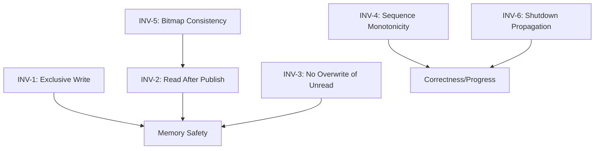

# Safety Invariants Catalog

> **Key Takeaway**: disruptor-rs maintains 6 core safety invariants. Together they guarantee: no concurrent read-write conflicts, no data tearing, and no use-after-free in the ring buffer. Each invariant is enforced at the code level through **atomic operations + protocol constraints**, and verified through **TLA+ models + Miri + stress tests**.

---

## Invariant Overview



---

## INV-1: Exclusive Write Access

**ID**: INV-1

**Name**: Exclusive Write Access

**Description**: At any given moment, each ring buffer slot has at most one thread holding a write reference (`&mut E`).

**Formalization**:

$$\forall t, \forall i \in [0, \text{Size}-1]: \quad |\{p \mid p \text{ holds } \texttt{\&mut} \text{ to slot } i \text{ at time } t\}| \leq 1$$

**TLA+ Correspondence**: `NoDataRaces` in `RingBuffer.tla`:

```
Cardinality(ringbuffer.writers[i]) <= 1
```

**Enforcement Mechanism**:

| Producer Type | Mechanism | Code Location |
|---|---|---|
| `SingleProducer` | `&mut self` exclusive borrow, compile-time single-thread guarantee | `producer/single.rs`: `apply_update` |
| `MultiProducer` | CAS competition allocates non-overlapping sequence intervals | `producer/multi.rs`: `next_sequences` |

- `SingleProducer`: Rust's `&mut self` compile-time guarantee ensures only one thread calls `publish`. Sequences increment sequentially, making it impossible for two threads to write to the same slot.
- `MultiProducer`: `compare_exchange(current, n_next)` ensures each producer gets an exclusive sequence interval `(current, n_next]`. Different intervals map to different slots (modulo size).

**Verification**:
- TLA+ `NoDataRaces` invariant: PASS
- `cargo miri test`: No UB detected
- `unsafe` code audit: `&mut *event_ptr` is only called after holding an exclusive sequence

---

## INV-2: No Read Before Publish

**ID**: INV-2

**Name**: Consumers only read published events

**Description**: Consumers will not read a sequence that the producer has not yet marked as available via `publish()`.

**Formalization**:

$$\forall r \in \text{Readers}, \forall s: \quad r \text{ reads slot } s \implies s \leq \text{published\_sequence}$$

**TLA+ Correspondence**: Precondition of `BeginRead` in `Disruptor.tla`:

```
published >= next
```

In `MPMC.tla`:

```
IsPublished(next)
```

**Enforcement Mechanism**:

| Scenario | Synchronization Method | Code Location |
|---|---|---|
| Managed consumer | `barrier.get_after(sequence)` + `fence(Acquire)` | `consumer.rs`: `wait_for_events` |
| EventPoller | `dependent_barrier.get_after(sequence)` + `fence(Acquire)` | `event_poller.rs`: `take` |
| SingleProducer | `Cursor::store(Release)` | `producer/single.rs`: `SingleProducerBarrier::publish` |
| MultiProducer | `fetch_xor(Release)` marks availability | `producer/multi.rs`: `publish_with_ordering` |

**Memory Ordering Guarantee**: The producer's `store(Release)` / `fetch_xor(Release)` and the consumer's `fence(Acquire)` form a happens-before relationship:

$$\text{producer: } \texttt{store(Release)} \xrightarrow{\text{happens-before}} \text{consumer: } \texttt{fence(Acquire)}$$

This ensures that when the consumer reads event data, it can see all content written by the producer.

---

## INV-3: No Wraparound Overwrite

**ID**: INV-3

**Name**: Producer does not overwrite slots not yet read by all consumers

**Description**: Before publishing a new event, the producer waits until the slowest consumer has finished reading the slot that is about to be overwritten.

**Formalization**:

$$\forall s_{\text{new}}: \quad s_{\text{new}} - \text{Size} \leq \min_{r \in \text{Readers}}(\text{read}[r])$$

Equivalently, expressed using `free_slots`:

$$\text{free\_slots}(\text{last\_published}, \text{rear\_consumer}) \geq n$$

**TLA+ Correspondence**: Precondition of `BeginWrite`:

```
min_read >= next - Size
```

**Enforcement Mechanism**:

```rust
// producer/single.rs: next_sequences()
let free_slots = self.ring_buffer.free_slots(last_published, rear_sequence_read);
if free_slots < n {
    return Err(MissingFreeSlots((n - free_slots) as u64));
}
```

The producer caches `sequence_clear_of_consumers` to reduce barrier query frequency. It only re-queries the slowest consumer when the cached safe boundary is exhausted.

**Verification**:
- In the TLA+ model, the write precondition `min_read >= next - Size` is a guard on state machine transitions
- If this guard is removed, TLC reports a `NoDataRaces` violation

---

## INV-4: Sequence Monotonicity

**ID**: INV-4

**Name**: Sequence is strictly monotonically increasing

**Description**: The global sequence counter never goes backward and never repeats.

**Formalization**:

$$\forall t_1 < t_2: \quad \text{sequence}(t_1) < \text{sequence}(t_2) \quad \text{(per producer, locally)}$$

$$\forall p_1, p_2 \in \text{Producers}: \quad \text{claimed}[p_1] \cap \text{claimed}[p_2] = \emptyset$$

**Enforcement Mechanism**:

| Producer Type | Mechanism |
|---|---|
| `SingleProducer` | `self.sequence += 1` (local variable, no contention) |
| `MultiProducer` | `compare_exchange(current, current + n)` atomically increments shared cursor |

The `MultiProducer` CAS loop guarantees: if two threads attempt to increment simultaneously, only one succeeds and the other retries. It is impossible to allocate the same sequence.

**Verification**:
- TLA+ `TypeOk` asserts `published ∈ Int` and is monotonically increasing
- Rust type system: `Sequence = i64`, publish upper bound $2^{63} - 1$

---

## INV-5: Availability Bitmap Consistency (MultiProducer Only)

**ID**: INV-5

**Name**: Availability bitmap is consistent with publication round

**Description**: In `MultiProducerBarrier`, each slot's availability bit correctly reflects the parity of the round in which the slot was most recently published.

**Formalization**:

$$\forall i \in [0, \text{Size}-1]: \quad \text{available}[i] \oplus 1 = \left\lfloor \frac{s_i}{\text{Size}} \right\rfloor \mod 2$$

Where $s_i$ is the sequence of the last publication to slot $i$, and $\oplus$ is XOR.

**TLA+ Correspondence**: `IsPublished` and `Publish` in `MPMC.tla`:

```
IsPublished(sequence) ==
  LET round == sequence ÷ Size
  IN  published[index] = (round % 2 = 0)

Publish(sequence) ==
  published' = [published EXCEPT ![index] = XOR(TRUE, @)]
```

**Enforcement Mechanism**:

```rust
// producer/multi.rs
fn publish_with_ordering(&self, sequence: Sequence, ordering: Ordering) {
    let (availability_index, bit_index) = self.calculate_availability_indices(sequence);
    let mask = 1 << bit_index;
    availability.fetch_xor(mask, ordering); // XOR flip
}
```

Key property: The producer cannot lap a consumer by more than one full cycle (guaranteed by INV-3), so the XOR encoding of the availability bit is unambiguous.

**Verification**:
- TLA+ `MPMC.tla` `NoDataRaces` implies bitmap consistency
- Unit tests: `publication_of_range_wrapping_ringbuffer_for_barrier` in `multi.rs` tests multi-round wrap-around

---

## INV-6: Shutdown Propagation

**ID**: INV-6

**Name**: All consumers eventually receive the shutdown signal

**Description**: When the last `Producer` is dropped, all consumer threads eventually exit.

**Formalization**:

$$\text{Producer::drop()} \implies \Diamond \; (\forall c \in \text{Consumers}: c \text{ has terminated})$$

**Enforcement Mechanism**:

```rust
// SingleProducer::drop
self.shutdown_at_sequence.store(self.sequence, Ordering::Relaxed);
self.consumers.iter_mut().for_each(|c| c.join());

// MultiProducer::drop (last clone)
if old_count == 1 {
    let sequence = self.producer_barrier.current() + 1;
    self.shutdown_at_sequence.store(sequence, Ordering::Relaxed);
    shared.consumers.iter_mut().for_each(|c| c.join());
}
```

Consumer-side detection:

```rust
// consumer.rs: wait_for_events
if shutdown_at_sequence.load(Ordering::Relaxed) == sequence {
    return None;  // Exit the consumption loop
}
```

**Memory Ordering Note**: `shutdown_at_sequence` uses `Relaxed` ordering. This is safe because:
1. The shutdown value is written only once (from NONE to a concrete value)
2. The consumer repeatedly checks in a loop and will eventually see the update
3. No happens-before is needed -- the consumer only needs to know "it's time to exit" and does not depend on written data

**Verification**:
- TLA+ `Liveliness` property (with weak fairness) proves eventual termination
- Integration tests: After producer drop, consumer thread join succeeds
- EventPoller: Returns `Polling::Shutdown`

---

## Invariant vs. Verification Method Matrix

| ID | Invariant | TLA+ | Miri | Unit Tests | Integration Tests | Stress Tests |
|---|---|---|---|---|---|---|
| INV-1 | Exclusive Write | `NoDataRaces` | `&mut` aliasing detection | -- | -- | MPSC/SPSC bench |
| INV-2 | Read After Publish | `BeginRead` guard | `fence` verification | -- | publish-then-read | -- |
| INV-3 | No Overwrite of Unread | `BeginWrite` guard | -- | `free_slots` test | full-buffer test | -- |
| INV-4 | Sequence Monotonicity | `TypeOk` | -- | `cursor_operations` | -- | Multi-thread sequence check |
| INV-5 | Bitmap Consistency | `IsPublished` | -- | `publication_of_range_*` | -- | MPMC wrap-around |
| INV-6 | Shutdown Propagation | `Liveliness` | -- | -- | drop-then-join | -- |

---

## Unsafe Code vs. Invariant Cross-Reference

| Unsafe Location | Code | Dependent Invariants |
|---|---|---|
| `ringbuffer.rs`: `unsafe impl Sync for RingBuffer<E>` | `RingBuffer` only exposes `*mut E` through `get()` | INV-1, INV-2, INV-3 |
| `ringbuffer.rs`: `slots.get_unchecked(index)` | index guaranteed `< size` by bitmask | Array bounds safety |
| `producer/single.rs`: `&mut *event_ptr` | Single producer has exclusive sequence | INV-1 |
| `producer/multi.rs`: `&mut *event_ptr` | CAS guarantees exclusive sequence interval | INV-1, INV-4 |
| `producer.rs`: `&mut *event_ptr` (batch) | Iterator is within exclusive interval | INV-1 |
| `consumer.rs`: `&*event_ptr` (2 locations) | barrier + fence guarantee published | INV-2 |
| `event_poller.rs`: `&*event_ptr` | barrier + fence guarantee published | INV-2 |
| `producer/multi.rs`: `available.get_unchecked` | index guaranteed by `calculate_availability_indices` | Array bounds safety |
