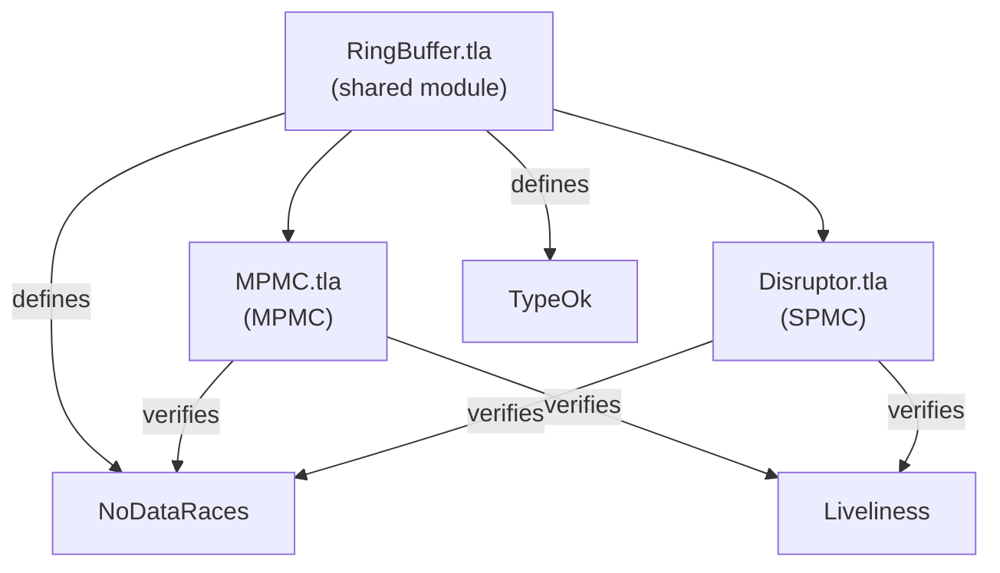
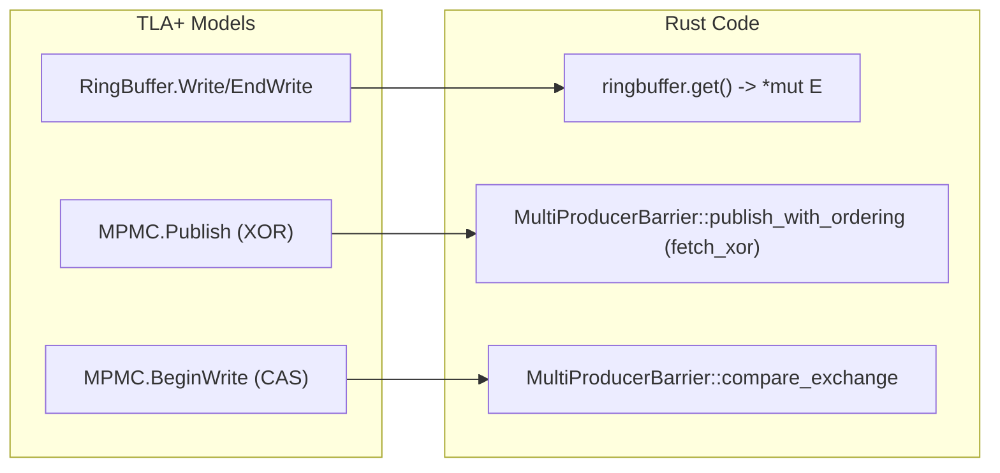

# TLA+ Model Documentation

> **Key Takeaway**: disruptor-rs uses three TLA+ models to verify core concurrency correctness -- `Disruptor.tla` (SPMC), `MPMC.tla` (MPMC), `RingBuffer.tla` (shared ring buffer safety). The models exhaustively explore the state space to prove **no data races** and **liveness (all consumers eventually read all events)**.

---

## Model Architecture



---

## RingBuffer.tla -- Shared Base Module

### Overview

`RingBuffer.tla` is a TLA+ **module (INSTANCE)** referenced by `Disruptor.tla` and `MPMC.tla`. It models a fixed-size ring buffer and tracks the set of readers and writers for each slot.

### State Variables

```
VARIABLE ringbuffer
  ringbuffer.slots   : [0..Size-1 -> Int ∪ {NULL}]   \* slot values
  ringbuffer.readers : [0..Size-1 -> SUBSET(Readers)]  \* current reader set per slot
  ringbuffer.writers : [0..Size-1 -> SUBSET(Writers)]  \* current writer set per slot
```

### Operations

| Operation | Signature | Semantics |
|---|---|---|
| `IndexOf(sequence)` | `sequence % Size` | Maps sequence number to slot index |
| `Write(index, writer, value)` | Writes value, adds to writer set | Models write begin |
| `EndWrite(index, writer)` | Removes from writer set | Models write completion |
| `BeginRead(index, reader)` | Adds to reader set | Models read begin |
| `Read(index)` | Returns slot value | Pure read |
| `EndRead(index, reader)` | Removes from reader set | Models read completion |

### Invariants

**TypeOk**: Type correctness.

**NoDataRaces** -- Core safety invariant:

$$\forall i \in [0, \text{Size}-1]: \quad \text{readers}[i] = \emptyset \lor \text{writers}[i] = \emptyset \quad \land \quad |\text{writers}[i]| \leq 1$$

Meaning:
1. No slot can have both readers and writers simultaneously (mutual exclusion)
2. Each slot has at most one writer (exclusive write)

---

## Disruptor.tla -- SPMC Model

### Overview

Models a single-producer, multi-consumer Disruptor. Verifies that no data races occur between producer and consumers, and that all consumers eventually read all published values.

### Constants

| Constant | Type | Description | Typical Configuration |
|---|---|---|---|
| `Writers` | Set | Producer thread ID set | `{w1}` (single producer) |
| `Readers` | Set | Consumer thread ID set | `{r1, r2}` |
| `MaxPublished` | Natural number | Maximum number of published events | 4-6 (state space limited) |
| `Size` | Natural number | Ring buffer size | 2-4 |
| `NULL` | Model value | Uninitialized marker | `NULL` |

### State Variables

```
VARIABLES
  ringbuffer    \* RingBuffer module instance
  published     \* Producer cursor (last published sequence)
  read          \* [Readers -> Int] Read sequence per consumer
  consumed      \* [Readers -> Seq(Nat)] Sequence of values read by each consumer
  pc            \* [Writers ∪ Readers -> {Access, Advance}] Program counter
```

### Actions

**Producer actions**:

1. `BeginWrite(writer)`: Checks `MinReadSequence >= next - Size` (does not overwrite unread slot), writes to ring buffer
2. `EndWrite(writer)`: Ends write, increments `published` cursor

**Consumer actions**:

1. `BeginRead(reader)`: Checks `published >= next` (published events available), reads and records value
2. `EndRead(reader)`: Ends read, increments `read[reader]`

### Verified Properties

**Safety (Invariants)**:
- `TypeOk`: All variable types are correct
- `NoDataRaces`: Inherited from `RingBuffer.tla` -- no concurrent read-write conflicts

**Liveness (Temporal properties)**:
- `Liveliness`: $\Diamond \Box \; (\forall r \in \text{Readers}: \text{consumed}[r] = [i \in 1..\text{MaxPublished} \mapsto i-1])$
  - Meaning: Eventually all consumers have read all values from 0 to MaxPublished-1

**Fairness**: Weak fairness (`WF_vars`) is used for all actions of all writers/readers.

### How to Trigger a Data Race

The documentation comments mention: "To see a data race, try and run the model with two publishers." Setting `Writers` to `{w1, w2}` will violate `NoDataRaces`, because two writers can simultaneously write to the same slot. This validates the necessity of the single-producer constraint.

---

## MPMC.tla -- Multi-Producer Multi-Consumer Model

### Overview

Models a multi-producer, multi-consumer Disruptor. Compared to SPMC, it adds modeling of CAS contention and the availability bitmap.

### Additional State Variables

```
VARIABLES
  next_sequence     \* Shared counter, producers compete via CAS
  claimed_sequence  \* [Writers -> Int] Sequence claimed by each producer
  published         \* [0..Size -> Bool] Availability bitmap (parity encoding)
```

### CAS Simulation

`BeginWrite(writer)` atomically executes:
1. Reads `next_sequence`
2. Sets `claimed_sequence[writer] = next_sequence`
3. Increments `next_sequence = next_sequence + 1`

The atomic steps of TLA+ naturally model CAS semantics -- reading and updating `next_sequence` in the same step.

### Availability Bitmap Encoding

```
IsPublished(sequence) ==
  LET
    index   == sequence % Size
    round   == sequence ÷ Size
    is_even == round % 2 = 0
  IN
    published[index] = is_even

Publish(sequence) ==
  LET index == sequence % Size
  IN  published' = [published EXCEPT ![index] = XOR(TRUE, @)]
```

This precisely corresponds to the `fetch_xor` logic in `MultiProducerBarrier` in the Rust implementation:
- Even rounds: bit = 0 means published
- Odd rounds: bit = 1 means published
- Publish = flip bit

### Verified Properties

Same as the SPMC model: `NoDataRaces` + `Liveliness`. However, the state space is larger due to more interleaving combinations from multiple writers.

---

## Running Model Checking

### Prerequisites

Install the [TLA+ Toolbox](https://lamport.azurewebsites.net/tla/toolbox.html) or [TLC](https://github.com/tlaplus/tlaplus) CLI.

### TLC Configuration Examples

**Disruptor.tla (SPMC)**:

```
CONSTANTS
  Writers      = {w1}
  Readers      = {r1, r2}
  MaxPublished = 4
  Size         = 2
  NULL         = NULL

INVARIANTS
  TypeOk
  NoDataRaces

PROPERTIES
  Liveliness

SPECIFICATION
  Spec
```

**MPMC.tla**:

```
CONSTANTS
  Writers      = {w1, w2}
  Readers      = {r1, r2}
  MaxPublished = 4
  Size         = 2
  NULL         = NULL

INVARIANTS
  TypeOk
  NoDataRaces

PROPERTIES
  Liveliness

SPECIFICATION
  Spec
```

### Command Line Execution

```bash
# Install TLC
# https://github.com/tlaplus/tlaplus/releases

# Run SPMC model
java -jar tla2tools.jar -config Disruptor.cfg verification/Disruptor.tla

# Run MPMC model
java -jar tla2tools.jar -config MPMC.cfg verification/MPMC.tla
```

### State Space Size Reference

| Model | Writers | Readers | MaxPublished | Size | Estimated States |
|---|---|---|---|---|---|
| SPMC | 1 | 2 | 4 | 2 | ~thousands |
| SPMC | 1 | 3 | 6 | 4 | ~tens of thousands |
| MPMC | 2 | 2 | 4 | 2 | ~tens of thousands |
| MPMC | 3 | 2 | 4 | 4 | ~hundreds of thousands |

Increasing `MaxPublished` or `Size` exponentially increases the state space. It is recommended to start with small parameters.

---

## Model Checking Results Summary

| Model | Property | Result | Meaning |
|---|---|---|---|
| SPMC (1W, 2R) | NoDataRaces | PASS | Single producer has no concurrent write conflicts |
| SPMC (1W, 2R) | Liveliness | PASS | All consumers eventually read all values |
| SPMC (**2W**, 2R) | NoDataRaces | **FAIL** | Validates that multiple writers cause data races |
| MPMC (2W, 2R) | NoDataRaces | PASS | CAS + availability bitmap guarantees safety |
| MPMC (2W, 2R) | Liveliness | PASS | All consumers can still read all values under multiple producers |

---

## Planned New Models

| Model | Purpose | Status |
|---|---|---|
| `Sequencer.tla` | Independently verify sequence allocation logic, including batch semantics | Planned |
| `WorkerPool.tla` | Verify competing consumer pattern (each event processed by only one worker) | Planned |
| `Shutdown.tla` | Verify shutdown signal propagation to all consumers | Planned |

---

## Model-to-Code Correspondence


